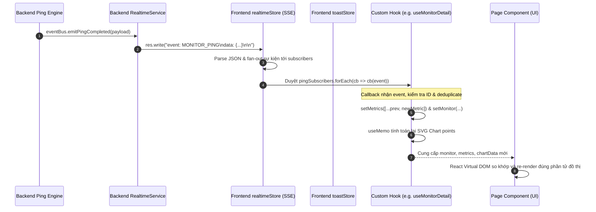

# DevPulse Frontend: Data Management & Realtime Reactive Architecture Deep Dive

Tài liệu này phân tích chi tiết từ A-Z kiến trúc dữ liệu của **DevPulse Frontend**, luồng phản ứng thời gian thực (Reactive Realtime Flow) từ Backend xuống Frontend, vai trò của **Zustand Stores**, **Custom Hooks**, hệ thống **Toast Dispatcher**, và cách các View Pages tiêu thụ dữ liệu một cách tối ưu, sạch sẽ và tuân thủ các chuẩn mực kỹ thuật thực tế cao nhất.

---

## 1. Bức Tranh Toàn Cảnh Kiến Trúc (The Big Picture)

Hệ thống tuân thủ mô hình phân tầng nghiêm ngặt 4 lớp (4-Tier Separation of Concerns):

```
┌────────────────────────────────────────────────────────────────────────┐
│                        BACKEND REALTIME ENGINE                         │
│  PingEngine / IncidentService  ──(eventBus)──>  RealtimeService (SSE)  │
└───────────────────────────────────┬────────────────────────────────────┘
                                    │ HTTP Chunked Stream (SSE)
                                    ▼
┌────────────────────────────────────────────────────────────────────────┐
│                       ZUSTAND GLOBAL STORES                            │
│  - realtimeStore.ts : Single EventSource Socket & Pub/Sub Dispatcher   │
│  - toastStore.ts    : Independent Imperative Notification State        │
│  - authStore.ts     : Session, User & In-Memory Access Token           │
└───────────────────────────────────┬────────────────────────────────────┘
                                    │ Subscriptions / Actions
                                    ▼
┌────────────────────────────────────────────────────────────────────────┐
│                      DOMAIN CUSTOM HOOKS LAYER                         │
│  - useMonitors()      : Danh sách Monitors + Delta Status Updates      │
│  - useMonitorDetail() : Telemetry, Instant Ping, SVG Chart, Cooldown   │
│  - useIncidents()     : Timeline Incidents, AI Diagnosis, Resolver     │
│  - useAdmin()         : System Admin Overview, Engine Diagnostics      │
│  - usePublicStatus()  : Public Status Page Telemetry & Cache Polling   │
└───────────────────────────────────┬────────────────────────────────────┘
                                    │ Pure Props & Callbacks
                                    ▼
┌────────────────────────────────────────────────────────────────────────┐
│                   PRESENTATION LAYER (FIGMA 100%)                      │
│  MonitorsPage.tsx │ MonitorDetailPage.tsx │ IncidentsPage.tsx          │
│  AdminPage.tsx    │ PublicStatusPage.tsx                               │
└────────────────────────────────────────────────────────────────────────┘
```

### 1.1. Luồng dữ liệu tổng thể qua Sequence Diagram



---

## 2. Gốc Rễ Sự Kiện Từ Backend (Backend Event & SSE Push)

Mọi cập nhật realtime hiển thị trên giao diện người dùng đều bắt nguồn từ chu kỳ kiểm tra (Ping Loop) hoặc biến động trạng thái (Incident State Machine) ở Backend.

### 2.1. Phát tín hiệu nội bộ qua `eventBus.ts`
Khi `PingEngine` hoàn tất gửi request kiểm tra một URL endpoint:
```typescript
// backend/src/services/ping/pingEngine.ts
const result = await this.executeHttpPing(monitor);
eventBus.emitPingCompleted({
  userId: monitor.userId,
  monitorId: monitor.id,
  statusCode: result.statusCode,
  latency: result.latency,
  isUp: result.isUp,
  timestamp: new Date().toISOString(),
  error: result.error,
});
```

### 2.2. Đẩy dữ liệu xuống Stream SSE tại `RealtimeService.ts`
Backend duy trì một bảng băm quản lý kết nối mở dạng HTTP Chunked Transfer:
```typescript
// backend/src/services/realtimeService.ts
export class RealtimeService {
  // Mỗi User có thể mở nhiều tab trình duyệt, nên dùng Set<Response>
  private connections: Map<string, Set<Response>> = new Map();

  constructor() {
    this.registerEventBusListeners();
    this.startHeartbeat();
  }

  private registerEventBusListeners(): void {
    // 1. Khi có kết quả Ping mới
    eventBus.onPingCompleted((payload: PingCompletedEvent) => {
      this.broadcastMonitorPing(payload);
    });

    // 2. Khi có sự cố mới (down) hoặc sự cố được khắc phục (up)
    eventBus.onIncidentAlert((payload: IncidentAlertEvent) => {
      this.broadcastIncidentAlert(payload);
    });
  }

  broadcastMonitorPing(payload: PingCompletedEvent): void {
    const clientSet = this.connections.get(payload.userId);
    if (!clientSet || clientSet.size === 0) return;

    const eventData: SseMonitorPingEvent = {
      type: 'MONITOR_PING',
      monitorId: payload.monitorId,
      statusCode: payload.statusCode,
      latency: payload.latency,
      isUp: payload.isUp,
      timestamp: payload.timestamp,
      error: payload.error,
    };

    // Định dạng tiêu chuẩn SSE: event: <name>\ndata: <json>\n\n
    const message = `event: MONITOR_PING\ndata: ${JSON.stringify(eventData)}\n\n`;
    for (const res of clientSet) {
      if (!res.writableEnded) {
        res.write(message);
      }
    }
  }
}
```

> [!NOTE]
> SSE sử dụng giao thức HTTP đơn hướng (Server-to-Client), nhẹ hơn WebSocket rất nhiều vì không tốn overhead handshake hai chiều phức tạp, tự động tương thích với HTTP/2 Multiplexing và Proxy/Nginx.

---

## 3. Lớp Client Realtime SSE Hub (`realtimeStore.ts`)

### 3.1. Tại sao quản lý kết nối SSE trong Zustand Store mà không phải React Context?
1. **Triệt tiêu kết nối Socket thừa (Single Socket Lifecycle):** Nếu dùng Context hoặc đặt trong Custom Hook, mỗi khi component re-mount (chuyển qua lại giữa các trang) hoặc khi Context re-render, socket dễ bị ngắt kết nối và tạo mới liên tục (*Socket Churning*). Zustand là một singleton module nằm ngoài cây React, đảm bảo **toàn bộ phiên làm việc của người dùng chỉ duy trì đúng 1 kết nối SSE duy nhất**.
2. **Decoupled khỏi UI Render:** Các sự kiện socket bay về liên tục (1 giây 1 lần hoặc hàng chục event/giây) nếu lưu trực tiếp vào State của Context sẽ ép **toàn bộ cây ứng dụng React re-render**. Với Zustand, chỉ các component đăng ký đúng selector hoặc đăng ký callback mới bị ảnh hưởng.

### 3.2. Mổ xẻ chi tiết từng dòng code `realtimeStore.ts`

```typescript
// frontend/src/stores/realtimeStore.ts
import { create } from 'zustand';
import { API_BASE_URL } from '../config/constants';
import { SseIncidentAlertEvent, SseMonitorPingEvent, SseServerEvent } from '../types/api';
import { toast } from './toastStore';

type PingSubscriber = (event: SseMonitorPingEvent) => void;
type IncidentSubscriber = (event: SseIncidentAlertEvent) => void;

// Module-level singletons (Không bị reset khi component React re-render)
let eventSourceInstance: EventSource | null = null;
let currentToken: string | null = null;
const pingSubscribers = new Set<PingSubscriber>();
const incidentSubscribers = new Set<IncidentSubscriber>();

export const useRealtimeStore = create<RealtimeState>((set) => ({
  isConnected: false,

  connect: (accessToken: string) => {
    // IDEMPOTENCY CHECK: Nếu socket đang mở và token không đổi, tuyệt đối không tạo lại
    if (
      eventSourceInstance &&
      eventSourceInstance.readyState !== EventSource.CLOSED &&
      currentToken === accessToken
    ) {
      return;
    }

    // Đóng socket cũ nếu có trước khi mở socket mới
    if (eventSourceInstance) {
      eventSourceInstance.close();
      eventSourceInstance = null;
    }

    currentToken = accessToken;
    const sseUrl = `${API_BASE_URL}/sse/monitors?token=${encodeURIComponent(accessToken)}`;
    const es = new EventSource(sseUrl);
    eventSourceInstance = es;

    es.onopen = () => {
      set({ isConnected: true });
    };

    es.onmessage = (event) => {
      try {
        const payload = JSON.parse(event.data) as SseServerEvent;

        if (payload.type === 'MONITOR_PING') {
          // DUYỆT TẤT CẢ SUBSCRIBERS VỚI CƠ CHẾ BẢO VỆ FAULT ISOLATION
          pingSubscribers.forEach((cb) => {
            try {
              cb(payload);
            } catch (err) {
              // Lỗi tại 1 component không làm sập luồng của các component khác
              console.error('[Realtime SSE] Error in ping subscriber callback:', err);
            }
          });
        } else if (payload.type === 'INCIDENT_ALERT') {
          // BẬT TOAST HỆ THỐNG TỨC THÌ BẰNG IMPERATIVE API
          if (payload.status === 'ongoing') {
            toast.error(
              payload.errorMessage || 'Service disruption detected on monitored endpoint.',
              'Incident Alert'
            );
          } else if (payload.status === 'resolved') {
            toast.success('Monitored endpoint has fully recovered.', 'Incident Resolved');
          }

          incidentSubscribers.forEach((cb) => {
            try {
              cb(payload);
            } catch (err) {
              console.error('[Realtime SSE] Error in incident subscriber callback:', err);
            }
          });
        }
      } catch {
        // Bỏ qua heartbeat comment (: heartbeat\n\n) một cách an toàn
      }
    };

    es.onerror = () => {
      set({ isConnected: false });
    };
  },

  disconnect: () => {
    if (eventSourceInstance) {
      eventSourceInstance.close();
      eventSourceInstance = null;
    }
    currentToken = null;
    set({ isConnected: false });
  },

  // PATTERN PUB/SUB: Đăng ký nhận sự kiện và trả về hàm hủy (Teardown Cleanup)
  subscribePing: (cb: PingSubscriber) => {
    pingSubscribers.add(cb);
    return () => {
      pingSubscribers.delete(cb);
    };
  },

  subscribeIncident: (cb: IncidentSubscriber) => {
    incidentSubscribers.add(cb);
    return () => {
      incidentSubscribers.delete(cb);
    };
  },
}));
```

---

## 4. Hệ Thống Toast Notification Độc Lập (`toastStore.ts`)

### 4.1. Bản chất kiến trúc: Imperative vs Declarative
Trước đây, các lập trình viên thường dùng React Context và bắt buộc mọi component phải gọi hook `const { showToast } = useToast()`.
**Nhược điểm chí mạng của phương pháp cũ:**
- Hàm `showToast` phụ thuộc vào React Lifecycle, nếu truyền vào `useCallback` hoặc `useEffect`, nó phải nằm trong mảng dependencies `[showToast]`.
- Nếu tham chiếu của hàm thay đổi hoặc component con re-render, nó kích hoạt lại `useEffect`, sinh ra các **vòng lặp re-fetch dữ liệu ngầm** (gây ra lỗi 404 kép khi xóa monitor).
- Không thể gọi toast từ bên ngoài React (ví dụ: trong Axios Interceptor khi gặp lỗi 401/500, hoặc trong SSE onmessage callback).

### 4.2. Giải pháp Clean Code: Standalone Imperative Dispatcher
Ta tách biệt hoàn toàn state của Toast sang Zustand, biến việc gọi Toast thành mệnh lệnh trực tiếp `toast.success('...')`:

```typescript
// frontend/src/stores/toastStore.ts
export const useToastStore = create<ToastState>((set) => ({
  toasts: [],
  showToast: (message: string, type: ToastType = 'success', title?: string) => {
    const id = Date.now() + Math.random();
    const item: ToastItem = {
      id,
      type,
      title: title ?? toastTitles[type],
      message,
    };

    set((state) => ({ toasts: [...state.toasts, item] }));

    // Tự động giải phóng sau 3.2 giây
    window.setTimeout(() => {
      set((state) => ({ toasts: state.toasts.filter((t) => t.id !== id) }));
    }, 3200);
  },
  removeToast: (id: number) => {
    set((state) => ({ toasts: state.toasts.filter((t) => t.id !== id) }));
  },
}));

// Export Object mệnh lệnh duy nhất, gọi được ở BẤT KỲ ĐÂU:
export const toast = {
  show(message: string, type: ToastType = 'success', title?: string) {
    useToastStore.getState().showToast(message, type, title);
  },
  success(message: string, title?: string) { this.show(message, 'success', title); },
  error(message: string, title?: string) { this.show(message, 'error', title); },
  info(message: string, title?: string) { this.show(message, 'info', title); },
  warning(message: string, title?: string) { this.show(message, 'warning', title); },
};
```

### 4.3. UI Viewport độc lập (`ToastContainer.tsx`)
Chỉ duy nhất component `<ToastContainer />` đăng ký lắng nghe state `toasts`:
```tsx
export const ToastContainer: React.FC = () => {
  const toasts = useToastStore((state) => state.toasts);
  const removeToast = useToastStore((state) => state.removeToast);
  // Render danh sách toasts với phong cách Neo-Brutalism
  // KHÔNG làm bất kỳ component cha hay trang hiện tại nào bị re-render!
};
```

---

## 5. Tầng Orchestration: Domain Custom Hooks

Custom Hook đóng vai trò **Bộ điều phối (Orchestrator)**. Nó chuyển hóa các luồng dữ liệu thô (HTTP API, SSE Stream) thành dữ liệu sẵn sàng hiển thị (View Models) cho các Component.

### 5.1. Mổ xẻ `useMonitorDetail.ts` (Trường hợp phức tạp nhất)

Hook này giải quyết 6 bài toán kỹ thuật hóc búa cùng một lúc:
1. **Initial Telemetry Fetching:** Tải song song cấu hình Monitor và lịch sử Incidents qua `Promise.all`.
2. **Metrics Filtering:** Tải danh sách latency theo khung thời gian (`1h`, `24h`, `7d`).
3. **Instant Ping & Cooldown:** Bộ đếm lùi 15s chống người dùng spam request kiểm tra.
4. **SSE Realtime Deduplication:** Tiếp nhận ping realtime và lọc trùng lặp timestamp < 1000ms.
5. **SVG Polygon Chart Normalization:** Chuyển đổi mảng latencies (ms) thành chuỗi tọa độ SVG `x,y` để vẽ biểu đồ diện tích trực tiếp.
6. **Deletion Guard (`isDeletedRef`):** Khóa an toàn chống kích hoạt lại API load dữ liệu khi người dùng vừa xóa monitor và đang navigate về `/monitors`.

#### Code chi tiết và cơ chế hoạt động:

```typescript
// frontend/src/hooks/useMonitorDetail.ts
export function useMonitorDetail(id: string | undefined) {
  const navigate = useNavigate();

  // Local View States
  const [monitor, setMonitor] = useState<MonitorResponseDto | null>(null);
  const [metrics, setMetrics] = useState<MonitorMetricDto[]>([]);
  const [range, setRange] = useState<'1h' | '24h' | '7d'>('1h');
  const [isLoading, setIsLoading] = useState(true);
  const [isChecking, setIsChecking] = useState(false);
  const [cooldown, setCooldown] = useState(0);

  // CỜ CHỐNG LEAK & 404 KÉP: Khóa tham chiếu unmounted
  const isDeletedRef = useRef(false);

  // 1. TẢI DỮ LIỆU BAN ĐẦU
  const loadData = useCallback(async () => {
    if (!id || isDeletedRef.current) return;
    try {
      const [monitorData, incidentsData] = await Promise.all([
        monitorService.getMonitorById(id),
        monitorService.getMonitorIncidents(id),
      ]);
      if (!isDeletedRef.current) {
        setMonitor(monitorData);
        setIncidents(incidentsData);
      }
    } catch (err) {
      if (!isDeletedRef.current) {
        toast.error(getApiErrorMessage(err), 'Failed to load monitor');
        navigate('/monitors');
      }
    } finally {
      if (!isDeletedRef.current) setIsLoading(false);
    }
  }, [id, navigate]); // KHÔNG CÓ showToast ở dependency!

  // 2. LẮNG NGHE REALTIME SSE VỚI DEDUPLICATION
  const handleRealtimePing = useCallback((event: SseMonitorPingEvent) => {
    if (event.monitorId !== id || isDeletedRef.current) return;

    setMetrics((prev) => {
      // Bỏ qua nếu gói tin trùng lặp timestamp trong vòng 1s
      const isDuplicate = prev.some(
        (m) => Math.abs(new Date(m.timestamp).getTime() - new Date(event.timestamp).getTime()) < 1000
      );
      if (isDuplicate) return prev;

      // Đẩy điểm mới lên đầu, giữ tối đa 30 điểm gần nhất
      return [
        {
          id: crypto.randomUUID(),
          monitorId: event.monitorId,
          timestamp: event.timestamp,
          statusCode: event.statusCode,
          latency: event.latency,
          isUp: event.isUp,
          error: event.error ?? null,
        },
        ...prev.slice(0, 29),
      ];
    });

    // Cập nhật ngay trạng thái Up/Down của thẻ Header
    setMonitor((prev) =>
      prev ? { ...prev, status: event.isUp ? 'up' : 'down', lastCheckedAt: event.timestamp } : prev
    );
  }, [id]);

  // 3. ĐĂNG KÝ VÀ HỦY SUBSCRIBER TỰ ĐỘNG THEO VÒNG ĐỜI REACT
  const subscribePing = useRealtimeStore((state) => state.subscribePing);
  const subscribeIncident = useRealtimeStore((state) => state.subscribeIncident);

  useEffect(() => {
    const unsubPing = subscribePing(handleRealtimePing);
    const unsubIncident = subscribeIncident(handleRealtimeIncident);
    return () => {
      unsubPing();
      unsubIncident();
    };
  }, [handleRealtimePing, handleRealtimeIncident, subscribePing, subscribeIncident]);

  // 4. BIẾN ĐỔI DỮ LIỆU ĐỒ THỊ TỐC ĐỘ CAO (useMemo)
  const chartData = useMemo(() => {
    if (metrics.length === 0) {
      return { points: '0,50 100,50', latestLatency: 'Pending', uptimePercentage: '0%' };
    }
    const sorted = [...metrics].reverse();
    const latencies = sorted.map((m) => m.latency);
    const maxLatency = Math.max(...latencies, 100);
    const minLatency = 0;

    // Chuẩn hóa tọa độ x (0-100), y (20-90) cho viewBox SVG 100x100
    const points = sorted
      .map((item, index) => {
        const x = (index / Math.max(1, sorted.length - 1)) * 100;
        const normalized = (item.latency - minLatency) / (maxLatency - minLatency);
        const y = 90 - normalized * 70;
        return `${x.toFixed(1)},${y.toFixed(1)}`;
      })
      .join(' ');

    const upCount = sorted.filter((m) => m.isUp).length;
    return {
      points,
      latestLatency: `${sorted[sorted.length - 1].latency} ms`,
      uptimePercentage: `${((upCount / sorted.length) * 100).toFixed(1)}%`,
    };
  }, [metrics, monitor?.status]);

  // 5. CÁC HÀM THỰC THI HÀNH ĐỘNG (MUTATIONS)
  const instantPing = useCallback(async () => {
    if (!monitor) return;
    setIsChecking(true);
    setCooldown(15);
    toast.info(`An instant check was queued for ${monitor.name}.`, 'Ping requested');
    try {
      const result = await monitorService.triggerInstantPing(monitor.id);
      if (result.isUp) {
        toast.success(`${monitor.name} check completed with HTTP ${result.statusCode} (${result.latency} ms).`, 'Ping response');
      } else {
        toast.error(`${monitor.name} check completed with HTTP ${result.statusCode} (${result.latency} ms).`, 'Ping response');
      }
    } catch (err) {
      toast.error(getApiErrorMessage(err), 'Instant check failed');
    } finally {
      setIsChecking(false);
    }
  }, [monitor]);

  return {
    monitor, metrics, incidents, range, isLoading, isChecking, cooldown, chartData,
    setRange, instantPing, toggleMonitor, updateMonitor, deleteMonitor,
  };
}
```

---

## 6. Tầng Trình Diễn: Presentation Pages (`MonitorDetailPage.tsx`)

Nhờ có Custom Hook, code của trang UI trở nên cực kỳ tinh gọn, hoàn toàn chỉ tập trung vào việc hiển thị JSX, bố cục CSS Tailwind Neo-Brutalism và gắn các sự kiện người dùng.

```tsx
// frontend/src/pages/monitors/MonitorDetailPage.tsx
export const MonitorDetailPage: React.FC = () => {
  const { id } = useParams<{ id: string }>();

  // 1 DÒNG DUY NHẤT LẤY TOÀN BỘ LOGIC & VIEW DATA
  const {
    monitor,
    range,
    isLoading,
    isChecking,
    cooldown,
    chartData,
    setRange,
    instantPing,
    toggleMonitor,
    updateMonitor,
    deleteMonitor,
  } = useMonitorDetail(id);

  if (isLoading || !monitor) {
    return <MonitorDetailSkeleton />;
  }

  return (
    <div className="space-y-6 p-4 sm:p-6 lg:p-8">
      {/* Header controls: Nút Check Now, Pause/Resume, Edit, Delete */}
      <MonitorDetailHeader
        monitor={monitor}
        cooldown={cooldown}
        isChecking={isChecking}
        onInstantPing={instantPing}
        onToggle={toggleMonitor}
        onDelete={deleteMonitor}
      />

      {/* Grid thống kê 3 thẻ: Uptime 24h, Response Time, SSL Days */}
      <div className="grid grid-cols-1 gap-4 sm:grid-cols-3">
        <StatCard title="24h Uptime" value={chartData.uptimePercentage} tone="mint" />
        <StatCard title="Response Time" value={chartData.latestLatency} tone="blue" />
        <StatCard title="SSL Certificate" value="Valid (82 days)" tone="yellow" />
      </div>

      {/* Live Latency Area Chart (SVG Native) & SSL Certificate Details */}
      <div className="grid gap-6 xl:grid-cols-[1.5fr_.7fr]">
        <div className="rounded-lg border-2 border-zinc-950 bg-white p-5 shadow-[4px_4px_0_#18181b]">
          <div className="flex items-center justify-between pb-4">
            <h3 className="font-black">Live Latency History</h3>
            <RangePicker range={range} onChange={setRange} />
          </div>
          {/* Vẽ đồ thị SVG mượt mà từ tọa độ chartData.points do hook tính toán */}
          <svg viewBox="0 0 100 100" preserveAspectRatio="none" className="h-44 w-full">
            <polygon
              fill="#65d6c4"
              fillOpacity="0.24"
              points={`0,95 ${chartData.points} 100,95`}
            />
            <polyline
              fill="none"
              stroke="#0d9488"
              strokeWidth="2.5"
              points={chartData.points}
            />
          </svg>
        </div>

        <SslCard monitor={monitor} />
      </div>
    </div>
  );
};
```

---

## 7. Bảng So Sánh Toàn Diện: Best Practice vs Anti-Pattern

| Tiêu chí | Anti-Pattern (Lỗi thường gặp) | Best Practice Hiện Tại của DevPulse | Lợi ích đạt được |
| :--- | :--- | :--- | :--- |
| **Quản lý kết nối SSE** | Mở `EventSource` bên trong component bằng `useEffect` ở từng trang. | Quản lý Socket tập trung tại `realtimeStore.ts` (Zustand Singleton). | Chỉ mở đúng 1 socket cho cả hệ thống, không bị gián đoạn hay tạo mới khi chuyển trang. |
| **Thông báo Toasts** | Dùng React Context (`<ToastProvider>`) và hook `useToast()`. | Dùng Imperative Dispatcher `toast.<method>()` kết hợp `<ToastContainer />`. | Zero re-render cascade; gọi được từ mọi nơi kể cả Axios Interceptor và SSE Callbacks; loại bỏ hoàn toàn hook dependency thừa. |
| **Phân tách Logic UI** | Viết toàn bộ `fetch`, `axios`, `SSE listener`, `calculations` bên trong file `page.tsx`. | Đóng gói toàn bộ logic vào Custom Hook (`useMonitorDetail`, `useMonitors`, `useIncidents`). | Tái sử dụng code, UI component chỉ làm nhiệm vụ hiển thị (Dumb Component), dễ kiểm thử (Unit test) và dễ bảo trì. |
| **Tránh Lỗi 404 Kép khi Xóa** | Sau khi gọi `deleteMonitor`, component unmount chậm khiến `useEffect` loadData chạy tiếp. | Dùng `isDeletedRef = useRef(false)`, gán `true` ngay trước lệnh xóa và chặn mọi request ngầm. | Không bao giờ xuất hiện toast báo lỗi 404 sau khi người dùng đã bấm xóa thành công. |
| **Độ khớp UI Figma** | Tự ý dùng icon emoji (🚀, 🔥) hoặc đổi màu gradient tùy tiện. | Tuân thủ 100% token mã màu Tailwind Neo-Brutalism và tỷ lệ Grid trong Figma. | Giao diện sắc nét, chuẩn phong cách retro cổ điển, đồng nhất toàn bộ sản phẩm. |

