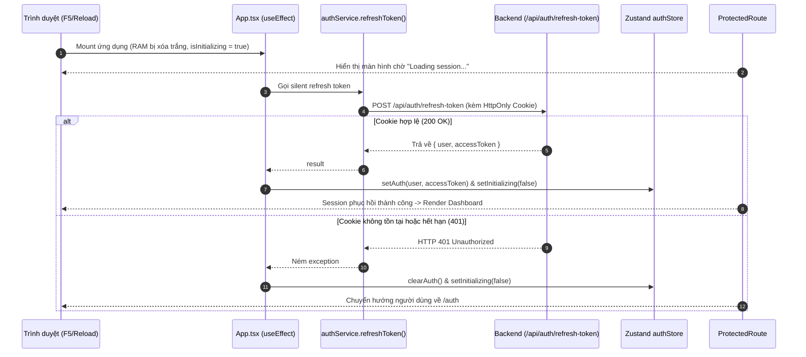

<!-- AGENT_DIRECTIVE: READ_ALLOWED -->
<!-- Options: [READ_ALLOWED | DO_NOT_READ] -->

# Frontend Standard Architecture Blueprint (React + Vite + TypeScript + Tailwind CSS)

Tài liệu chuẩn hóa kiến trúc Frontend React / TypeScript theo mô hình **Modular Component-Service Architecture**, đóng vai trò là khuôn mẫu chuẩn (*Standard Template*) cho toàn bộ mã nguồn Frontend dự án DevPulse cũng như tái sử dụng cho các dự án web hiện đại.

Tài liệu này phân tích chi tiết từ triết lý kiến trúc, cấu trúc thư mục, vòng đời session, tầng API Client Interceptor, quản lý State với Zustand, hệ thống Router & Route Guards, Toast Notification System, cơ chế Realtime SSE Client, Custom Hooks, Data Visualization, cho đến hệ thống Design System Retro Neo-Brutalism.

---

## 1. Architectural Philosophy and Design Principles

Kiến trúc tuân thủ nguyên tắc phân tách trách nhiệm (*Separation of Concerns*), định hướng luồng dữ liệu một chiều (*Unidirectional Data Flow*), và đảm bảo nguồn chân lý duy nhất (*Single Source of Truth*):

```
[User Action / UI Event]
          │
          ▼
[Page View / Feature Container]  (Page-level composition, route params, local view state)
          │
          ├──► [Domain Widgets & Atomic Primitives] (Presentational rendering, Tailwind styling)
          │
          ▼
[Custom Hooks & Global Stores]   (useMonitors, useIncidents, authStore, themeStore, realtimeStore)
          │
          ▼
[Typed API Services Layer]       (authService, monitorService, incidentService...)
          │
          ▼
[Axios Client & Interceptors]    (JWT Bearer injection, 401 Silent Token Rotation, failedQueue)
          │
          ▼
[Backend REST API / SSE Stream]  (Standard JSON envelopes, Server-Sent Events stream)
```

### Nguyên tắc cốt lõi:
1. **Trình bày sạch (Clean Presentation Layer):**
   - Components và Pages chỉ chịu trách nhiệm render UI, bắt tương tác người dùng và hiển thị dữ liệu.
   - Tuyệt đối không nhúng trực tiếp các lời gọi `axios` thô hay logic tính toán phức tạp vào components. Tất cả phải ủy thác qua tầng **Services** (`services/`), **Stores** (`stores/`), hoặc **Custom Hooks** (`hooks/`).
2. **Nguồn chân lý dữ liệu duy nhất (Single Source of Truth):**
   - Hợp đồng dữ liệu giữa Frontend và Backend phải tuân thủ 100% tài liệu [`dev-pulse/documents/data-contracts.md`](dev-pulse/documents/data-contracts.md).
   - **Xóa bỏ triệt để code nước đôi / Fallback bloat:** Khi Backend quy định kiểu dữ liệu chuẩn, Frontend chỉ truy xuất trực tiếp đúng một trường duy nhất (cấm `item.a || item.b`, cấm `? :` 2-3 tầng phòng thủ thừa thãi).
3. **Bảo mật Session trong RAM (Memory-Only Token Storage):**
   - Access Token được lưu trữ độc quyền trong RAM (`authStore`), tuyệt đối không lưu vào `localStorage` hay `sessionStorage` để triệt tiêu hoàn toàn rủi ro tấn công XSS.
   - Refresh Token được quản lý an toàn qua `HttpOnly Cookie`. Khi F5/Reload trang, cơ chế Session Hydration tại `App.tsx` âm thầm gọi `/api/auth/refresh-token` để phục hồi phiên làm việc.
4. **An toàn kiểu dữ liệu tuyệt đối (Strict Typing & Zero Non-Null Assertion):**
   - Tuyệt đối cấm sử dụng `any`, cấm ép kiểu vô căn cứ (`as unknown as ...`), cấm lạm dụng non-null assertion `!`.
   - Chuẩn hóa Envelopes phản hồi API thành Discriminated Union (`ApiSuccessResponse<T>` và `ApiErrorResponse`) để TypeScript tự động thu hẹp kiểu mà không cần `!`.
5. **Xử lý Lỗi chuẩn hóa một cửa (Centralized Error Normalization):**
   - Toàn bộ lỗi từ API hoặc mạng được chuẩn hóa qua hàm duy nhất `getApiErrorMessage(err)` tại `src/lib/apiError.ts`.
   - Phía Frontend luôn bóc tách thông điệp lỗi từ trường **`error`** và chi tiết validation từ trường **`details`**, không đọc trường `message` cho error responses.
6. **UI Nhất quán & Chống "AI Slop" (Anti-AI Slop Guardrails):**
   - Tuyệt đối không dùng emoji làm icon trên nút bấm, menu, bảng, hay status badge.
   - Toàn bộ icons sử dụng vector đồng nhất từ `lucide-react`.
   - Bố cục styling theo Design System Retro Neo-Brutalism (`border-2 border-zinc-950`, bóng đổ cứng `shadow-retro`, tone màu cream/retro đã cấu hình trong `tailwind.config.ts`).

---

## 2. Directory Layout & Folder Breakdown

```text
frontend/
├── src/
│   ├── components/          # Các UI components tái sử dụng
│   │   ├── auth/            # Components chuyên biệt cho luồng Auth (OtpInput, AuthDecorations)
│   │   ├── common/          # Atomic primitives & shared layout pieces (Header, Sidebar, Badge, Logo, ThemeToggle, ToastContainer)
│   │   └── monitors/        # Widgets chuyên biệt cho Monitor (MonitorCard, LatencyChart, UptimeBar)
│   ├── config/              # Hằng số môi trường & cấu hình API endpoint (constants.ts)
│   ├── hooks/               # Custom hooks tái sử dụng (useMonitors, useIncidents, useDebounce)
│   ├── layouts/             # Khung bố cục trang (DashboardLayout)
│   ├── lib/                 # Tiện ích thuần túy không state (utils.ts - cn, apiError.ts - chuẩn hóa lỗi)
│   ├── pages/               # Các trang màn hình tương ứng với từng đường dẫn route
│   │   ├── admin/           # Trang quản trị hệ thống (/admin)
│   │   ├── auth/            # Trang đăng nhập / đăng ký / OTP (/auth)
│   │   ├── dashboard/       # Trang tổng quan (/ - Overview)
│   │   ├── incidents/       # Trang quản lý sự cố (/incidents)
│   │   ├── monitors/        # Trang danh sách & chi tiết monitor (/monitors, /monitors/:id)
│   │   ├── not-found/       # Trang lỗi 404 Not Found
│   │   └── status/          # Trang trạng thái công khai (/status/:slug)
│   ├── routes/              # Cấu hình định tuyến và route guards (AppRoutes, ProtectedRoute, PublicRoute)
│   ├── services/            # Tầng giao tiếp API đã định kiểu (api.ts, authService, monitorService...)
│   ├── stores/              # Quản lý state toàn cục qua Zustand (authStore, themeStore, toastStore, realtimeStore)
│   ├── types/               # Toàn bộ TypeScript interfaces & DTOs khớp 100% Backend contract
│   ├── App.tsx              # Component gốc: Session Hydration, ToastContainer, Router
│   ├── main.tsx             # Entry point React DOM mount
│   └── index.css            # Tailwind directives, font-family, custom scrollbars, animations
├── public/                  # Static assets công khai (favicon.svg)
├── index.html               # HTML template gốc
├── tailwind.config.ts       # Cấu hình Tailwind colors, shadows, borders, fonts
├── tsconfig.json            # Cấu hình TypeScript Strict Mode (Target ES2020)
├── vite.config.ts           # Cấu hình Vite build & dev proxy (/api -> localhost:5000)
└── package.json
```

### Chi tiết vai trò từng thư mục:

| Thư mục | Trách nhiệm chính | Quy tắc biên soạn |
| :--- | :--- | :--- |
| **`config/`** | Khai báo hằng số toàn cục (`constants.ts`), base URL, cấu hình SSE endpoint. | Cấm hardcode URL trực tiếp trong services hoặc components. Mọi endpoint phải thông qua `constants.ts`. |
| **`lib/`** | Tiện ích thuần túy không chứa state: ghép class Tailwind `cn()`, chuẩn hóa lỗi `getApiErrorMessage()`. | Các hàm pure functions, không phụ thuộc vào React lifecycles. |
| **`types/`** | Định nghĩa 100% dữ liệu: request payloads, response DTOs, domain enums/unions. Khớp chính xác với Backend. | Không dùng `any`. Mỗi domain có file types riêng (`auth.ts`, `monitor.ts`, `incident.ts`...). |
| **`services/`** | Đóng gói API calls qua Axios. Mỗi service ứng với một domain (`authService`, `monitorService`...). | Trả về trực tiếp `data: T` từ `ApiSuccessResponse<T>`, không trả raw Axios response. |
| **`stores/`** | State toàn cục nhẹ bằng Zustand: Access Token, User Profile, Theme, Toasts, Realtime SSE socket. | Chỉ lưu shared global state cần truy cập đa màn hình hoặc ngoài React lifecycle. |
| **`hooks/`** | Custom hooks tái sử dụng logic (fetch data, realtime SSE, debounce, media queries). | Bắt đầu bằng tiền tố `use`, quản lý lifecycle và cleanup an toàn. |
| **`components/`** | UI components phân theo tính tái sử dụng: `common/` cho primitives dùng chung; domain folders cho widgets chuyên biệt. | Tách nhỏ components, tuân thủ nguyên tắc Single Responsibility. |
| **`layouts/`** | Cấu trúc khung giao diện chung (Desktop Sidebar + Mobile bottom nav + Sticky Header + Main Outlet). | Chứa `<Outlet />` cho các trang con kế thừa. |
| **`routes/`** | Cây định tuyến React Router DOM v7 kết hợp Route Guards (`ProtectedRoute`, `PublicRoute`). | Tập trung toàn bộ route definition tại một file duy nhất `AppRoutes.tsx`. |
| **`pages/`** | View containers kết nối với Router: nhận URL params, gọi services/hooks, phân phối dữ liệu cho components con. | Không viết CSSinline rườm rà; chia nhỏ code phức tạp thành sub-components. |

---

## 3. Entry Point & Session Hydration Lifecycle

### 3.1. `src/main.tsx` (Strict DOM Bootstrap)
Khởi tạo React 18 với `createRoot` và gắn vào phần tử `#root` của `index.html`:

```tsx
import React from 'react';
import ReactDOM from 'react-dom/client';
import { App } from './App';
import './index.css';

ReactDOM.createRoot(document.getElementById('root')!).render(
  <React.StrictMode>
    <App />
  </React.StrictMode>
);
```

### 3.2. `src/App.tsx` (Session Hydration, ToastContainer, Router)
Component đóng vai trò là "trái tim" khởi động ứng dụng, thực thi quy trình **Session Hydration** ngay khi người dùng mở hoặc F5 lại trang:

```tsx
import React, { useEffect } from 'react';
import { BrowserRouter } from 'react-router-dom';
import { ToastContainer } from './components/common/ToastContainer';
import { AppRoutes } from './routes/AppRoutes';
import { useAuthStore } from './stores/authStore';
import { authService } from './services/authService';

// Root application component handling session hydration, global routing, and toast notifications
export const App: React.FC = () => {
  const { setAuth, clearAuth, setInitializing } = useAuthStore();

  useEffect(() => {
    // Attempt silent session hydration from HttpOnly refresh cookie on application startup
    const hydrateSession = async () => {
      try {
        const result = await authService.refreshToken();
        if (result.user && result.accessToken) {
          setAuth(result.user, result.accessToken);
        } else {
          clearAuth();
        }
      } catch {
        clearAuth();
      } finally {
        setInitializing(false);
      }
    };

    hydrateSession();
  }, [setAuth, clearAuth, setInitializing]);

  return (
    <BrowserRouter>
      <AppRoutes />
      <ToastContainer />
    </BrowserRouter>
  );
};
```

### 3.3. Sơ đồ vòng đời Session Hydration khi F5/Reload trang



---

### 3.4. Phân tích Chuyên sâu Cơ chế Session Hydration & Xử lý Trạng thái Khởi tạo (Deep Dive)

Cơ chế Session Hydration tại [src/App.tsx](src/App.tsx) giải quyết một trong những bài toán hóc búa nhất của Single Page Application (SPA) khi áp dụng kiến trúc bảo mật **Dual Token (Memory-Only Access Token)**:

#### 🛡️ Bài toán kiến trúc:
- Để triệt tiêu hoàn toàn nguy cơ rò rỉ token qua tấn công XSS, **Access Token không bao giờ được lưu vào `localStorage` hay `sessionStorage`**. Nó chỉ tồn tại trong bộ nhớ RAM của Zustand (`useAuthStore`).
- Hậu quả: Khi người dùng nhấn F5 hoặc mở lại trình duyệt, **toàn bộ bộ nhớ RAM bị xóa sạch**. `useAuthStore` khởi tạo lại với trạng thái rỗng (`user: null`, `accessToken: null`, `isAuthenticated: false`).
- Thách thức: Nếu ứng dụng không có cơ chế giữ chân người dùng thông minh, cây định tuyến tại `AppRoutes` và `ProtectedRoute` sẽ lập tức phát hiện `isAuthenticated === false` và chuyển hướng người dùng về màn hình `/auth` ngay trong microsecond đầu tiên, **trước khi bất kỳ API khôi phục phiên nào kịp gửi đi**!

#### 🔄 Giải pháp: Cờ trạng thái `isInitializing` và Vòng đời Hydration:
1. **Khởi tạo cờ `isInitializing: true`:** Trong `authStore.ts`, cờ `isInitializing` được thiết lập mặc định là `true`.
2. **Treo màn hình chờ tại `ProtectedRoute.tsx`:** Khi `isInitializing === true`, component `ProtectedRoute` không thực hiện bất kỳ lệnh redirect nào mà render màn hình chờ xoay tròn ("Loading session..."). Điều này ngăn chặn việc đá người dùng ra trang login khi phiên làm việc thực chất vẫn còn hợp lệ.
3. **Phân tích từng bước thực thi trong `hydrateSession()`:**
   - **Bước 1:** `authService.refreshToken()` gửi request `POST /api/auth/refresh-token`. Do cấu hình Axios có `withCredentials: true`, trình duyệt sẽ tự động đính kèm HttpOnly Cookie chứa Refresh Token mà mã JavaScript không thể đọc trực tiếp.
   - **Bước 2 (Happy Path):** Nếu Refresh Cookie hợp lệ và chưa hết hạn 7 ngày, Backend cấp phát Access Token mới (15 phút) cùng thông tin `user`. Hàm gọi `setAuth(result.user, result.accessToken)` cập nhật RAM, chuyển `isAuthenticated = true`.
   - **Bước 3 (Unhappy Path):** Nếu người dùng lần đầu truy cập, hoặc Refresh Cookie đã hết hạn/bị thu hồi, Backend trả về `HTTP 401 Unauthorized`. Khối `catch` bắt được exception và gọi `clearAuth()` để đảm bảo state hoàn toàn sạch sẽ.
   - **Bước 4 (Finally Block - Bắt buộc):** Dù thành công hay thất bại, khối `finally` luôn thực thi lệnh `setInitializing(false)`. Khi cờ này chuyển sang `false`, `ProtectedRoute` mới chính thức đưa ra quyết định:
     - Nếu `isAuthenticated === true`: Render giao diện Dashboard cho người dùng.
     - Nếu `isAuthenticated === false`: Điều hướng về `/auth` kèm `state: { from: location }` để ghi nhớ trang người dùng vừa cố truy cập.

---

## 4. Routing Architecture & Route Guards (`react-router-dom` v7)

### 4.1. Cây định tuyến tập trung (`src/routes/AppRoutes.tsx`)
Hệ thống sử dụng cơ chế định tuyến khai báo phân cấp, phân tách rõ ràng giữa các nhóm quyền:

```tsx
import React from 'react';
import { Routes, Route } from 'react-router-dom';
import { ProtectedRoute } from './ProtectedRoute';
import { PublicRoute } from './PublicRoute';
import { DashboardLayout } from '../layouts/DashboardLayout';
import { AuthPage } from '../pages/auth/AuthPage';
import { OverviewPage } from '../pages/dashboard/OverviewPage';
import { MonitorsPage } from '../pages/monitors/MonitorsPage';
import { MonitorDetailPage } from '../pages/monitors/MonitorDetailPage';
import { IncidentsPage } from '../pages/incidents/IncidentsPage';
import { AdminPage } from '../pages/admin/AdminPage';
import { PublicStatusPage } from '../pages/status/PublicStatusPage';
import { NotFoundPage } from '../pages/not-found/NotFoundPage';

// Central routing tree for authentication, dashboard, and public views
export const AppRoutes: React.FC = () => {
  return (
    <Routes>
      {/* Public Guest Routes */}
      <Route element={<PublicRoute />}>
        <Route path="/auth" element={<AuthPage />} />
      </Route>

      {/* Public Status Page (Accessible to everyone) */}
      <Route path="/status/:slug" element={<PublicStatusPage />} />

      {/* Protected Dashboard Routes */}
      <Route element={<ProtectedRoute />}>
        <Route element={<DashboardLayout />}>
          <Route path="/" element={<OverviewPage />} />
          <Route path="/monitors" element={<MonitorsPage />} />
          <Route path="/monitors/:id" element={<MonitorDetailPage />} />
          <Route path="/incidents" element={<IncidentsPage />} />

          {/* Admin Restricted Route */}
          <Route element={<ProtectedRoute adminOnly />}>
            <Route path="/admin" element={<AdminPage />} />
          </Route>
        </Route>
      </Route>

      {/* Fallback 404 Route */}
      <Route path="*" element={<NotFoundPage />} />
    </Routes>
  );
};
```

### 4.2. Route Guard bảo vệ tài nguyên (`src/routes/ProtectedRoute.tsx`)
Ngăn chặn truy cập trái phép khi chưa đăng nhập, đồng thời hỗ trợ kiểm tra phân quyền quản trị (`adminOnly`):

```tsx
import React from 'react';
import { Navigate, Outlet, useLocation } from 'react-router-dom';
import { useAuthStore } from '../stores/authStore';

interface ProtectedRouteProps {
  adminOnly?: boolean;
}

// Route guard restricting access to authenticated sessions and specific roles
export const ProtectedRoute: React.FC<ProtectedRouteProps> = ({ adminOnly = false }) => {
  const { isAuthenticated, isInitializing, user } = useAuthStore();
  const location = useLocation();

  if (isInitializing) {
    return (
      <div className="flex min-h-screen items-center justify-center bg-cream text-zinc-950 dark:bg-retro-night dark:text-[#f3eadc]">
        <div className="flex flex-col items-center gap-3">
          <div className="size-8 rounded-full border-4 border-zinc-950 border-t-retro-orange animate-spin dark:border-slate-700 dark:border-t-retro-orange" />
          <span className="text-xs font-black uppercase tracking-wider text-zinc-600 dark:text-slate-400">
            Loading session...
          </span>
        </div>
      </div>
    );
  }

  if (!isAuthenticated) {
    return <Navigate to="/auth" state={{ from: location }} replace />;
  }

  if (adminOnly && user?.role !== 'admin') {
    return <Navigate to="/" replace />;
  }

  return <Outlet />;
};
```

### 4.3. Route Guard cho khách vãng lai (`src/routes/PublicRoute.tsx`)
Chặn người dùng đã đăng nhập quay lại màn hình `/auth` và chuyển hướng thẳng vào `/`:

```tsx
import React from 'react';
import { Navigate, Outlet } from 'react-router-dom';
import { useAuthStore } from '../stores/authStore';

// Route guard redirecting authenticated users away from public auth pages
export const PublicRoute: React.FC = () => {
  const { isAuthenticated, isInitializing } = useAuthStore();

  if (isInitializing) {
    return (
      <div className="flex min-h-screen items-center justify-center bg-cream text-zinc-950 dark:bg-retro-night dark:text-[#f3eadc]">
        <div className="flex flex-col items-center gap-3">
          <div className="size-8 rounded-full border-4 border-zinc-950 border-t-retro-orange animate-spin dark:border-slate-700 dark:border-t-retro-orange" />
          <span className="text-xs font-black uppercase tracking-wider text-zinc-600 dark:text-slate-400">
            Checking session...
          </span>
        </div>
      </div>
    );
  }

  if (!isAuthenticated) {
    return <Navigate to="/" replace />;
  }

  return <Outlet />;
};
```

---

## 5. Global State Management with Zustand (`stores/`)

### Tại sao chọn Zustand thay vì Redux Toolkit hoặc React Context?
1. **Zero Boilerplate:** Không cần Provider lồng nhau, không cần Action Types, Reducers phức tạp.
2. **Truy cập ngoài React Lifecycle:** Có thể đọc và cập nhật state trực tiếp từ Axios Interceptor hoặc EventSource thông qua `useAuthStore.getState()`.
3. **Hiệu năng tối ưu (Fine-grained Selectors):** Chỉ re-render những components lắng nghe đúng trường dữ liệu thay đổi (`const user = useAuthStore(s => s.user)`).

### 5.1. Quản lý Phiên xác thực (`src/stores/authStore.ts`)
```typescript
import { create } from 'zustand';
import { AuthUser } from '../types/auth';

interface AuthState {
  user: AuthUser | null;
  accessToken: string | null;
  isAuthenticated: boolean;
  isInitializing: boolean;
  setAuth: (user: AuthUser, accessToken: string) => void;
  setAccessToken: (accessToken: string) => void;
  setUser: (user: AuthUser) => void;
  clearAuth: () => void;
  setInitializing: (isInitializing: boolean) => void;
}

// Global authentication state management using Zustand
export const useAuthStore = create<AuthState>((set) => ({
  user: null,
  accessToken: null,
  isAuthenticated: false,
  isInitializing: true,
  setAuth: (user, accessToken) =>
    set({
      user,
      accessToken,
      isAuthenticated: true,
      isInitializing: false,
    }),
  setAccessToken: (accessToken) =>
    set({
      accessToken,
      isAuthenticated: true,
    }),
  setUser: (user) =>
    set({
      user,
      isAuthenticated: true,
    }),
  clearAuth: () =>
    set({
      user: null,
      accessToken: null,
      isAuthenticated: false,
      isInitializing: false,
    }),
  setInitializing: (isInitializing) => set({ isInitializing }),
}));
```

### 5.2. Quản lý Chủ đề Giao diện (`src/stores/themeStore.ts`)
Đồng bộ trực tiếp giữa state trong ứng dụng, class `dark` trên thẻ `<html>`, và `localStorage`:

```typescript
import { create } from 'zustand';

type Theme = 'light' | 'dark';

interface ThemeState {
  theme: Theme;
  toggleTheme: () => void;
  setTheme: (theme: Theme) => void;
}

const STORAGE_KEY = 'devpulse_theme';

// Resolve initial theme preference from LocalStorage or system preference
function getInitialTheme(): Theme {
  const stored = localStorage.getItem(STORAGE_KEY);
  if (stored === 'light' || stored === 'dark') {
    return stored;
  }
  return window.matchMedia('(prefers-color-scheme: dark)').matches ? 'dark' : 'light';
}

function applyThemeClass(theme: Theme): void {
  const root = document.documentElement;
  if (theme === 'dark') {
    root.classList.add('dark');
  } else {
    root.classList.remove('dark');
  }
}

// Global theme state management syncing with HTML class and LocalStorage
export const useThemeStore = create<ThemeState>((set) => {
  const initialTheme = getInitialTheme();
  applyThemeClass(initialTheme);

  return {
    theme: initialTheme,
    toggleTheme: () =>
      set((state) => {
        const nextTheme = state.theme === 'light' ? 'dark' : 'light';
        localStorage.setItem(STORAGE_KEY, nextTheme);
        applyThemeClass(nextTheme);
        return { theme: nextTheme };
      }),
    setTheme: (theme) => {
      localStorage.setItem(STORAGE_KEY, theme);
      applyThemeClass(theme);
      set({ theme });
    },
  };
});
```

---

## 6. Typed API Layer & Axios Interceptors Architecture (`services/` & `lib/`)

### 6.1. Kiến trúc Dual Interceptor trong `src/services/api.ts`
Xử lý đồng thời 2 bài toán lớn:
1. **Request Interceptor:** Tự động đọc Access Token từ `useAuthStore.getState()` và đính kèm vào Header `Authorization: Bearer <token>`.
2. **Response Interceptor:** Bắt mã `401 Unauthorized`. Khi có nhiều request cùng thất bại đồng thời, chỉ gửi **đúng 1 request refresh token**, gom các request còn lại vào `failedQueue`, và tự động replay toàn bộ khi token mới được cấp:

```typescript
import axios, { AxiosError, InternalAxiosRequestConfig } from 'axios';
import { useAuthStore } from '../stores/authStore';
import { ApiErrorResponse, ApiSuccessResponse } from '../types/api';
import { AuthSessionResponse } from '../types/auth';
import { API_BASE_URL } from '../config/constants';

export const apiClient = axios.create({
  baseURL: API_BASE_URL,
  withCredentials: true,
  headers: {
    'Content-Type': 'application/json',
  },
});

let isRefreshing = false;
let failedQueue: Array<{
  resolve: (token: string) => void;
  reject: (error: unknown) => void;
}> = [];

function processQueue(error: unknown, token: string | null = null): void {
  failedQueue.forEach((promise) => {
    if (error) {
      promise.reject(error);
    } else if (token) {
      promise.resolve(token);
    }
  });
  failedQueue = [];
}

// Attach access token to outgoing request headers
apiClient.interceptors.request.use(
  (config: InternalAxiosRequestConfig) => {
    const accessToken = useAuthStore.getState().accessToken;
    if (accessToken && config.headers) {
      config.headers.Authorization = `Bearer ${accessToken}`;
    }
    return config;
  },
  (error) => Promise.reject(error)
);

// Catch 401 errors and handle silent token rotation
apiClient.interceptors.response.use(
  (response) => response,
  async (error: AxiosError<ApiErrorResponse>) => {
    const originalRequest = error.config as InternalAxiosRequestConfig & { _retry?: boolean };

    if (!error.response || !originalRequest) {
      return Promise.reject(error);
    }

    const isAuthRoute =
      originalRequest.url?.includes('/auth/login') ||
      originalRequest.url?.includes('/auth/refresh-token') ||
      originalRequest.url?.includes('/auth/logout');

    if (error.response.status === 401 && !originalRequest._retry && !isAuthRoute) {
      if (isRefreshing) {
        return new Promise((resolve, reject) => {
          failedQueue.push({
            resolve: (token: string) => {
              if (originalRequest.headers) {
                originalRequest.headers.Authorization = `Bearer ${token}`;
              }
              resolve(apiClient(originalRequest));
            },
            reject: (err) => reject(err),
          });
        });
      }

      originalRequest._retry = true;
      isRefreshing = true;

      try {
        const response = await axios.post<ApiSuccessResponse<AuthSessionResponse>>(
          `${API_BASE_URL}/auth/refresh-token`,
          {},
          { withCredentials: true }
        );

        const newAccessToken = response.data.data.accessToken;
        const refreshedUser = response.data.data.user;

        if (newAccessToken && refreshedUser) {
          useAuthStore.getState().setAuth(refreshedUser, newAccessToken);
          processQueue(null, newAccessToken);

          if (originalRequest.headers) {
            originalRequest.headers.Authorization = `Bearer ${newAccessToken}`;
          }
          return apiClient(originalRequest);
        }

        throw new Error('Refresh response missing access token');
      } catch (refreshError) {
        processQueue(refreshError, null);
        useAuthStore.getState().clearAuth();
        return Promise.reject(refreshError);
      } finally {
        isRefreshing = false;
      }
    }

    return Promise.reject(error);
  }
);
```

### 6.2. Phân tích Chuyên sâu Cơ chế Failed Queue & Xoay Vòng Token Âm Thầm (Deep Dive: Silent Token Rotation & Concurrent Failed Queue)

Tại [src/services/api.ts](src/services/api.ts), Response Interceptor xử lý một bài toán kinh điển trong lập trình mạng: **Xử lý bão lỗi 401 khi nhiều request cùng thất bại đồng thời mà chỉ làm mới token duy nhất 1 lần**.

#### 💥 Tình huống thực tế (Race Condition Problem):
Khi người dùng mở trang Dashboard Overview, ứng dụng sẽ đồng thời gửi đi 3 đến 5 API requests song song:
- Request A: `GET /api/monitors`
- Request B: `GET /api/incidents?status=ongoing`
- Request C: `GET /api/users/profile`

Giả sử đúng thời điểm này, Access Token 15 phút vừa hết hạn. Cả 3 requests A, B, C gửi lên server đều bị từ chối với mã lỗi `HTTP 401 Unauthorized` gần như cùng một tích tắc!
- **Nếu KHÔNG có hàng đợi:** Cả 3 requests độc lập cùng nhảy vào nhánh xử lý 401 và cùng lúc bắn 3 requests `POST /api/auth/refresh-token` xuống server. Điều này gây lãng phí tài nguyên mạng, race condition trên database xoay vòng token, và kích hoạt cơ chế phòng vệ *Token Reuse Detection* của Backend (hủy toàn bộ phiên vì nghi ngờ bị hacker tấn công replay).

#### 🛡️ Giải pháp hàng đợi `failedQueue` và biến khóa `isRefreshing`:
1. **Biến cờ khóa `isRefreshing: boolean`:** Nằm trong phạm vi module của `api.ts`, dùng làm ổ khóa nhị phân để biết có request nào đang làm nhiệm vụ đi xin cấp lại token hay không.
2. **Hàng đợi `failedQueue`:** Mảng chứa các callbacks `{ resolve: (token) => void, reject: (error) => void }` để đóng băng các request gửi sau.
3. **Phân tích chi tiết quy trình 5 bước trong Response Interceptor:**
   - **Bước 1 (Request A đến trước):** Request A gặp lỗi 401. Nó kiểm tra `!isRefreshing` $\rightarrow$ Thấy cờ đang `false`. Nó lập tức chiếm quyền refresh:
     - Đặt cờ `isRefreshing = true` để khóa các request đến sau.
     - Đánh dấu `originalRequest._retry = true` trên cấu hình của Request A. Cờ này là chốt chặn an toàn: nếu chính request A sau khi thử lại vẫn bị 401 (hoặc refresh thất bại), nó sẽ không bao giờ kích hoạt interceptor 401 lần thứ hai, triệt tiêu nguy cơ vòng lặp vô tận (*Infinite Retry Loop*).
   - **Bước 2 (Request B và C đến sau):** Trong khi Request A đang chờ mạng trả lời từ `/auth/refresh-token`, Request B và C lần lượt nhận lỗi 401. Chúng kiểm tra thấy `isRefreshing === true`:
     - Nhánh `if (isRefreshing)` được kích hoạt. Request B và C không gọi thêm bất kỳ request refresh nào nữa!
     - Chúng tự đóng gói mình thành một Promise mới và đẩy vào `failedQueue`:
       ```typescript
       return new Promise((resolve, reject) => {
         failedQueue.push({
           resolve: (token: string) => {
             // Khi được đánh thức, gán token mới và bắn lại request ban đầu
             if (originalRequest.headers) {
               originalRequest.headers.Authorization = `Bearer ${token}`;
             }
             resolve(apiClient(originalRequest));
           },
           reject: (err) => reject(err),
         });
       });
       ```
     - Cả Request B và C rơi vào trạng thái *Pending* (chờ), treo lại trong RAM một cách an toàn.
   - **Bước 3 (Nhận token mới):** Request A hoàn thành việc gọi `/api/auth/refresh-token` thành công:
     - Đọc `newAccessToken` và `refreshedUser` từ server.
     - Cập nhật state vào Zustand: `useAuthStore.getState().setAuth(refreshedUser, newAccessToken)`.
     - Kích hoạt hàm giải phóng hàng đợi: `processQueue(null, newAccessToken)`.
   - **Bước 4 (Giải phóng và Replay toàn bộ):**
     - Hàm `processQueue` duyệt qua toàn bộ các phần tử trong `failedQueue`, gọi `promise.resolve(newAccessToken)`.
     - Khi `resolve` được gọi, logic bên trong (đã định nghĩa ở Bước 2) thực thi: gán Header Authorization mới và gọi `apiClient(originalRequest)`.
     - Kết quả: Cả Request B và C tự động được bắn lại lên server với token mới, nhận về dữ liệu thành công và trả về cho UI mượt mà!
     - Đặt lại `failedQueue = []`.
   - **Bước 5 (Dọn dẹp và xử lý thất bại):**
     - Khối `finally` luôn đặt lại `isRefreshing = false` để mở khóa cho các chu kỳ hết hạn tiếp theo.
     - Nếu việc làm mới token thất bại hoàn toàn (ví dụ: Refresh token cookie bị thu hồi): `processQueue(refreshError, null)` sẽ từ chối (reject) toàn bộ các request đang chờ, xóa state `clearAuth()`, và người dùng bị đẩy về trang đăng nhập.

#### 🚫 Tại sao bắt buộc phải có điều kiện `isAuthRoute`?
```typescript
const isAuthRoute =
  originalRequest.url?.includes('/auth/login') ||
  originalRequest.url?.includes('/auth/refresh-token') ||
  originalRequest.url?.includes('/auth/logout');
```
Nếu người dùng gõ sai mật khẩu khi đăng nhập, endpoint `/api/auth/login` sẽ trả về `HTTP 401 Unauthorized`. Đây là lỗi nhập sai thông tin tài khoản thông thường, **hoàn toàn không phải do token hết hạn**. Nếu không loại trừ các auth routes, interceptor sẽ tưởng lầm và tự động gửi tiếp request `/auth/refresh-token`, gây ra lỗi logic ngớ ngẩn và treo form đăng nhập.

---

### 6.3. Tại sao Tầng Service Dùng `ApiSuccessResponse<T>` còn Tầng Bóc Tách Lỗi Dùng `ApiErrorResponse`? (Architectural Typing Rationale)

Đây là mẫu thiết kế kiểu dữ liệu phân tầng chuẩn mực theo nguyên lý hoạt động của Axios:

#### 1. Luồng thành công (Promise Resolved) trong Service:
- Axios được cấu hình mặc định: Chỉ những response có mã trạng thái HTTP nằm trong dải thành công ($200 \le \text{status} < 300$) mới làm cho Promise chuyển sang trạng thái **Resolved**.
- Phía Backend đã quy định trong chuẩn phong bì phản hồi `sendSuccess` rằng khi thành công, dữ liệu JSON trả về luôn có cấu trúc:
  ```json
  {
    "success": true,
    "message": "Optional description",
    "data": { ... }
  }
  ```
- Do đó, khi ta định kiểu cho lời gọi Axios trong Service:
  ```typescript
  const response = await apiClient.get<ApiSuccessResponse<MonitorResponseDto[]>>('/monitors');
  return response.data.data;
  ```
  Trình biên dịch TypeScript biết chắc chắn 100% rằng `response.data.data` tồn tại và có kiểu `MonitorResponseDto[]`. Lập trình viên **không bao giờ phải dùng dấu chấm than `!` (non-null assertion)** hay viết các dấu `?.` phòng thủ thừa thãi.

#### 2. Luồng thất bại (Promise Rejected) trong Block `catch`:
- Khi Backend trả về các mã lỗi HTTP như `400 Bad Request`, `401 Unauthorized`, `403 Forbidden`, `404 Not Found`, `429 Too Many Requests`, hoặc `500 Internal Server Error`, Axios sẽ **tự động ném ra ngoại lệ (throw AxiosError)** và đưa luồng thực thi vào khối `catch (err)`.
- Phía Backend đã quy định trong chuẩn phong bì lỗi `sendError` rằng khi thất bại, dữ liệu JSON trả về luôn có cấu trúc:
  ```json
  {
    "success": false,
    "error": "Error description string",
    "details": { ... }
  }
  ```
- Vì vậy, hàm tiện ích bóc tách lỗi tập trung `getApiErrorMessage(err)` sẽ ép kiểu:
  ```typescript
  const axiosErr = err as AxiosError<ApiErrorResponse>;
  ```
  Nhờ đó, hàm đọc trực tiếp trường `axiosErr.response.data.error` và `axiosErr.response.data.details` một cách an toàn tuyệt đối, chấm dứt hoàn toàn thói quen tai hại là viết fallback `axiosErr.response.data.message || axiosErr.response.data.error` hoặc đoán mò tên trường.

---

### 6.4. Cấu trúc chuẩn của một Service Domain (`src/services/monitorService.ts`)
Một file service đạt chuẩn phải:
- Nhận payload/params có kiểu tường minh.
- Gọi qua `apiClient` đã được gán kiểu generic `ApiSuccessResponse<T>`.
- Trả về trực tiếp trường `response.data.data` (loại bỏ tầng bọc HTTP của Axios).
- Không nuốt lỗi, để exception nổi lên cho caller (Hook/Component) xử lý thông báo.

```typescript
import { apiClient } from './api';
import { ApiSuccessResponse } from '../types/api';
import {
  CreateMonitorPayload,
  InstantPingResponseDto,
  MonitorMetricDto,
  MonitorResponseDto,
  UpdateMonitorPayload,
} from '../types/monitor';
import { IncidentResponseDto } from '../types/incident';

export const monitorService = {
  // Fetch user monitors
  async getMonitors(): Promise<MonitorResponseDto[]> {
    const response = await apiClient.get<ApiSuccessResponse<MonitorResponseDto[]>>('/monitors');
    return response.data.data;
  },

  // Fetch single monitor by id
  async getMonitorById(id: string): Promise<MonitorResponseDto> {
    const response = await apiClient.get<ApiSuccessResponse<MonitorResponseDto>>(`/monitors/${id}`);
    return response.data.data;
  },

  // Create new monitor
  async createMonitor(payload: CreateMonitorPayload): Promise<MonitorResponseDto> {
    const response = await apiClient.post<ApiSuccessResponse<MonitorResponseDto>>('/monitors', payload);
    return response.data.data;
  },

  // Update existing monitor
  async updateMonitor(id: string, payload: UpdateMonitorPayload): Promise<MonitorResponseDto> {
    const response = await apiClient.put<ApiSuccessResponse<MonitorResponseDto>>(`/monitors/${id}`, payload);
    return response.data.data;
  },

  // Toggle monitor active state
  async toggleMonitor(id: string): Promise<MonitorResponseDto> {
    const response = await apiClient.patch<ApiSuccessResponse<MonitorResponseDto>>(`/monitors/${id}/toggle`);
    return response.data.data;
  },

  // Fetch monitor metric latency history matching backend query param 'range'
  async getMetrics(
    id: string,
    options?: { range?: '1h' | '24h' | '7d'; limit?: number }
  ): Promise<MonitorMetricDto[]> {
    const response = await apiClient.get<ApiSuccessResponse<MonitorMetricDto[]>>(`/monitors/${id}/metrics`, {
      params: options,
    });
    return response.data.data;
  },

  // Fetch incidents for a target monitor
  async getMonitorIncidents(id: string): Promise<IncidentResponseDto[]> {
    const response = await apiClient.get<ApiSuccessResponse<IncidentResponseDto[]>>(`/monitors/${id}/incidents`);
    return response.data.data;
  },

  // Trigger manual instant ping check
  async triggerInstantPing(id: string): Promise<InstantPingResponseDto> {
    const response = await apiClient.post<ApiSuccessResponse<InstantPingResponseDto>>(`/monitors/${id}/ping`);
    return response.data.data;
  },

  // Delete monitor by id
  async deleteMonitor(id: string): Promise<void> {
    await apiClient.delete<ApiSuccessResponse<null>>(`/monitors/${id}`);
  },
};
```

### 6.5. Chuẩn hóa Bóc tách Lỗi (`src/lib/apiError.ts`)
```typescript
import { AxiosError } from 'axios';
import { ApiErrorResponse } from '../types/api';

// Extract human-readable error message from backend API or network failure
export function getApiErrorMessage(err: unknown): string {
  const axiosErr = err as AxiosError<ApiErrorResponse>;

  if (!axiosErr.response || axiosErr.code === 'ERR_NETWORK') {
    return 'Cannot connect to server. Please ensure the backend is running.';
  }

  if (axiosErr.response.data?.details && typeof axiosErr.response.data.details === 'object') {
    const fieldErrors = Object.values(axiosErr.response.data.details).flat().join(', ');
    if (fieldErrors) return fieldErrors;
  }

  if (axiosErr.response.data?.error) {
    return axiosErr.response.data.error;
  }

  return 'An unexpected error occurred. Please try again.';
}
```

---

## 7. Toast Notification System with Zustand (`stores/toastStore.ts` & `components/common/ToastContainer.tsx`)

Hệ thống Toast Notification được chuyển giao toàn diện sang Zustand Store (`stores/toastStore.ts`) kết hợp UI Viewport độc lập (`ToastContainer.tsx`) thay vì dùng React Context truyền thống:
- **Zero Re-Render Cascading:** Chỉ duy nhất component `<ToastContainer />` re-render khi danh sách toasts thay đổi (thêm mới hoặc hết hạn sau 3.2s). Toàn bộ cây component còn lại trong ứng dụng không hề bị re-render.
- **Truy cập ngoài React Lifecycle tự nhiên:** Gọi hàm điều phối mệnh lệnh `toast.success('Done')`, `toast.error('Failed')`, `toast.info('Info')`, `toast.warning('Warning')` trực tiếp từ mọi nơi (Axios Interceptors, SSE Listeners, custom hooks, event handlers) mà không cần hook wrapper hay dependency array.
- **Thống nhất 1 cơ chế duy nhất (No Compromises / No Shims):** Loại bỏ hoàn toàn adapter hook `useToast()` cũ để đảm bảo tính đồng nhất tuyệt đối trong toàn bộ codebase, tuân thủ nghiêm ngặt quy tắc kiến trúc và sạch mã nguồn.

### 7.1. Cấu trúc Store Quản trị Toasts (`src/stores/toastStore.ts`):
```typescript
import { create } from 'zustand';

export type ToastType = 'success' | 'info' | 'warning' | 'error';

export interface ToastItem {
  id: number;
  type: ToastType;
  title: string;
  message: string;
}

const toastTitles: Record<ToastType, string> = {
  success: 'Done',
  info: 'Updated',
  warning: 'Heads up',
  error: 'Couldn’t complete',
};

interface ToastState {
  toasts: ToastItem[];
  showToast: (message: string, type?: ToastType, title?: string) => void;
  removeToast: (id: number) => void;
}

// Global atomic toast notification store powered by Zustand
export const useToastStore = create<ToastState>((set) => ({
  toasts: [],

  showToast: (message: string, type: ToastType = 'success', title?: string) => {
    const id = Date.now() + Math.random();
    const item: ToastItem = {
      id,
      type,
      title: title ?? toastTitles[type],
      message,
    };

    set((state) => ({
      toasts: [...state.toasts, item],
    }));

    window.setTimeout(() => {
      set((state) => ({
        toasts: state.toasts.filter((t) => t.id !== id),
      }));
    }, 3200);
  },

  removeToast: (id: number) => {
    set((state) => ({
      toasts: state.toasts.filter((t) => t.id !== id),
    }));
  },
}));

// Standalone imperative toast dispatcher callable from anywhere in the application
export const toast = {
  show(message: string, type: ToastType = 'success', title?: string) {
    useToastStore.getState().showToast(message, type, title);
  },
  success(message: string, title?: string) {
    this.show(message, 'success', title);
  },
  error(message: string, title?: string) {
    this.show(message, 'error', title);
  },
  info(message: string, title?: string) {
    this.show(message, 'info', title);
  },
  warning(message: string, title?: string) {
    this.show(message, 'warning', title);
  },
};
```

### 7.2. Viewport Hiển thị Thông báo Retro Neo-Brutalism (`src/components/common/ToastContainer.tsx`):
```tsx
import React from 'react';
import { useToastStore, ToastType } from '../../stores/toastStore';

const toastStyles: Record<ToastType, string> = {
  success: 'bg-mint text-zinc-950 dark:bg-[#356b63] dark:text-[#f3eadc]',
  info: 'bg-retro-blue text-zinc-950 dark:bg-[#394b67] dark:text-[#f3eadc]',
  warning: 'bg-yellow-200 text-zinc-950 dark:bg-[#665c2f] dark:text-[#fff8df]',
  error: 'bg-coral-soft text-red-950 dark:bg-[#713f3b] dark:text-[#fff0ea]',
};

// Presentational toast viewport consuming Zustand state with zero re-rendering impact on application tree
export const ToastContainer: React.FC = () => {
  const toasts = useToastStore((state) => state.toasts);
  const removeToast = useToastStore((state) => state.removeToast);

  return (
    <div
      aria-live="polite"
      className="pointer-events-none fixed right-4 top-20 z-[100] flex w-[min(22rem,calc(100vw-2rem))] flex-col gap-3"
    >
      {toasts.map((item) => (
        <div
          key={item.id}
          role="status"
          className={`pointer-events-auto overflow-hidden rounded-lg border-2 border-zinc-950 shadow-[5px_5px_0_#18181b] dark:border-[#737c91] dark:shadow-[5px_5px_0_#090b10] ${toastStyles[item.type]}`}
        >
          <div className="flex items-start gap-3 p-4">
            <span
              className={`mt-1 size-2.5 shrink-0 rounded-full border border-zinc-950 ${
                item.type === 'success'
                  ? 'bg-emerald-600'
                  : item.type === 'info'
                    ? 'bg-blue-700'
                    : item.type === 'warning'
                      ? 'bg-amber-600'
                      : 'bg-red-600'
              }`}
            />
            <div className="min-w-0 flex-1">
              <div className="text-sm font-black">{item.title}</div>
              <p className="mt-1 text-xs font-medium leading-5 opacity-90">{item.message}</p>
            </div>
            <button
              type="button"
              onClick={() => removeToast(item.id)}
              aria-label="Dismiss notification"
              className="grid size-7 shrink-0 place-items-center rounded-md border border-current text-sm font-black hover:bg-black/10 dark:hover:bg-white/10"
            >
              ×
            </button>
          </div>
          <div className="toast-progress h-1 bg-zinc-950/55 dark:bg-white/55" />
        </div>
      ))}
    </div>
  );
};
```

### 7.3. Phân tích Chuyên sâu So sánh Kỹ thuật: Zustand Store vs React Context cho Toast

#### 1. Nguy cơ Re-Render Cascade của React Context:
- Khi dùng React Context (`<ToastProvider>`), mảng state `toasts` nằm ngay bên trong Provider bọc ngoài cùng ứng dụng.
- Mỗi khi có toast mới xuất hiện hoặc biến mất sau 3.2s, component `ToastProvider` bắt buộc phải re-render.
- Dù đã dùng `useMemo` cho `value`, nhưng nếu một consumer lắng nghe Context, bất kỳ sự thay đổi tham chiếu nào cũng có nguy cơ kéo theo re-render không mong muốn cho các components bên dưới.
- Đặc biệt, trong trường hợp lỗi thực tế ở phiên trước: khi một modal xóa tài nguyên và gọi hàm toast từ Context, reference không ổn định của hàm show trong Context đã kích hoạt lại các hook `useEffect` phụ thuộc, dẫn tới việc component gửi thêm các request load dữ liệu ngầm lên backend khi tài nguyên đã bị xóa, sinh ra lỗi 404 kép ("Failed to load monitor: Monitor not found").

#### 2. Lợi thế Tuyệt đối của Zustand Store:
- **Tách biệt hoàn toàn State và UI:** State `toasts` được giữ trong bộ nhớ Zustand bên ngoài cây Virtual DOM. Chỉ component duy nhất đăng ký selector `state => state.toasts` (chính là `<ToastContainer />`) bị re-render khi toasts thay đổi.
- **Zero Provider Overhead:** Không cần bọc `<ToastProvider>` làm sâu thêm cây DOM của ứng dụng.
- **Triệt tiêu hoàn toàn Hook Adapter & Dependency Array:** Việc gọi trực tiếp `toast.success(...)` hoặc `toast.error(...)` loại bỏ hoàn toàn wrapper hook, không yêu cầu khai báo vào mảng phụ thuộc (`deps`) của `useCallback` hay `useEffect`, ngăn ngừa 100% nguy cơ stale closures hoặc re-render loops.

---

## 8. Realtime Server-Sent Events (SSE) Client Architecture (`stores/realtimeStore.ts`)

Khi các màn hình Dashboard (Overview, Monitors, Incidents) cần nhận cập nhật trực tiếp theo thời gian thực từ Backend mà không phải liên tục polling HTTP, ứng dụng sử dụng kiến trúc kết nối SSE duy nhất qua Zustand Store kết hợp mô hình Pub/Sub.

### 8.1. Tại sao Quản lý SSE Connection trong Zustand Store là Best Practice Thực tế?
1. **Triệt tiêu kết nối Socket thừa (Single Socket Lifecycle):**
   - Nếu quản lý `EventSource` bên trong React Hook cục bộ hoặc từng Page: khi người dùng mở nhiều tabs hoặc khi nhiều components trên cùng một trang cùng gọi hook, trình duyệt sẽ mở đồng thời bấy nhiêu kết nối SSE song song về máy chủ. Điều này nhanh chóng làm nghẽn số lượng kết nối tối đa của trình duyệt (giới hạn 6 kết nối HTTP/1.1 trên mỗi domain) và lãng phí tài nguyên backend.
   - Quản lý qua Zustand Store `realtimeStore.ts` đảm bảo toàn bộ ứng dụng chỉ duy trì **duy nhất 1 kết nối `EventSource` nền** cho mỗi phiên đăng nhập của người dùng.
2. **Loại bỏ Re-Render Cascading của React Context:**
   - Nếu bọc qua `RealtimeContext`, mỗi khi cờ `isConnected` hoặc sự kiện mới đến thay đổi state trong Context, mọi component tiêu thụ Context đều bị kích hoạt re-render.
   - Với Zustand Fine-grained Selectors:
     - Header chỉ lắng nghe `const isConnected = useRealtimeStore(s => s.isConnected)` để bật/tắt chấm xanh stream mà không quan tâm payload ping.
     - Monitor Table / Incident Timeline chỉ đăng ký nhận dữ liệu qua hàm callback Pub/Sub mà không làm re-render toàn bộ layout cha.

### 8.2. Cấu trúc Realtime Store (`src/stores/realtimeStore.ts`):
```typescript
import { create } from 'zustand';
import { API_BASE_URL } from '../config/constants';
import { SseIncidentAlertEvent, SseMonitorPingEvent, SseServerEvent } from '../types/api';
import { toast } from './toastStore';

type PingSubscriber = (event: SseMonitorPingEvent) => void;
type IncidentSubscriber = (event: SseIncidentAlertEvent) => void;

interface RealtimeState {
  isConnected: boolean;
  lastPingEvent: SseMonitorPingEvent | null;
  lastIncidentEvent: SseIncidentAlertEvent | null;
  connect: (accessToken: string) => void;
  disconnect: () => void;
  subscribePing: (cb: PingSubscriber) => () => void;
  subscribeIncident: (cb: IncidentSubscriber) => () => void;
}

let eventSourceInstance: EventSource | null = null;
let currentToken: string | null = null;
const pingSubscribers = new Set<PingSubscriber>();
const incidentSubscribers = new Set<IncidentSubscriber>();

// Central Zustand store managing the single background SSE EventSource socket and event fan-out
export const useRealtimeStore = create<RealtimeState>((set) => ({
  isConnected: false,
  lastPingEvent: null,
  lastIncidentEvent: null,

  connect: (accessToken: string) => {
    // Avoid re-establishing identical active connection on component re-renders
    if (
      eventSourceInstance &&
      eventSourceInstance.readyState !== EventSource.CLOSED &&
      currentToken === accessToken
    ) {
      return;
    }

    if (eventSourceInstance) {
      eventSourceInstance.close();
      eventSourceInstance = null;
    }

    currentToken = accessToken;
    const sseUrl = `${API_BASE_URL}/sse/monitors?token=${encodeURIComponent(accessToken)}`;
    const es = new EventSource(sseUrl);
    eventSourceInstance = es;

    es.onopen = () => {
      set({ isConnected: true });
    };

    es.onmessage = (event) => {
      try {
        const payload = JSON.parse(event.data) as SseServerEvent;

        if (payload.type === 'MONITOR_PING') {
          set({ lastPingEvent: payload });
          pingSubscribers.forEach((cb) => {
            try {
              cb(payload);
            } catch (err) {
              console.error('[Realtime SSE] Error in ping subscriber callback:', err);
            }
          });
        } else if (payload.type === 'INCIDENT_ALERT') {
          set({ lastIncidentEvent: payload });
          if (payload.status === 'ongoing') {
            toast.error(
              payload.errorMessage || 'Service disruption detected on monitored endpoint.',
              'Incident Alert'
            );
          } else if (payload.status === 'resolved') {
            toast.success(
              'Monitored endpoint has fully recovered.',
              'Incident Resolved'
            );
          }
          incidentSubscribers.forEach((cb) => {
            try {
              cb(payload);
            } catch (err) {
              console.error('[Realtime SSE] Error in incident subscriber callback:', err);
            }
          });
        }
      } catch {
        // Discard heartbeat comments and non-JSON data safely
      }
    };

    es.onerror = () => {
      set({ isConnected: false });
    };
  },

  disconnect: () => {
    if (eventSourceInstance) {
      eventSourceInstance.close();
      eventSourceInstance = null;
    }
    currentToken = null;
    set({ isConnected: false, lastPingEvent: null, lastIncidentEvent: null });
  },

  subscribePing: (cb: PingSubscriber) => {
    pingSubscribers.add(cb);
    return () => {
      pingSubscribers.delete(cb);
    };
  },

  subscribeIncident: (cb: IncidentSubscriber) => {
    incidentSubscribers.add(cb);
    return () => {
      incidentSubscribers.delete(cb);
    };
  },
}));
```

### 8.3. Mô hình Tiêu thụ Sự kiện Trực tiếp từ Zustand Store (`useRealtimeStore`):

Toàn bộ các components và custom hooks trong hệ thống đều trực tiếp tiêu thụ `useRealtimeStore`:

#### 1. Đọc trạng thái luồng trực tiếp với Atomic Selector (`src/components/common/Header.tsx`):
```typescript
import { useRealtimeStore } from '../../stores/realtimeStore';

export const Header: React.FC<HeaderProps> = () => {
  // Chỉ re-render khi cờ isConnected thay đổi, hoàn toàn miễn nhiễm với bão sự kiện ping
  const isConnected = useRealtimeStore((state) => state.isConnected);
  ...
};
```

#### 2. Đăng ký nhận sự kiện Pub/Sub với Auto-Cleanup (`src/hooks/useMonitors.ts` & `src/pages/monitors/MonitorDetailPage.tsx`):
```typescript
import { useRealtimeStore } from '../../stores/realtimeStore';

const subscribePing = useRealtimeStore((state) => state.subscribePing);
const subscribeIncident = useRealtimeStore((state) => state.subscribeIncident);

useEffect(() => {
  const unsubPing = subscribePing(handleRealtimePing);
  const unsubIncident = subscribeIncident(handleRealtimeIncident);
  return () => {
    unsubPing();
    unsubIncident();
  };
}, [handleRealtimePing, handleRealtimeIncident, subscribePing, subscribeIncident]);
```

### 8.4. Phân tích Chuyên sâu Cơ chế Kết nối & Vòng đời SSE Client (Deep Dive)

1. **Rào cản Header & Truyền Access Token qua Query Param:**
   - Đối tượng Native `window.EventSource` của trình duyệt không cho phép thêm custom headers (không thể truyền `Authorization: Bearer <token>`).
   - Để xác thực, Frontend bắt buộc phải truyền Access Token thông qua URL Query Parameter: `sse/monitors?token=${encodeURIComponent(accessToken)}`.
   - Phía Backend đã hỗ trợ trích xuất token từ `req.query.token` trong `authMiddleware.ts` để đáp ứng chuẩn kết nối này.

2. **Cơ chế Lọc Bỏ Heartbeat Comment của Server:**
   - Phía Backend Node.js định kỳ 30 giây gửi một dòng comment W3C: `: heartbeat\n\n`.
   - Theo đặc tả W3C HTML5 Server-Sent Events, bất kỳ dòng dữ liệu nào bắt đầu bằng dấu hai chấm (`:`) đều được trình duyệt coi là comment.
   - Trình duyệt sẽ âm thầm tiếp nhận byte để giữ socket mạng luôn mở qua Nginx Reverse Proxy mà hoàn toàn không kích hoạt sự kiện `onmessage`. Khối `try/catch` bổ sung chỉ nhằm bảo vệ ứng dụng khỏi dữ liệu không hợp lệ.

3. **Điều phối Sự kiện Nghiệp vụ Tập trung:**
   - **Sự kiện `MONITOR_PING`:** Phát sinh khi Ping Engine kiểm tra xong một trang web. Dữ liệu chứa `{ monitorId, statusCode, latency, isUp, timestamp }`. Store cập nhật `lastPingEvent` và fan-out tới các callback `pingSubscribers`.
   - **Sự kiện `INCIDENT_ALERT`:** Phát sinh khi website bị sập hoặc vừa phục hồi. Store tự động kích hoạt thông báo Toast cấp hệ thống (`toast.error` hoặc `toast.success`) mà không cần chờ component UI nào bắt được sự kiện, đồng thời fan-out tới `incidentSubscribers`.

4. **Dọn dẹp Kết nối Khi Unmount & Đăng xuất:**
   - Kết nối SSE duy nhất được khởi tạo tại `DashboardLayout.tsx` khi có `accessToken`.
   - Khi người dùng đăng xuất hoặc đóng tab, hàm `disconnect()` được gọi để thực thi `eventSourceInstance.close()`. Lệnh này ngay lập tức gửi tín hiệu TCP FIN/RST đóng kênh truyền phát, giải phóng tài nguyên socket trên máy chủ.

---

## 9. Custom Hooks Pattern & Domain Separation (`hooks/`)

Khi phát triển các màn hình nghiệp vụ, logic fetch dữ liệu, mutations, debounce và xử lý sự kiện realtime phải được bóc tách vào Custom Hooks độc lập để Component giữ đúng vai trò Presentation Layer:

### 9.1. Hook Quản lý Danh sách Monitors (`src/hooks/useMonitors.ts`):
- Đảm nhận toàn bộ nghiệp vụ danh sách: fetch monitors, instant ping với cooldown countdown timer 15s, create, update, toggle, delete.
- Cập nhật tức thì (optimistic) trạng thái của monitor khi trigger instant ping thành công mà không chờ đợi độ trễ của SSE.
- Lắng nghe realtime SSE qua `subscribePing` và `subscribeIncident` từ `useRealtimeStore`.

### 9.2. Hook Chi tiết Telemetry Monitor (`src/hooks/useMonitorDetail.ts`):
- Đảm nhận quản lý state của một monitor cụ thể, lịch sử đo độ trễ metrics, danh sách incidents, bộ chọn khung thời gian (`range: 1h | 24h | 7d`).
- Quản lý cooldown 15s cho instant ping, mutation toggle, update, delete.
- Chuẩn hóa tọa độ SVG chart (`points: string`, `latestLatency`, `uptimePercentage`) để component UI chỉ việc binding vào thẻ `<polyline />`.
- Đảm bảo an toàn khi xóa bằng `isDeletedRef` chống re-trigger fetch 404.

### 9.3. Hook Quản lý Sự cố & Phân tích AI (`src/hooks/useIncidents.ts`):
- Quản lý danh sách incidents theo tab `ongoing` và `resolved`, tự động chọn phần tử đầu tiên khi đổi tab.
- Mutation giải quyết thủ công `resolveIncident(id)` và tái phân tích `reanalyzeIncident(id)`.
- Tự động nhận diện sự kiện `INCIDENT_ALERT` thời gian thực từ SSE để cập nhật timeline.

### 9.4. Hook Quản trị Hạ tầng & Engine (`src/hooks/useAdmin.ts`):
- Quản lý dữ liệu tổng quan admin (`overview`), trạng thái ping engine (`engineStatus`), và chỉ số sức khỏe container (`health`).
- Tự động thăm dò định kỳ (15s polling) để duy trì thông số buffer và dung lượng RAM Node.js cập nhật trực tiếp.
- Thao tác xả bộ đệm cưỡng bức `flushBuffer()` gọi `POST /api/admin/ping-engine/flush`, cập nhật tức thời UI và thông báo toast.

### 9.5. Hook Trang Trạng thái Công khai (`src/hooks/usePublicStatus.ts`):
- Truy xuất thông tin tổng quan hệ thống, danh sách dịch vụ và sự cố gần nhất theo `slug` định tuyến.
- Cơ chế tự động thăm dò 30s (`setInterval`) đồng bộ tuyệt đối với TTL của bộ đệm `node-cache` phía backend.
- Phân tầng lỗi chặt chẽ, hỗ trợ hiển thị màn hình 404 phong cách Retro khi không tìm thấy slug.

---

## 10. Data Visualization & Realtime Latency Charts

Đối với các màn hình cần trực quan hóa dữ liệu (như biểu đồ Latency và thanh Uptime 90 ngày của Monitor):

### 10.1. Thanh Uptime 90 ngày phong cách Retro Neo-Brutalism (`src/components/monitors/UptimeBar.tsx`):
- Tránh dùng các thư viện chart quá cồng kềnh (như Chart.js hay ECharts 500KB bundle size).
- Sử dụng SVG thuần túy hoặc các khối div HTML có tính toán màu sắc linh hoạt, viền đen sắc cạnh:

```tsx
import React from 'react';

interface UptimeDay {
  date: string;
  uptimePercentage: number;
}

interface UptimeBarProps {
  days: UptimeDay[];
  overallPercentage: number;
}

// 90-day uptime bars with tooltip details matching Figma retro theme
export const UptimeBar: React.FC<UptimeBarProps> = ({ days, overallPercentage }) => {
  return (
    <div className="rounded-lg border-2 border-zinc-950 bg-white p-4 shadow-retro dark:border-[#737c91] dark:bg-retro-panel">
      <div className="flex items-center justify-between text-xs font-bold mb-3">
        <span className="text-zinc-600 dark:text-slate-400">90 days ago</span>
        <span className="font-black text-emerald-600 dark:text-emerald-400">
          {overallPercentage.toFixed(2)}% Uptime
        </span>
        <span className="text-zinc-600 dark:text-slate-400">Today</span>
      </div>

      <div className="flex items-center gap-1 overflow-x-auto py-1">
        {days.map((day) => {
          const isFull = day.uptimePercentage >= 99;
          const isPartial = day.uptimePercentage >= 90 && day.uptimePercentage < 99;

          return (
            <div
              key={day.date}
              title={`${day.date}: ${day.uptimePercentage.toFixed(1)}%`}
              className={`h-8 w-2 flex-1 min-w-[4px] rounded-sm border border-zinc-950 transition-transform hover:scale-110 ${
                isFull
                  ? 'bg-mint dark:bg-emerald-500'
                  : isPartial
                    ? 'bg-yellow-300 dark:bg-amber-400'
                    : 'bg-coral dark:bg-red-500'
              }`}
            />
          );
        })}
      </div>
    </div>
  );
};
```

---

## 11. UI Design System: Retro Neo-Brutalism with Tailwind CSS

### 11.1. Hệ thống Bảng màu & Shadows Tokens (`tailwind.config.ts`)
```typescript
import type { Config } from 'tailwindcss';

const config: Config = {
  content: ['./index.html', './src/**/*.{js,ts,jsx,tsx}'],
  darkMode: 'class',
  theme: {
    extend: {
      fontFamily: {
        sans: ['DM Sans', 'sans-serif'],
      },
      spacing: {
        '18': '4.5rem',
      },
      colors: {
        cream: '#f5efe3',
        coral: '#ff6b6b',
        'coral-soft': '#ffc5c2',
        mint: '#78d8c5',
        'retro-blue': '#79a7d3',
        'retro-lilac': '#b8a1d9',
        'retro-orange': '#e89b55',
        'retro-olive': '#a8ad65',
        'retro-night': '#171a24',
        'retro-panel': '#252a38',
        'retro-sage': '#d9ef9f',
      },
      boxShadow: {
        retro: '3px 3px 0 #18181b',
        'retro-md': '4px 4px 0 #18181b',
        'retro-lg': '10px 10px 0 #18181b',
        'retro-dark': '4px 4px 0 #090b10',
        'retro-focus': '4px 4px 0 #65d6c4',
      },
    },
  },
  plugins: [],
};

export default config;
```

### 11.2. Danh mục UI Primitives chuẩn mực:
- **`RetroWindowBar.tsx`:** Thanh tiêu đề mô phỏng Mac OS với 3 nút tròn màu sắc và nhãn uppercase tracking rộng.
- **`Badge.tsx`:** Badge trạng thái đa miền với viền đen `border-zinc-900`, chấm tròn pulsing theo màu và strict `BadgeStatus` typing.
- **`ThemeToggle.tsx`:** Nút toggle Dark/Light hiển thị icon vector + nhãn văn bản đồng bộ chiều cao $72\text{px}$ với Header.
- **`OtpInput.tsx`:** 6 ô input vuông độc lập, tự động focus ô tiếp theo và xử lý sự kiện `onPaste` chuẩn xác.

---

## 12. Frontend Quality Assurance, Code Standards & Checklist

### 12.1. Quy tắc viết mã bất biến:
1. **100% English:** Toàn bộ tên biến, hàm, class, types, comments, và commit messages hoàn toàn bằng tiếng Anh.
2. **Single-Line Comments Only (`//`):** Tuyệt đối cấm JSDoc block (`/** ... */`), cấm `@param`, `@returns`. Chỉ dùng comment 1 dòng ngắn gọn để giải thích *WHY*.
3. **Strict TypeScript:** Cấm `any`, cấm ép kiểu lỏng lẻo (`as unknown as ...`), cấm `!` non-null assertion.
4. **Zero Fallback Bloat:** Tuyệt đối cấm viết `item.a || item.b`, cấm `? :` 2-3 tầng để phòng ngừa những trường hợp không bao giờ xảy ra khi backend đã chốt hợp đồng.
5. **Anti-AI Trace:** Cấm tuyệt đối các comment báo cáo lịch sử AI như `// Updated by AI`, `// Fixed bug for user`.
6. **Clean Git History:** Mọi sửa đổi sau khi triển khai tính năng phải dùng `git commit --amend --no-edit` để gộp vào commit hiện tại.

### 12.2. Checklist Kiểm định Bắt buộc trước khi Hoàn thành (Pre-Completion Checklist):
- [ ] Đã kiểm tra `data-contracts.md` để đảm bảo đúng 100% tên trường và URL endpoints.
- [ ] Đã tách UI Primitives ra `components/` thay vì dồn code nguyên khối vào `page.tsx`.
- [ ] Đã xử lý bắt lỗi qua `getApiErrorMessage(err)` và hiển thị thông báo qua `showToast()`.
- [ ] Đã kiểm tra giao diện trên cả 2 chế độ: **Light mode** và **Dark mode**.
- [ ] Đã kiểm tra tính đáp ứng trên thiết bị di động (Mobile drawer menu & Bottom nav bar).
- [ ] Chạy `npm run type-check` (tsc --noEmit) đạt **0 errors**.
- [ ] Chạy `npm run build` (tsc && vite build) đạt **0 errors**.
- [ ] Đã amend commit sạch đẹp bằng `git commit --amend --no-edit`.
