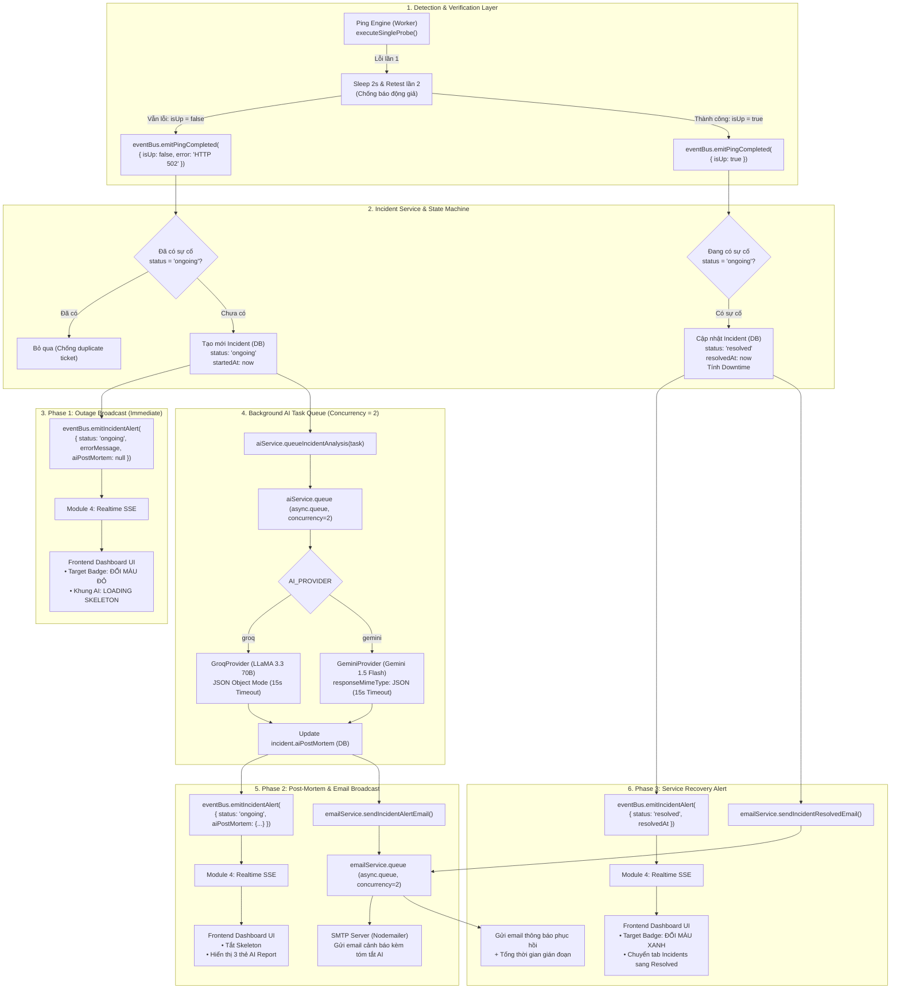
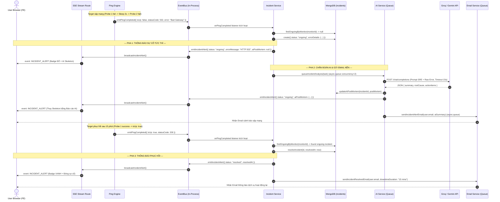
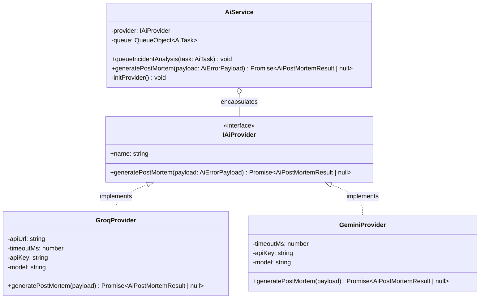

# Incident Detection, Pluggable AI Post-Mortem, and Alert Architecture

Tài liệu thiết kế kỹ thuật chuyên sâu về cấu trúc vận hành, luồng xử lý mã nguồn chi tiết từng bước, kiến trúc hướng đối tượng (OOP) của các nhà cung cấp Generative AI, cơ chế hàng đợi xử lý ngầm và sơ đồ phát sự kiện toàn diện giữa Backend và Frontend của **Module 6: Incidents** trong hệ thống DevPulse.

---

## 1. End-to-End System Event Flow and Topology

Mô-đun Incidents đóng vai trò là "trung tâm phản ứng sự cố" (Incident Response Hub) của DevPulse. Nó liên kết chặt chẽ giữa tiến trình đo lường mạng (Ping Engine), loa phát thanh nội bộ (EventBus), động cơ trí tuệ nhân tạo (Generative AI), dịch vụ thư điện tử (Email SMTP) và luồng truyền phát thời gian thực (Realtime SSE) xuống trình duyệt.



---

## 2. Sequence Diagram: Vòng Đời Sự Cố Từ Phát Hiện Đến Khắc Phục

Sơ đồ trình tự thời gian mô tả chi tiết các gói tin trao đổi giữa **Client Browser**, **Nginx/API**, **EventBus**, **AI Provider** và **SMTP Gateway**:



---

## 3. Step-by-Step Code-Driven Execution Flow

Dưới đây là chi tiết mã nguồn và hành vi kỹ thuật qua từng bước thực thi trong hệ thống:

---

### Bước 1: Kiểm Tra Lỗi & Cơ Chế Chống Báo Động Giả (Fast Retest)
Khi một website gặp sự cố mạng (packet drop, timeout hoặc HTTP 5xx), [`src/services/pingExecutor.ts`](../backend/src/services/pingExecutor.ts) **không kết luận ngay là web chết**. Nó tạm hoãn 2 giây và bắn lượt kiểm tra thứ 2:

```typescript
// File: src/services/pingExecutor.ts
// Lần 1 thất bại: Tạm hoãn 2 giây để kiểm tra lại nhanh (chống False Positive do rớt gói mạng)
await new Promise((resolve) => setTimeout(resolve, this.retryDelayMs));
const retryProbe = await this.executeSingleProbe(monitor);

// Chỉ khi cả 2 lần đều chết thì mới chính thức tuyên bố mục tiêu DOWN
return {
  statusCode: retryProbe.statusCode,
  latency: retryProbe.latency,
  isUp: retryProbe.isUp,
  error: retryProbe.error,
};
```

Sau khi xác nhận `isUp: false`, [`src/services/pingEngine.ts`](../backend/src/services/pingEngine.ts) phát sự kiện lên EventBus:

```typescript
// File: src/services/pingEngine.ts
eventBus.emitPingCompleted({
  monitorId: monitor._id.toString(),
  userId: monitor.userId.toString(),
  statusCode: result.statusCode,
  latency: result.latency,
  isUp: result.isUp,
  timestamp: new Date().toISOString(),
  error: result.error,
});
```

---

### Bước 2: Nhận Diện Sự Cố Duy Nhất & Tạo Bản Ghi (Idempotent Outage Detection)
Tại [`src/services/incidentService.ts`](../backend/src/services/incidentService.ts), hệ thống lắng nghe sự kiện `PING_COMPLETED`.

Để ngăn chặn việc **tạo hàng chục ticket trùng lặp** khi website bị sập liên tục trong nhiều chu kỳ 30 giây:

```typescript
// File: src/services/incidentService.ts
private async handleTargetFailure(payload: PingCompletedEvent): Promise<void> {
  // 1. Kiểm tra xem monitor này đã có ticket nào đang 'ongoing' chưa
  const existingOngoing = await incidentRepository.findOngoingByMonitor(payload.monitorId);
  if (existingOngoing) {
    // Đã có sự cố đang mở -> Bỏ qua, không tạo thêm bản ghi mới
    return;
  }

  const monitor = await monitorRepository.findById(payload.monitorId);
  if (!monitor) return;

  const startedDate = new Date(payload.timestamp);

  // 2. Tạo bản ghi Incident mới trong MongoDB
  const incident = await incidentRepository.create({
    monitorId: monitor._id,
    userId: monitor.userId,
    status: 'ongoing',
    startedAt: startedDate,
    resolvedAt: null,
    errorDetails: {
      statusCode: payload.statusCode,
      errorMessage: payload.error || 'Health check probe failed',
      responseBody: '',
      responseHeaders: {},
    },
  });

  // 3. Pha 1: Bắn ngay thông báo sập mạng lên Dashboard qua SSE (aiPostMortem = undefined)
  eventBus.emitIncidentAlert({
    incidentId: incident._id.toString(),
    monitorId: payload.monitorId,
    userId: payload.userId,
    status: 'ongoing',
    startedAt: payload.timestamp,
    errorMessage: payload.error,
  });

  // 4. Đẩy tác vụ chẩn đoán AI vào hàng đợi xử lý nền (KHÔNG CẦN CALLBACK)
  aiService.queueIncidentAnalysis({
    incidentId: incident._id.toString(),
    monitorId: monitor._id.toString(),
    userId: monitor.userId.toString(),
    monitorName: monitor.name,
    monitorUrl: monitor.url,
    startedAt: payload.timestamp,
    statusCode: payload.statusCode,
    errorMessage: payload.error || 'Health check probe failed',
  });
}
```

---

### Bước 3: Pha 1 — Bắn Cảnh Báo Sập Mạng Tức Thì (Instant Outage Broadcast)
Khối dữ liệu gửi qua SSE ở Pha 1:

```json
{
  "type": "INCIDENT_ALERT",
  "incidentId": "6729abcd1234567890ef0001",
  "monitorId": "672411112222333344445555",
  "status": "ongoing",
  "startedAt": "2026-11-05T08:00:00.000Z",
  "errorMessage": "HTTP 502: Bad Gateway",
  "aiPostMortem": null
}
```

* **Trải nghiệm Frontend (UX):**
  * Badge trạng thái mục tiêu lập tức chuyển sang **Màu Đỏ (DOWN)**.
  * Xuất hiện Banner cảnh báo sự cố đang diễn ra.
  * Vì `aiPostMortem === null`, khung hiển thị AI Post-Mortem sẽ hiển thị hiệu ứng **Loading Skeleton ("Analyzing root cause with AI...")**.

---

### Bước 4: Hàng Đợi Nền Gọi Generative AI (Pluggable Provider Pattern)
Tại [`src/services/aiService.ts`](../backend/src/services/aiService.ts), hàng đợi `this.queue` (`async.queue` với `concurrency = 2`) tự động bốc task ra xử lý:

```typescript
// File: src/services/aiService.ts
private async processTask(task: AiTask): Promise<void> {
  try {
    // 1. Gọi Provider đang hoạt động (Groq hoặc Gemini)
    const postMortem = await this.generatePostMortem({
      targetUrl: task.monitorUrl,
      statusCode: task.statusCode,
      errorMessage: task.errorMessage,
      responseBody: task.responseBody,
    });

    if (postMortem) {
      const generatedAt = new Date();
      // 2. Lưu kết quả phân tích vào MongoDB
      await incidentRepository.updateAiPostMortem(task.incidentId, {
        summary: postMortem.summary,
        rootCause: postMortem.rootCause,
        actionItems: postMortem.actionItems,
        generatedAt,
      });

      // 3. Pha 2: Bắn sự kiện SSE lần 2 kèm toàn bộ dữ liệu aiPostMortem
      eventBus.emitIncidentAlert({
        incidentId: task.incidentId,
        monitorId: task.monitorId,
        userId: task.userId,
        status: 'ongoing',
        startedAt: task.startedAt,
        errorMessage: task.errorMessage,
        aiPostMortem: {
          summary: postMortem.summary,
          rootCause: postMortem.rootCause,
          actionItems: postMortem.actionItems,
          generatedAt: generatedAt.toISOString(),
        },
      });
    }

    // 4. Đẩy tác vụ gửi email cảnh báo vào Email Queue
    const user = await userRepository.findById(task.userId);
    if (user) {
      emailService.sendIncidentAlertEmail(
        user.email,
        task.monitorName,
        task.monitorUrl,
        task.startedAt,
        { statusCode: task.statusCode, errorMessage: task.errorMessage },
        postMortem?.summary
      );
    }
  } catch (error) {
    console.error(`[AI Service] Error processing incident analysis for ${task.incidentId}:`, error);
  }
}
```

---

### Bước 5: Pha 2 — Cập Nhật Báo Cáo AI Lên Dashboard & Gửi Email SMTP
Gói tin SSE gửi xuống ở Pha 2:

```json
{
  "type": "INCIDENT_ALERT",
  "incidentId": "6729abcd1234567890ef0001",
  "monitorId": "672411112222333344445555",
  "status": "ongoing",
  "startedAt": "2026-11-05T08:00:00.000Z",
  "errorMessage": "HTTP 502: Bad Gateway",
  "aiPostMortem": {
    "summary": "Target endpoint returned 502 Bad Gateway due to upstream reverse proxy disconnection.",
    "rootCause": "The application server process crashed or closed the socket connection unexpectedly before sending HTTP response headers.",
    "actionItems": [
      "Check Node.js / Docker container logs on the target server for uncaught exceptions",
      "Verify process manager status (PM2 or systemd)",
      "Ensure backend listening port matches Nginx upstream proxy_pass configuration"
    ],
    "generatedAt": "2026-11-05T08:00:03.120Z"
  }
}
```

* **Trải nghiệm Frontend (UX):**
  * Nhận thấy `aiPostMortem` đã có dữ liệu hợp lệ $\rightarrow$ **Tắt Loading Skeleton**.
  * Hiển thị bảng phân tích 3 phần rõ rệt: Tóm tắt sự cố (Summary), Nguyên nhân gốc rễ (Root Cause), và Danh sách hành động khuyến nghị (Action Items).
* **Email Alert:** Hộp thư của người dùng nhận email có banner đỏ, bảng dữ liệu lỗi kỹ thuật kèm trích dẫn chẩn đoán của AI.

---

### Bước 6: Phục Hồi Sự Cố Tự Động (Self-Healing Incident Resolution)
Khi mục tiêu sống lại (`isUp: true`), [`incidentService.ts`](../backend/src/services/incidentService.ts) tự động đóng vòng đời sự cố:

```typescript
// File: src/services/incidentService.ts
private async handleTargetRecovery(payload: PingCompletedEvent): Promise<void> {
  const ongoingIncident = await incidentRepository.findOngoingByMonitor(payload.monitorId);
  if (!ongoingIncident) return;

  const resolvedDate = new Date(payload.timestamp);

  // 1. Cập nhật trạng thái sự cố sang 'resolved' và lưu mốc thời gian kết thúc
  const resolvedIncident = await incidentRepository.resolveIncident(
    ongoingIncident._id.toString(),
    resolvedDate
  );
  if (!resolvedIncident) return;

  // 2. Phát sự kiện phục hồi lên SSE Dashboard
  eventBus.emitIncidentAlert({
    incidentId: ongoingIncident._id.toString(),
    monitorId: payload.monitorId,
    userId: payload.userId,
    status: 'resolved',
    startedAt: ongoingIncident.startedAt.toISOString(),
    resolvedAt: payload.timestamp,
  });

  // 3. Tính toán tổng thời lượng downtime chính xác (ví dụ: '14 minutes', '1 hour 25 min')
  const monitor = await monitorRepository.findById(payload.monitorId);
  const user = await userRepository.findById(payload.userId);

  if (monitor && user) {
    const durationMs = resolvedDate.getTime() - ongoingIncident.startedAt.getTime();
    const downtimeDuration = this.formatDuration(durationMs);

    // 4. Gửi email thông báo hệ thống đã phục hồi bình thường
    emailService.sendIncidentResolvedEmail(
      user.email,
      monitor.name,
      monitor.url,
      ongoingIncident.startedAt.toISOString(),
      resolvedDate.toISOString(),
      downtimeDuration
    );
  }
}
```

---

## 4. Pluggable Generative AI Provider OOP Architecture

Hệ thống được thiết kế theo nguyên lý **Open/Closed Principle (SOLID)**. Khi cần đổi mô hình hoặc tích hợp nhà cung cấp AI mới, lập trình viên chỉ cần thêm class mới kế thừa interface `IAiProvider` mà không cần sửa đổi bất kỳ logic nghiệp vụ nào trong `incidentService` hay `aiService`.



### So sánh cấu hình kỹ thuật giữa 2 nhà cung cấp:

| Tiêu chí | Groq Provider ([`groqProvider.ts`](../backend/src/services/ai/groqProvider.ts)) | Google Gemini Provider ([`geminiProvider.ts`](../backend/src/services/ai/geminiProvider.ts)) |
| :--- | :--- | :--- |
| **Model mặc định** | `llama-3.3-70b-versatile` | `gemini-1.5-flash` |
| **Giao thức API** | OpenAI-compatible Chat Completions API | Google Generative Language REST API (v1beta) |
| **Ràng buộc JSON Mode** | `response_format: { type: "json_object" }` | `generationConfig: { responseMimeType: "application/json" }` |
| **Độ trễ phản hồi** | Siêu nhanh (~500ms – 1.2s qua Groq LPU) | Rất nhanh (~1.0s – 1.8s) |
| **Biến môi trường bật** | `AI_PROVIDER=groq` + `GROQ_API_KEY` | `AI_PROVIDER=gemini` + `GEMINI_API_KEY` |
| **Cơ chế Timeout** | `AbortController` cắt cứng sau 15 giây | `AbortController` cắt cứng sau 15 giây |

---

## 5. Dual In-Memory Task Queues: Kiến Trúc Đồng Nhất

Cả hai dịch vụ xử lý tác vụ nền trong DevPulse ([`aiService.ts`](../backend/src/services/aiService.ts) và [`emailService.ts`](../backend/src/services/emailService.ts)) đều tuân thủ **một mô hình thiết kế duy nhất 100%**:

```text
               Caller Service (incidentService.ts)
                    │                       │
      aiService.queueIncidentAnalysis()   emailService.sendIncidentAlertEmail()
                    │                       │
                    ▼                       ▼
            ┌───────────────┐       ┌───────────────┐
            │   AI Queue    │       │  Email Queue  │
            │ (async.queue) │       │ (async.queue) │
            │ Concurrency=2 │       │ Concurrency=2 │
            └───────┬───────┘       └───────┬───────┘
                    │                       │
         ┌──────────┴──────────┐            ▼
         ▼                     ▼      SMTP Gateway
    GroqProvider        GeminiProvider   (Nodemailer)
   (LLaMA 3.3 70B)     (Gemini 1.5 Flash)
```

* **Tại sao cố định `concurrency = 2`?** 
  * Máy chủ Linux VPS triển khai thực tế có cấu hình 1 vCPU và 1GB RAM vật lý.
  * Việc giới hạn tối đa 2 tác vụ song song cho AI và 2 tác vụ song song cho Email đảm bảo CPU máy chủ không bao giờ bị nghẽn (CPU Spike) và kết nối socket ra ngoài mạng không bị cạn kiệt, đồng thời tuân thủ đúng giới hạn tần suất (Rate Limit) của Groq và Gmail SMTP.
* **Không truyền Callback từ ngoài:** Caller chỉ việc ném dữ liệu vào `service.queue...()`, bản thân mỗi service tự biết cách xử lý trọn vẹn vòng đời của tác vụ đó.

---

## 6. End-to-End System Event Map (BE to FE)

Bảng ánh xạ toàn bộ các sự kiện được phát ra trong hệ thống, cấu trúc dữ liệu và phản ứng tương ứng trên giao diện người dùng React:

| Tên sự kiện | Nơi phát (Emitter) | Nơi nghe (Subscriber) | Dữ liệu chính (Payload) | Hành vi trên giao diện (Frontend Reaction) |
| :--- | :--- | :--- | :--- | :--- |
| **`ping:completed`** | `pingEngine.ts` | `realtimeService.ts`<br>`incidentService.ts` | `monitorId, userId, statusCode, latency, isUp, error` | *(Sự kiện nội bộ)* Kích hoạt truyền phát SSE và kích hoạt máy trạng thái Incident. |
| **`MONITOR_PING`** | `realtimeService.ts` (SSE) | Trình duyệt người dùng (Client) | `monitorId, statusCode, latency, isUp, timestamp` | Thêm điểm dữ liệu mới vào đuôi biểu đồ Live Latency; cập nhật nhãn `Last checked: Just now`. |
| **`INCIDENT_ALERT`** *(Pha 1: Outage)* | `realtimeService.ts` (SSE) | Trình duyệt người dùng (Client) | `incidentId, monitorId, status: 'ongoing', errorMessage, aiPostMortem: null` | • Đổi huy hiệu mục tiêu sang **Màu Đỏ (DOWN)**.<br>• Mở Banner cảnh báo sự cố.<br>• Hiển thị **Loading Skeleton** tại khung AI Report. |
| **`INCIDENT_ALERT`** *(Pha 2: AI Done)* | `realtimeService.ts` (SSE) | Trình duyệt người dùng (Client) | `incidentId, monitorId, status: 'ongoing', errorMessage, aiPostMortem: {...}` | • Tắt Loading Skeleton.<br>• Điền dữ liệu vào 3 thẻ: **Summary, Root Cause, Action Items**. |
| **`INCIDENT_ALERT`** *(Pha 3: Resolved)* | `realtimeService.ts` (SSE) | Trình duyệt người dùng (Client) | `incidentId, monitorId, status: 'resolved', resolvedAt` | • Đổi huy hiệu mục tiêu sang **Màu Xanh (UP)**.<br>• Tắt Banner cảnh báo.<br>• Chuyển incident sang tab **Resolved**. |
| **`: heartbeat`** | `realtimeService.ts` (SSE) | Trình duyệt người dùng (Client) | *(Dòng chú thích SSE rỗng)* | Giữ kết nối TCP mở liên tục qua Nginx, không kích hoạt event listener trên UI. |

---

## 7. RESTful API Endpoints & Tenant Security (OWASP Compliance)

Mọi yêu cầu truy cập hoặc thao tác trên sự cố đều được bảo vệ nghiêm ngặt bằng cơ chế **Tenant Data Scoping**:

```text
GET    /api/incidents                    -> Lấy danh sách sự cố của user (hỗ trợ filter status, monitorId, pagination)
GET    /api/incidents/:id                -> Xem chi tiết 1 sự cố kèm dữ liệu lỗi thô và AI post-mortem
GET    /api/monitors/:id/incidents       -> Lấy lịch sử sự cố của 1 monitor cụ thể
PATCH  /api/incidents/:id/resolve        -> Đóng sự cố thủ công từ nút bấm trên Dashboard
POST   /api/incidents/:id/reanalyze      -> Kích hoạt AI phân tích lại khi có log lỗi mới
```

* **Chống IDOR / BOLA (OWASP API Security):** Mọi câu truy vấn đều kẹp cứng `userId`: `incidentRepository.findByIdAndUser(id, req.user.id)`. Nếu User A cố tình gửi request với ID của User B, hệ thống trả về **`HTTP 404 Not Found` (Anti-Enumeration)** thay vì 403, che giấu hoàn toàn sự tồn tại của tài nguyên để chống tấn công vét cạn.
