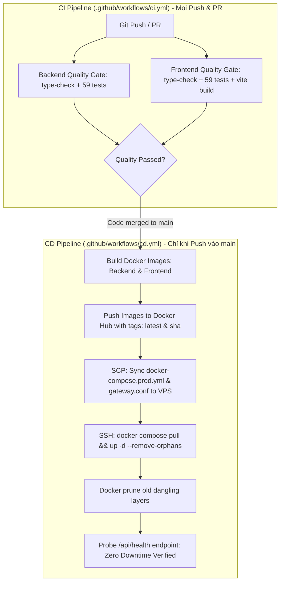

# Infrastructure and Deployment Specification - DevPulse

## 1. Infrastructure Overview

Hệ thống được thiết kế để triển khai trên một Linux VPS chạy hệ điều hành Ubuntu 22.04 LTS hoặc 24.04 LTS. Toàn bộ các service được đóng gói độc lập bên trong các Docker container và quản trị thông qua Docker Compose. Quy trình CI/CD chuyển giao mã nguồn từ Git repository đến môi trường production được tự động hóa hoàn toàn bằng GitHub Actions.

---

## 2. Server Sizing and Hardware Topology

### 2.1. Recommended Hardware
- CPU: 1 vCPU hoặc 2 vCPU.
- RAM: Tối thiểu 1GB, khuyến nghị 2GB.
- Swap memory: 2GB trên ổ SSD để phòng ngừa tình trạng OOM khi tải đột biến.
- Ổ cứng SSD: 20GB đến 25GB.

### 2.2. Resource Allocation Plan

| Service | Container Name | Image Source | Memory Limit | Memory Reservation | CPU Limit |
| :--- | :--- | :--- | :--- | :--- | :--- |
| **Edge Gateway** | `devpulse-gateway` | `nginx:1.27-alpine` (official) | 64MB | 20MB | 0.20 |
| **Frontend SPA** | `devpulse-frontend` | `dorayakiiiiz/devpulse-frontend` | 64MB | 20MB | 0.20 |
| **Backend API** | `devpulse-backend` | `dorayakiiiiz/devpulse-backend` | 256MB | 128MB | 0.50 |
| **Database** | `devpulse-database` | `mongo:7.0` (official) | 384MB | 256MB | 0.30 |

Hệ thống hoạt động thực tế chỉ tiêu thụ ~390MB RAM (Gateway ~8MB, Frontend ~8MB, Backend ~120MB, MongoDB ~256MB), đảm bảo hoạt động tuyệt đối an toàn và ổn định trên VPS 1GB RAM với hơn 600MB RAM dự phòng cho hệ điều hành.

---

## 3. Containerization Strategy

### 3.1. Phân Tách Độc Lập Giữa Edge Gateway và Frontend (Best Practice vs Monolith Coupling)
- **Vấn đề của việc gom Nginx vào Frontend:** Nếu gộp Nginx Reverse Proxy và static files của Frontend vào chung 1 container, mỗi khi thay đổi UI (CSS/HTML), toàn bộ Edge Gateway phải khởi động lại, làm gián đoạn mọi kết nối SSE thời gian thực và việc proxy đến API. Ngược lại, nếu muốn sửa rule proxy hoặc renew SSL, lại phải build lại image Frontend.
- **Giải pháp chuẩn mực thực tế (Decoupled Microservices):**
  - `devpulse-gateway`: Đóng vai trò Edge Reverse Proxy duy nhất, lắng nghe port 80/443, xử lý SSL Let's Encrypt, Gzip, điều phối lưu lượng `/api` sang backend và `/*` sang frontend.
  - `devpulse-frontend`: Container độc lập chạy Nginx Alpine tối giản chỉ phục vụ static files của React SPA trên port 80 nội bộ, xử lý `try_files` định tuyến React Router và cache static assets.

### 3.2. Backend Multi-Stage Dockerfile
Quy trình build multi-stage của backend phân tách thành hai stage nhằm tối ưu image size và bảo mật:
- Stage 1 Builder: Sử dụng base image `node:20-alpine`, cài đặt toàn bộ dependencies và biên dịch source code TypeScript sang JavaScript (`npm run build`). Sau đó prune devDependencies để giữ lại production dependencies.
- Stage 2 Runner: Sử dụng image tối giản `node:20-alpine`, chỉ copy thư mục `dist/` đã build và `node_modules` production. Ứng dụng chạy dưới quyền non-root user `USER node` nhằm ngăn ngừa leo thang đặc quyền.
- Kích thước Docker image hoàn thiện: Dưới 120MB.

### 3.3. Frontend Multi-Stage Dockerfile
- Stage 1 Builder: Cài đặt dependencies và thực thi build static bundle tối ưu qua Vite (`npm run build`).
- Stage 2 Runner: Sử dụng web server `nginx:1.27-alpine` để serve các static files HTML, CSS và JavaScript, giúp tiết kiệm tối đa tài nguyên (~8MB RAM).
- Kích thước Docker image hoàn thiện: Dưới 25MB.

### 3.4. Production Docker Compose Architecture

File cấu hình `docker-compose.prod.yml` quản lý 4 service liên kết chặt chẽ:
- `devpulse-gateway`: Edge Reverse Proxy gắn kết cấu hình `deploy/nginx/gateway.conf` và SSL certificates.
- `devpulse-frontend`: Phục vụ giao diện React 18 SPA.
- `devpulse-backend`: Service backend Node.js 20 Express xử lý logic nghiệp vụ, scheduler ping engine và kết nối database.
- `devpulse-database`: MongoDB container gắn kết với Docker volume bền vững trên ổ cứng VPS kèm cấu hình `--wiredTigerCacheSizeGB 0.25`.

Mạng nội bộ Docker network giữa các container được cô lập hoàn toàn (`devpulse-network`). Chỉ duy nhất cổng mạng của service reverse proxy là port 80 và 443 được public ra ngoài Internet.

---

## 4. Reverse Proxy and SSL Automation

### 4.1. Traffic Routing Configuration
- Toàn bộ requests có tiền tố `/api` hoặc `/api/sse` được proxy pass nguyên vẹn vào backend service nội bộ.
- Đối với endpoint `/api/sse`, cấu hình Nginx tắt response buffering với chỉ thị `proxy_buffering off` và tắt giới hạn thời gian chờ với chỉ thị `proxy_read_timeout 24h` để duy trì kết nối SSE liên tục.
- Toàn bộ các requests còn lại được điều hướng trực tiếp đến static files của frontend.
- Endpoint public status page được thiết lập header Cache-Control public với max-age 30 giây.

### 4.2. SSL Certificate Lifecycle
- Tích hợp Certbot để tự động cấp phát chứng chỉ SSL miễn phí từ Let's Encrypt.
- Thiết lập tự động redirect toàn bộ lưu lượng HTTP cổng 80 sang HTTPS cổng 443 có mã hóa bảo mật.
- Cronjob tự động kiểm tra và renew chứng chỉ SSL định kỳ và tự động reload Nginx khi chứng chỉ mới được cập nhật.

---

## 5. Continuous Integration and Continuous Deployment Pipelines

Kiến trúc CI/CD được phân tách thành hai workflow hoàn toàn độc lập nhằm đảm bảo an toàn bí mật hạ tầng (Least Privilege) và tối ưu thời gian phát hành:

### 5.1. Continuous Integration Workflow (`ci.yml`)
Kích hoạt tự động khi có commit đẩy lên branch `main`, `develop` hoặc khi mở Pull Request vào `main`:
- **Backend Quality Gate:** Kiểm tra type-checking với `tsc --noEmit`, thực thi toàn bộ 59 unit & integration tests trên runner Ubuntu cách ly.
- **Frontend Quality Gate:** Kiểm tra type-checking với `tsc --noEmit`, chạy toàn bộ 59 component/hook tests, và xác thực đóng gói bundle production với Vite (`npm run build`).
- **An toàn bảo mật:** Workflow CI tuyệt đối không chứa quyền truy cập vào SSH Key hay bí mật hạ tầng của server production.

### 5.2. Continuous Deployment Workflow (`cd.yml`)
Kích hoạt tự động khi code đã được merge thành công vào nhánh `main`:
- **Kiểm tra Quality Gate lần cuối:** Xác thực code sạch trước khi đóng gói.
- **Build & Push Docker Images:** Sử dụng Docker Buildx trên GitHub runner (4 vCPU / 16GB RAM) để build multi-stage images và đẩy lên Docker Hub (`dorayakiiiiz/devpulse-backend` và `dorayakiiiiz/devpulse-frontend`). Server VPS hoàn toàn không tốn CPU/RAM để build code.
- **SSH Deployment & Rolling Restart:**
  1. Tự động đồng bộ các file cấu hình `docker-compose.prod.yml` và `deploy/nginx/gateway.conf` sang thư mục `~/devpulse` trên VPS thông qua SCP Action.
  2. Kết nối SSH vào VPS qua `appleboy/ssh-action` sử dụng SSH Key ed25519 đã ủy quyền.
  3. Kéo images mới nhất bằng `docker compose pull` (chỉ mất vài giây do dùng Docker layer caching).
  4. Tái khởi động containers bằng `docker compose up -d --remove-orphans` mà không làm gián đoạn database volume.
  5. Xóa các layer image mồ côi bằng `docker image prune -f` để bảo vệ dung lượng ổ cứng SSD.
  6. Kiểm tra trực tiếp endpoint `/api/health` để xác thực hệ thống online 100%.

---

## 6. Server Hardening and Production Safety

### 6.1. Firewall Configuration
- Kích hoạt tường lửa UFW và chỉ mở 3 port duy nhất:
  - Port 22: SSH phục vụ quản trị và GitHub Actions CD runner.
  - Port 80: HTTP phục vụ Let's Encrypt challenge và redirect sang HTTPS.
  - Port 443: HTTPS phục vụ toàn bộ traffic ứng dụng mã hóa TLS.
- Toàn bộ internal ports của database và backend API bị cô lập hoàn toàn trong Docker network, không expose ra internet.

### 6.2. Swap Space Configuration
- Cấu hình Swap file có kích thước 2GB trên ổ SSD.
- Điều chỉnh tham số `vm.swappiness = 10` nhằm đảm bảo kernel chỉ dùng swap khi RAM vật lý thực sự cạn kiệt, tránh suy giảm hiệu năng disk I/O.

### 6.3. Service Health Check Endpoint
- Backend service cung cấp health check endpoint tại `/api/health` trả về:
  - Trạng thái kết nối database.
  - Mức tiêu thụ heap memory của Node.js process.
  - Uptime liên tục kể từ lần khởi động gần nhất.
- Endpoint này được Docker container healthcheck sử dụng để phát hiện kịp thời các sự cố treo process và tự động restart container.
