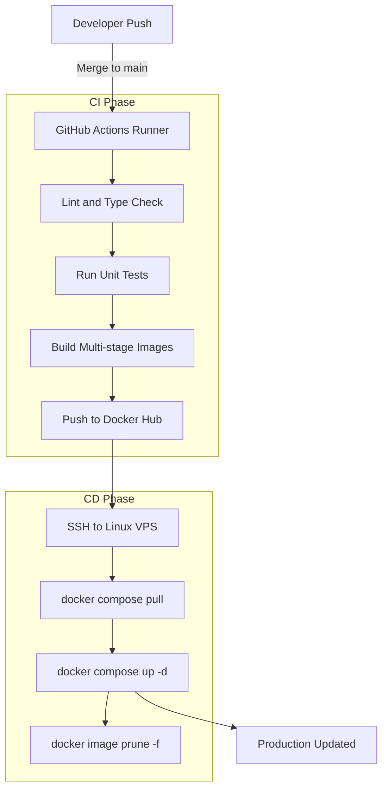

# Infrastructure and Deployment Specification - DevPulse

## 1. Infrastructure Overview

Hệ thống được thiết kế để triển khai trên một Linux VPS chạy hệ điều hành Ubuntu 22.04 LTS hoặc 24.04 LTS. Toàn bộ các service được đóng gói độc lập bên trong các Docker container và quản trị thông qua Docker Compose. Quy trình CI/CD chuyển giao mã nguồn từ Git repository đến môi trường production được tự động hóa hoàn toàn bằng GitHub Actions.

---

## 2. Server Sizing and Hardware Topology

### 2.1. Recommended Hardware
- CPU: 1 vCPU hoặc 2 vCPU.
- RAM: Tối thiểu 1GB, khuyến nghị 2GB.
- Swap memory: 2GB trên ổ SSD để phòng ngừa tình trạng OOM khi tải đột biến.
- Ổ cứng SSD: 20GB đến 25GB.

### 2.2. Resource Allocation Plan

| Service | Container Name | Memory Limit | Memory Reservation |
| :--- | :--- | :--- | :--- |
| Gateway | `devpulse-gateway` | 64MB | 20MB |
| Backend API | `devpulse-backend` | 256MB | 128MB |
| Database | `devpulse-database` | 384MB | 256MB |

Toàn bộ hệ thống tiêu thụ thông thường dưới 600MB RAM, đảm bảo hoạt động an toàn và ổn định trên VPS có dung lượng 1GB RAM.

---

## 3. Containerization Strategy

### 3.1. Backend Multi-Stage Dockerfile
Quy trình build multi-stage của backend phân tách thành hai stage nhằm tối ưu image size và bảo mật:
- Stage 1 Builder: Sử dụng base image đầy đủ để cài đặt devDependencies và build source code TypeScript thành JavaScript.
- Stage 2 Runner: Sử dụng image tối giản dựa trên Alpine Linux `node:20-alpine`, chỉ copy thư mục `dist/` đã build và production dependencies. Ứng dụng chạy dưới quyền non-root user `USER node` nhằm ngăn ngừa việc leo thang đặc quyền.
- Kích thước Docker image hoàn thiện: Dưới 120MB.

### 3.2. Frontend Multi-Stage Dockerfile
- Stage 1 Builder: Thực thi cài đặt dependencies và build static files tối ưu qua Vite.
- Stage 2 Runner: Sử dụng web server Nginx Alpine để serve các static files HTML, CSS và JavaScript, giúp tiết kiệm tối đa RAM và CPU.
- Kích thước Docker image hoàn thiện: Dưới 30MB.

### 3.3. Production Docker Compose Architecture

File cấu hình `docker-compose.prod.yml` quản lý 3 service liên kết chặt chẽ:
- `devpulse-gateway`: Đóng vai trò reverse proxy, serve static files cho frontend và forward requests đến backend API.
- `devpulse-backend`: Service backend xử lý logic nghiệp vụ, scheduler kiểm tra mục tiêu và kết nối database.
- `devpulse-database`: MongoDB container gắn kết với Docker volume bền vững trên ổ cứng VPS.

Mạng nội bộ Docker network giữa các container được cô lập hoàn toàn. Chỉ duy nhất cổng mạng của service reverse proxy là port 80 và 443 được public ra internet.

---

## 4. Reverse Proxy and SSL Automation

### 4.1. Traffic Routing Configuration
- Toàn bộ requests có tiền tố `/api` hoặc `/api/sse` được proxy pass nguyên vẹn vào backend service nội bộ.
- Đối với endpoint `/api/sse`, cấu hình Nginx tắt response buffering với chỉ thị `proxy_buffering off` và tắt giới hạn thời gian chờ với chỉ thị `proxy_read_timeout 24h` để duy trì kết nối SSE liên tục.
- Toàn bộ các requests còn lại được điều hướng trực tiếp đến static files của frontend.
- Endpoint public status page được thiết lập header Cache-Control public với max-age 30 giây.

### 4.2. SSL Certificate Lifecycle
- Tích hợp Certbot để tự động cấp phát chứng chỉ SSL miễn phí từ Let's Encrypt.
- Thiết lập tự động redirect toàn bộ lưu lượng HTTP cổng 80 sang HTTPS cổng 443 có mã hóa bảo mật.
- Cronjob tự động kiểm tra và renew chứng chỉ SSL định kỳ và tự động reload Nginx khi chứng chỉ mới được cập nhật.

---

## 5. Continuous Integration and Continuous Deployment Pipeline

### 5.1. Continuous Integration Workflow
Kích hoạt tự động khi có event git push hoặc merge pull request vào branch main:
- Chạy linter với `eslint` và type-check với lệnh `tsc --noEmit`.
- Thực thi toàn bộ unit tests tự động.
- Đăng nhập vào Docker Hub qua credentials lưu an toàn trong GitHub Secrets.
- Build Docker images, gắn tag commit hash và tag latest.
- Push Docker images lên Docker Hub registry.

### 5.2. Continuous Deployment Workflow
Kích hoạt tự động ngay sau khi CI phase hoàn tất thành công:
- Thiết lập kết nối SSH vào Linux VPS qua SSH Private Key lưu trong GitHub Secrets.
- Di chuyển vào thư mục dự án trên VPS.
- Thực thi kéo các images phiên bản mới nhất: `docker compose pull`.
- Khởi động lại các container có thay đổi image bằng lệnh: `docker compose up -d --remove-orphans`. Quá trình này không làm ảnh hưởng đến volume dữ liệu của database.
- Thực thi lệnh dọn dẹp các image cũ không còn sử dụng để giải phóng dung lượng ổ cứng: `docker image prune -f`.

---

## 6. Server Hardening and Production Safety

### 6.1. Firewall Configuration
- Kích hoạt tường lửa UFW và chỉ mở 3 port duy nhất:
  - Port 22: SSH phục vụ quản trị và GitHub Actions CD runner.
  - Port 80: HTTP phục vụ Let's Encrypt challenge và redirect sang HTTPS.
  - Port 443: HTTPS phục vụ toàn bộ traffic ứng dụng mã hóa TLS.
- Toàn bộ internal ports của database và backend API bị cô lập hoàn toàn trong Docker network, không expose ra internet.

### 6.2. Swap Space Configuration
- Cấu hình Swap file có kích thước 2GB trên ổ SSD.
- Điều chỉnh tham số `vm.swappiness = 10` nhằm đảm bảo kernel chỉ dùng swap khi RAM vật lý thực sự cạn kiệt, tránh suy giảm hiệu năng disk I/O.

### 6.3. Service Health Check Endpoint
- Backend service cung cấp health check endpoint tại `/api/health` trả về:
  - Trạng thái kết nối database.
  - Mức tiêu thụ heap memory của Node.js process.
  - Uptime liên tục kể từ lần khởi động gần nhất.
- Endpoint này được Docker container healthcheck sử dụng để phát hiện kịp thời các sự cố treo process và tự động restart container.
