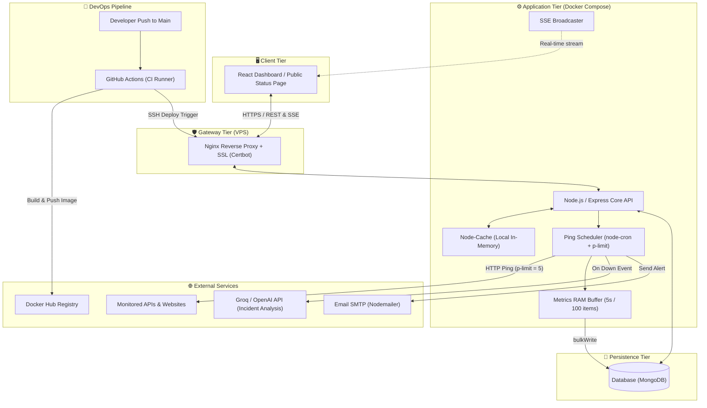

# DevPulse – Cloud Uptime & API Health Monitoring SaaS
> **Hệ thống giám sát trạng thái Website, đo lường độ trễ API theo thời gian thực và tự động tạo báo cáo sự cố bằng AI**

---

## 1. Tổng quan dự án (Project Overview)

- **Tên dự án:** DevPulse
- **Mô hình:** B2B Developer Tool / Observability SaaS
- **Đối tượng sử dụng:** Lập trình viên, DevOps Engineers, Indie Hackers, các nhóm phát triển phần mềm cần giám sát website/microservices và công khai trang trạng thái (Public Status Page) cho khách hàng.
- **Mục tiêu kỹ thuật:** Xây dựng một ứng dụng Fullstack hoàn chỉnh, áp dụng tư duy **Event-Driven, Controlled Concurrency Scheduler, High-Write Batching, Real-time Streaming** và quy trình triển khai tự động **DevOps CI/CD chuẩn production trên Linux VPS**.

---

## 2. Kiến trúc hệ thống tổng thể (System Architecture)



---

## 3. Chi tiết các module tính năng cốt lõi (Core Modules)

### 3.1. Giám sát Uptime & Đo độ trễ (Ping Engine)
- **Cơ chế:** Cho phép người dùng thêm các Endpoint cần theo dõi (URL, HTTP Method, Headers, Interval: 30s/60s/300s).
- **Thu thập dữ liệu:**
  - **HTTP Status Code:** Nhận diện 2xx (Up), 3xx (Redirect), 4xx/5xx (Down/Degraded).
  - **Response Time (Latency):** Đo chính xác thời gian phản hồi (DNS lookup + TLS Handshake + TTFB).
  - **SSL Certificate Monitoring:** Kiểm tra ngày hết hạn chứng chỉ SSL và phát cảnh báo trước 7 ngày.

### 3.2. Lập lịch & Kiểm soát đồng thời (Scheduler & Concurrency Control)
- **Vấn đề:** Nếu có 100 monitors cùng đến hạn ping một lúc, gọi `fetch()` đồng thời sẽ làm cạn kiệt socket mạng và nghẽn Main Thread của Node.js.
- **Giải pháp:**
  - Sử dụng **`node-cron`** để thiết lập lịch ping định kỳ và **`p-limit`** để kiểm soát hồ bơi thực thi (Concurrency Limit = 5 requests đồng thời).
  - Pacing delay `100ms` giữa các đợt bắn request để nhường CPU cho các API request từ người dùng.
  - Tách hoàn toàn luồng gửi mail cảnh báo (SMTP mất 2-3s) ra xử lý bất đồng bộ (background task), không block API.

### 3.3. Cơ chế Event Batching & Quản lý Log (Gom nhóm ghi đĩa tối ưu I/O)
- **Vấn đề:** Với 100 monitors ping mỗi 30 giây, một ngày hệ thống sinh ra gần 300.000 log records. Nếu mỗi lần ping xong đều gọi câu lệnh `db.create()` thì Database sẽ bị nghẽn I/O ghi đĩa nghiêm trọng và nhanh chóng đầy ổ cứng.
- **Giải pháp:**
  - **Gom Buffer trên RAM:** Mọi kết quả ping (timestamp, latency, statusCode) được đẩy vào mảng **In-Memory Buffer** trên RAM. Khi đạt **100 records** HOẶC sau mỗi **5 giây**, hệ thống kích hoạt xả buffer bằng **1 câu lệnh `bulkWrite`** duy nhất xuống Database, giảm thiểu hơn **90% số lượng truy vấn I/O ghi đĩa**.
  - **MongoDB Time-Series Collection:** Lưu trữ dữ liệu ping theo dạng chuỗi thời gian, tự động nén dữ liệu giúp tiết kiệm 70% dung lượng đĩa.
  - **Data Retention Policy (TTL 7 ngày):** Thiết lập TTL Index 7 ngày trên trường `timestamp` để Database tự động giải phóng các bản ghi thô cũ, không cần cronjob dọn rác.

### 3.4. Cập nhật thời gian thực bằng Server-Sent Events (SSE)
- **Trải nghiệm người dùng:** Lập trình viên mở màn hình Dashboard theo dõi không cần F5 trang.
- **Luồng hoạt động:**
  - Client mở 1 kết nối SSE một chiều: `GET /api/sse/monitors`.
  - Khi hệ thống hoàn thành lượt ping mới hoặc phát hiện một server bị sập, backend bắn event `MONITOR_PING` hoặc `INCIDENT_ALERT` qua kết nối SSE.
  - Màn hình React tự động cập nhật biểu đồ độ trễ và đổi màu icon xanh/đỏ tức thì.
  - Sử dụng cơ chế phục hồi kết nối tự động khi mạng bị gián đoạn.

### 3.5. Public Status Page & Multi-Layer Caching
- **Nghiệp vụ:** Cung cấp trang công khai (vd: `devpulse.io/status/acme-corp`) để khách hàng của user vào xem trạng thái hệ thống.
- **Bài toán:** Khi một website bị sập, hàng vạn khách hàng sẽ ùa vào xem trang Status Page làm lưu lượng đọc tăng vọt (Spike traffic).
- **Kiến trúc Cache 2 tầng:**
  - **Tầng 1 (Local RAM Cache - `node-cache`):** Dữ liệu trạng thái tổng hợp được cache trong RAM với TTL = 30s. Mọi request đọc trong 30s được phục vụ tức thì (< 2ms) mà không chạm vào Database.
  - **Tầng 2 (CDN / Reverse Proxy Caching):** Cấu hình Header `Cache-Control: public, max-age=30, s-maxage=60` để Cloudflare hoặc Nginx cache ở tầng mép mạng.

### 3.6. AI Incident Post-Mortem (Phân tích sự cố tự động)
- **Cơ chế:** Khi một endpoint trả về lỗi liên tiếp (vd: 500 Internal Server Error hoặc 502 Bad Gateway), hệ thống thu thập:
  - HTTP Status Code, Response Headers, Error Response Body.
- **Xử lý AI:**
  - Ném dữ liệu lỗi vào LLM (thông qua Groq API siêu tốc hoặc OpenAI).
  - Prompt chuyên biệt cho DevOps: Yêu cầu AI đóng vai SRE Engineer tóm tắt:
    1. *Hiện tượng sự cố là gì?*
    2. *Nguyên nhân tiềm tàng (VD: Lỗi DB connection, memory leak, proxy timeout).*
    3. *Hành động khắc phục đề xuất (Action Items).*
  - Báo cáo này được tự động đính kèm vào email gửi cho lập trình viên và lưu vào lịch sử sự cố (Incident Timeline).

### 3.7. Xác thực & Cơ chế chống Spam OTP 2 lớp
- **JWT trong HttpOnly Cookie:** Token được gắn cờ `HttpOnly = true`, `Secure = true`, `SameSite = Strict` chống rò rỉ qua tấn công XSS.
- **Bảo vệ luồng Quên mật khẩu / Gửi OTP:**
  - **Tầng 1 (IP-Level):** Dùng `express-rate-limit` chặn tối đa 10 request / 15 phút trên mỗi địa chỉ IP (chống botnet DDoS).
  - **Tầng 2 (Email-Level):** Dùng `node-cache` lưu key `otp_cooldown:${email}` có thời gian sống 60 giây. Bất kỳ ai yêu cầu cấp lại mã OTP trong vòng 60s đều bị từ chối với mã lỗi `429 Too Many Requests`.
- **Lưu trữ & Tự hủy OTP:**
  - Dùng **Atomic Upsert** (`findOneAndUpdate({ email }, { otp }, { upsert: true })`) để gom thao tác xóa mã cũ và ghi mã mới thành 1 lệnh duy nhất.
  - Sử dụng **MongoDB TTL Index** (`expires: 300`) để cơ sở dữ liệu tự động xóa vĩnh viễn record sau 5 phút mà không cần viết cronjob dọn rác.

---

## 4. Kiến trúc DevOps & Pipeline CI/CD

```
Code Push (Git) ➔ GitHub Actions (CI) ➔ Multi-stage Docker Build ➔ Docker Hub ➔ SSH VPS (CD) ➔ Docker Compose ➔ Nginx (SSL)
```

### 4.1. Đóng gói Docker (Multi-stage Build)
- **Tối ưu dung lượng:**
  - *Stage 1 (Builder):* Cài đặt đầy đủ `devDependencies`, build code TypeScript/Vite React.
  - *Stage 2 (Runner):* Chỉ copy thư mục `dist/` và production dependencies, chạy trên base image siêu nhẹ `node:20-alpine`.
  - Dung lượng image giảm từ **~1GB xuống còn < 120MB**.
- **Bảo mật:** Chạy container với tài khoản non-root (`USER node`) để ngăn ngừa tấn công leo thang đặc quyền (Privilege Escalation).

### 4.2. Pipeline Tự động hóa CI/CD (GitHub Actions)
- **CI Phase (Kiểm thử & Đóng gói):**
  - Kích hoạt khi có commit merge vào nhánh `main`.
  - Chạy Type-checking (`tsc`), Unit & Integration Tests (`vitest`), và xác thực production build.
  - Đăng nhập và build Docker image, gắn tag commit hash và tag `latest`, đẩy lên **Docker Hub**.
- **CD Phase (Triển khai tự động lên VPS):**
  - Sử dụng GitHub Actions SSH vào Linux VPS (qua SSH Private Key lưu an toàn trong GitHub Secrets).
  - Tự động kéo image mới: `docker compose pull`.
  - Restart service mà không ảnh hưởng database: `docker compose up -d --remove-orphans`.
  - Dọn dẹp image cũ để tránh tràn ổ cứng VPS: `docker image prune -f`.

### 4.3. Cấu hình Môi trường Production trên VPS (Ubuntu)
- Quản trị toàn bộ hệ thống bằng `docker-compose.prod.yml`:
  - `devpulse-backend`: Node.js API Service.
  - `devpulse-frontend`: Static build phục vụ bởi Nginx container.
  - `devpulse-db`: MongoDB volume bền vững.
- **Nginx Reverse Proxy & SSL:**
  - Đứng ở cổng `80` và `443` của VPS.
  - Điều hướng request: `/api` chuyển vào backend container, `/` phục vụ frontend.
  - Tích hợp **Certbot (Let's Encrypt)** tự động gia hạn chứng chỉ HTTPS.
- **Giám sát & Bảo mật VPS:**
  - Bật tường lửa `ufw` (chỉ mở port 22, 80, 443).
  - Endpoint `/api/health` kiểm tra tình trạng kết nối DB và memory usage.

---

## 5. Thiết kế Cơ sở Dữ liệu (Database Schema tóm tắt)

| Bảng / Collection | Các trường dữ liệu chính | Mục đích sử dụng |
| :--- | :--- | :--- |
| **`Users`** | `_id`, `name`, `email`, `passwordHash`, `role`, `createdAt` | Quản lý tài khoản đăng nhập |
| **`Monitors`** | `_id`, `userId`, `name`, `url`, `method`, `interval`, `isActive`, `status`, `lastCheckedAt` | Cấu hình các endpoint cần giám sát (hỗ trợ pause/resume) |
| **`PingMetrics`** | Time-Series Collection (TTL Index: 7 ngày trên `timestamp`) | Lưu lịch sử ping (được ghi theo batch) |
| **`Incidents`** | `_id`, `monitorId`, `startedAt`, `resolvedAt`, `causeSummary`, `aiPostMortem` | Ghi nhận các sự cố sập server & bài học |
| **`OtpCodes`** | `_id`, `email`, `codeHash`, `createdAt` (TTL Index: 300s) | Mã xác thực tạm thời tự hủy |

---

## 6. Mẫu đưa vào CV chuẩn chỉnh (Ready to use in CV.md)

```markdown
## [DevPulse](https://github.com/dorayakiiiiz/devpulse)
Role: Fullstack Developer [URL 🔗](https://github.com/dorayakiiiiz/devpulse)
Project Description: An uptime and API health monitoring SaaS for developers, featuring real-time latency streaming and automated AI incident post-mortems.

- Built the platform with Node.js/Express and React, optimizing high-read public status pages using a multi-layer caching strategy (Node-Cache & CDN).
- Implemented JWT authentication (HttpOnly Cookies) alongside a 2-layer defense mechanism for rate-limited email OTP recovery.
- Designed a cron scheduler with concurrency limits (p-limit) and an in-memory buffer to batch high-frequency ping metrics, reducing database write I/O by 90%.
- Integrated Server-Sent Events (SSE) for real-time latency updates and Generative AI to automatically generate incident post-mortems from HTTP error dumps.
- Built an automated CI/CD pipeline using GitHub Actions, containerized services with multi-stage Docker builds, and automated zero-downtime SSH deployments to a Linux VPS with Nginx reverse proxy and SSL.
```
