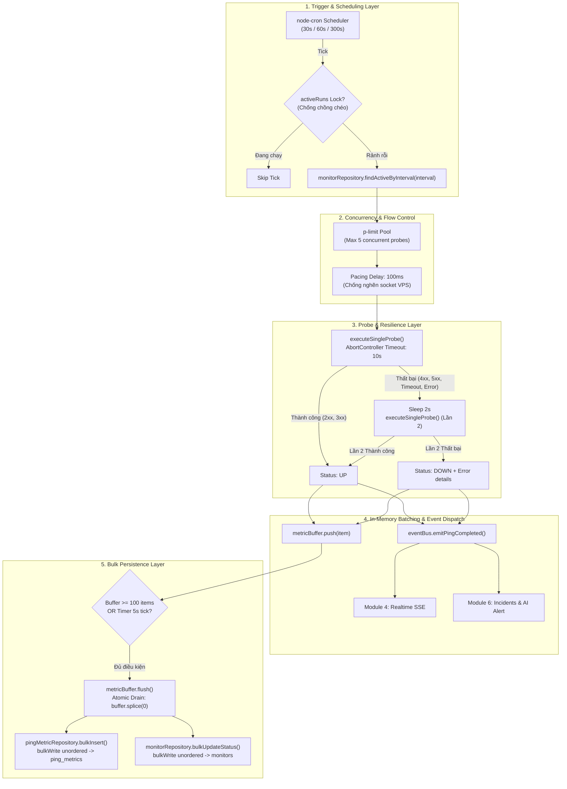
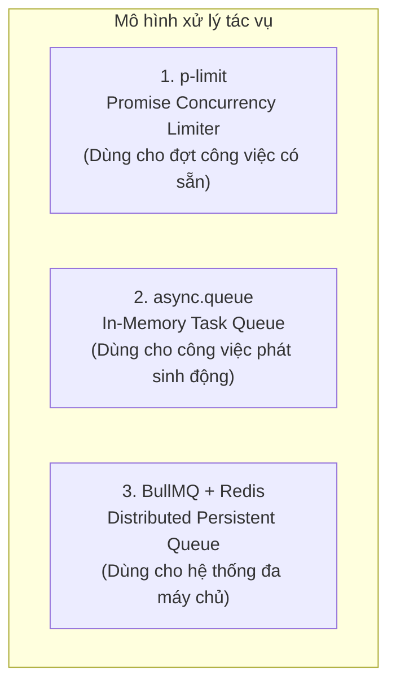
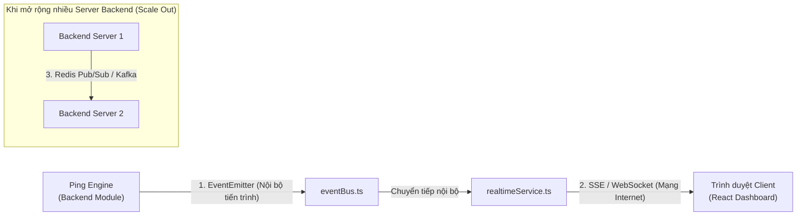

# Ping Engine Architecture, Concurrency Control, and Batch Processing

Tài liệu thiết kế kỹ thuật chuyên sâu về cấu trúc vận hành, luồng xử lý mã nguồn chi tiết từng bước, phân tích so sánh các mô hình truyền tin bất đồng bộ và các nguyên lý kiến trúc của **Module 3: Ping Engine** trong hệ thống DevPulse.

---

## 1. System Architecture and Lifecycle Topology

Ping Engine là một **tiến trình nền (Background Daemon Engine)** chạy độc lập bên trong tiến trình Node.js, hoạt động 24/7 theo chu kỳ thời gian thực mà không phụ thuộc vào request từ người dùng.



---

## 2. Step-by-Step Code-Driven Execution Flow

Dưới đây là hành trình chi tiết của một chu kỳ ping, đi qua từng file mã nguồn, kèm các đoạn trích dẫn code thực tế và chú thích kỹ thuật.

### Bước 1: Khởi động Engine trong vòng đời ứng dụng
Tại [`src/server.ts`](../backend/src/server.ts), ngay sau khi kết nối cơ sở dữ liệu MongoDB thành công, tiến trình `pingEngine.start()` được kích hoạt để nạp các tác vụ lập lịch vào Event Loop.

```typescript
// File: src/server.ts
async function bootstrap(): Promise<void> {
  await connectDatabase();

  // Start periodic ping engine schedulers and metric buffer flush timer
  pingEngine.start();

  const app = createApp();
  const server = app.listen(env.PORT, () => {
    console.log(`[Server] DevPulse Backend running on port ${env.PORT}`);
  });
  // ...
}
```

---

### Bước 2: Kích hoạt chu kỳ lập lịch và Cơ chế chống chồng chéo (Overlap Protection)
Tại [`src/services/pingEngine.ts`](../backend/src/services/pingEngine.ts), bộ lập lịch khởi tạo 3 cron task tương ứng với các chu kỳ `30s`, `60s`, `300s`, đồng thời bật bộ đếm thời gian 5 giây của RAM buffer.

```typescript
// File: src/services/pingEngine.ts
start(): void {
  if (this.isRunning) return;
  this.isRunning = true;
  metricBuffer.startTimer();

  // 1. Chu kỳ 30 giây (chạy tại giây :00 và :30)
  const task30s = cron.schedule('*/30 * * * * *', async () => {
    await this.runIntervalCycle(30);
  });

  // 2. Chu kỳ 60 giây (chạy tại giây :00 mỗi phút)
  const task60s = cron.schedule('0 * * * * *', async () => {
    await this.runIntervalCycle(60);
  });

  // 3. Chu kỳ 300 giây (chạy mỗi 5 phút)
  const task300s = cron.schedule('0 */5 * * * *', async () => {
    await this.runIntervalCycle(300);
  });

  this.tasks = [task30s, task60s, task300s];
}
```

Khi cron tick, hàm `runIntervalCycle` kiểm tra cờ `activeRuns`. Nếu chu kỳ trước của cùng interval đó vẫn đang xử lý dở dang (ví dụ do mạng bên ngoài phản hồi chậm), hệ thống lập tức bỏ qua lượt tick này để tránh hiện tượng dồn ứ tác vụ làm cạn kiệt tài nguyên VPS:

```typescript
// File: src/services/pingEngine.ts
private async runIntervalCycle(interval: 30 | 60 | 300): Promise<void> {
  // Prevent overlapping execution cycles if previous cycle is still ongoing
  if (this.activeRuns.get(interval)) {
    console.warn(`[PingEngine] Previous cycle for interval ${interval}s is still running. Skipping.`);
    return;
  }

  this.activeRuns.set(interval, true);

  try {
    // Truy vấn qua Repository: lấy các monitor đang bật có interval tương ứng
    const activeMonitors = await monitorRepository.findActiveByInterval(interval);
    if (activeMonitors.length === 0) return;

    // Bọc this.limit ở ngoài để chặn không cho cả 100 promises chạy cùng lúc.
    // p-limit chỉ cho tối đa 5 tasks chạy đồng thời, các task còn lại xếp hàng trong queue.
    const pingPromises = activeMonitors.map((monitor) =>
      this.limit(async () => {
        // Nhịp nghỉ 100ms: mỗi task khi được bốc khỏi queue sẽ ngủ 100ms trước khi bắn HTTP probe
        await new Promise((resolve) => setTimeout(resolve, this.pacingDelayMs));
        await this.processSingleMonitor(monitor);
      })
    );

    // Chờ toàn bộ các task (cả đang chạy lẫn trong hàng chờ của p-limit) cuốn chiếu hoàn tất
    await Promise.allSettled(pingPromises);
  } finally {
    // Mở khóa để chu kỳ kế tiếp được phép kích hoạt
    this.activeRuns.set(interval, false);
  }
}
```

---

### Bước 3: Kiểm soát đồng thời (Concurrency Control) và Nhịp nghỉ (Pacing Delay)
* **Cơ chế hoạt động của `this.limit` kết hợp `map` và `Promise.allSettled`:**
  * Bình thường, nếu dùng `.map(async () => ...)` thuần túy, JavaScript sẽ kích hoạt toàn bộ 100 requests cùng lúc trong 1ms.
  * Khi bọc `this.limit(async () => ...)`, `p-limit(5)` đóng vai trò người gác cổng (Semaphore): Nó lập tức cho 5 task đầu tiên thực thi, còn task 6 đến 100 bị đẩy vào mảng chờ nội bộ (`queue`).
  * `Promise.allSettled(pingPromises)` sẽ chờ toàn bộ mảng hoàn thành, nhưng tiến trình chạy thực tế diễn ra theo kiểu **cuốn chiếu**: Cứ 1 trong 5 task đang chạy nhận response xong $\rightarrow$ slot đó trống $\rightarrow$ `p-limit` lập tức rút 1 task mới từ queue vào thế chỗ.
* **Cơ chế nhịp nghỉ (Pacing Delay `100ms`):**
  * Đặt `await setTimeout(100ms)` ở đầu hàm task: Mỗi khi một task mới được rút từ queue vào slot chạy, nó sẽ "hít một nhịp" 100ms rồi mới gửi HTTP request. Điều này giúp các đợt bắn request không bị giẫm chân lên nhau và làm mịn đồ thị lưu lượng mạng của VPS.

---

### Bước 4: Đo đạc mạng và Phòng vệ Timeout (Single Probe Execution)
Tại [`src/services/pingExecutor.ts`](../backend/src/services/pingExecutor.ts), hàm `executeSingleProbe` thực hiện request mạng thực tế. Một `AbortController` được gắn kèm để đảm bảo request không bao giờ bị treo quá 10 giây:

```typescript
// File: src/services/pingExecutor.ts
private async executeSingleProbe(monitor: IMonitor): Promise<PingExecutionResult> {
  // Guard ngắt kết nối cưỡng chế sau 10 giây nếu server đối phương không phản hồi
  const controller = new AbortController();
  const timeout = setTimeout(() => controller.abort(), 10000);
  const startTime = Date.now();

  const headersRecord = Object.fromEntries(monitor.headers);

  let statusCode = 0;
  let isUp = false;
  let errorMessage: string | undefined;

  try {
    const response = await fetch(monitor.url, {
      method: monitor.method || 'GET',
      headers: headersRecord,
      signal: controller.signal, // Gắn abort signal
    });

    statusCode = response.status;
    // 2xx và 3xx được định nghĩa là hệ thống hoạt động bình thường (UP)
    isUp = statusCode >= 200 && statusCode < 400;

    if (!isUp) {
      errorMessage = `HTTP status code ${statusCode}`;
    }
  } catch (error: unknown) {
    isUp = false;
    if (error instanceof Error) {
      if (error.name === 'AbortError') {
        statusCode = 408;
        errorMessage = 'ETIMEDOUT'; // Quá 10s không phản hồi
      } else if ('code' in error && typeof error.code === 'string') {
        errorMessage = error.code; // ENOTFOUND (sai DNS), ECONNREFUSED (từ chối cổng)
      } else {
        errorMessage = error.message;
      }
    }
  } finally {
    // Luôn dọn dẹp timer để tránh rò rỉ bộ nhớ (memory leak) trên Node Event Loop
    clearTimeout(timeout);
  }

  // Set latency to 0 for unestablished connections (DNS failure or connection refused) per system spec
  const latency = statusCode === 0 ? 0 : Math.max(1, Date.now() - startTime);

  return {
    statusCode,
    latency,
    isUp,
    error: errorMessage,
    checkedAt: new Date(),
  };
}
```

---

### Bước 5: Cơ chế Thử lại Nhanh chống báo động giả (Fast Retest Pattern)
Khi một website trả về lỗi (4xx, 5xx, timeout hoặc đứt mạng), thay vì vội vàng kết luận là website đã sập, hàm `pingTarget` dừng 2 giây rồi thử lại thêm 1 lần duy nhất:

```typescript
// File: src/services/pingExecutor.ts
async pingTarget(monitor: IMonitor): Promise<PingExecutionResult> {
  const firstAttempt = await this.executeSingleProbe(monitor);

  // Nếu lần đầu thành công, trả về kết quả UP ngay lập tức
  if (firstAttempt.isUp) {
    return firstAttempt;
  }

  // Tạm dừng 2 giây để loại trừ hiện tượng rớt gói tin nhất thời của hạ tầng mạng
  await new Promise((resolve) => setTimeout(resolve, 2000));

  // Thử lại lần thứ 2: nếu lần này thành công thì ghi nhận UP, nếu vẫn lỗi mới chốt DOWN
  const retryAttempt = await this.executeSingleProbe(monitor);
  return retryAttempt;
}
```

---

### Bước 6: Đẩy dữ liệu vào Đệm RAM và Bắn sự kiện nội bộ
Tại `pingEngine.processSingleMonitor`, kết quả đo lường được chuyển tiếp đồng thời sang 2 kênh độc lập:
1. Đẩy vào bể chứa RAM `metricBuffer.push(...)` để chờ ghi đĩa hàng loạt.
2. Phát loa qua `eventBus.emitPingCompleted(...)` để các module khác nhận dữ liệu thời gian thực.

```typescript
// File: src/services/pingEngine.ts
async recordPingResult(monitor: IMonitor, result: PingExecutionResult): Promise<void> {
  // 1. Đưa bản ghi vào bộ đệm RAM để gom batch ghi DB
  await metricBuffer.push({
    timestamp: result.checkedAt,
    monitorId: monitor._id,
    statusCode: result.statusCode,
    latency: result.latency,
    isUp: result.isUp,
    error: result.error,
  });

  // 2. Bắn sự kiện nội bộ ra Event Bus (cho Realtime SSE và Incidents module)
  eventBus.emitPingCompleted({
    monitorId: monitor._id.toString(),
    userId: monitor.userId.toString(),
    statusCode: result.statusCode,
    latency: result.latency,
    isUp: result.isUp,
    timestamp: result.checkedAt.toISOString(),
    error: result.error,
  });
}

async processSingleMonitor(monitor: IMonitor): Promise<void> {
  try {
    const result = await pingExecutor.pingTarget(monitor);
    await this.recordPingResult(monitor, result);
  } catch (error) {
    console.error(`[PingEngine] Failed to process monitor ${monitor._id}:`, error);
  }
}
```

---

### Bước 7: Cơ chế Xả đệm RAM hàng loạt (BulkWrite Persistence Flow)
Tại [`src/services/metricBuffer.ts`](../backend/src/services/metricBuffer.ts), hàm `flush()` thực thi việc giải phóng RAM xuống MongoDB khi đạt **100 bản ghi** hoặc sau **mỗi 5 giây**:

```typescript
// File: src/services/metricBuffer.ts
async flush(): Promise<number> {
  // Chống race condition: nếu đang có tiến trình xả hoặc buffer rỗng thì dừng
  if (this.isFlushing || this.buffer.length === 0) return 0;

  this.isFlushing = true;
  // Bốc toàn bộ items hiện có trong buffer ra một mảng riêng và làm rỗng buffer ngay lập tức
  const itemsToFlush = this.buffer.splice(0);

  try {
    // 1. Chèn hàng loạt metrics vào MongoDB Time-Series collection
    await pingMetricRepository.bulkInsert(itemsToFlush);

    // 2. Gom trạng thái mới nhất của từng monitor trong batch
    const latestUpdates = new Map<string, { status: MonitorStatus; lastCheckedAt: Date }>();
    for (const item of itemsToFlush) {
      latestUpdates.set(item.monitorId.toString(), {
        status: item.isUp ? 'up' : 'down',
        lastCheckedAt: item.timestamp,
      });
    }

    // 3. Cập nhật đồng loạt các monitor thông qua Repository
    if (latestUpdates.size > 0) {
      await monitorRepository.bulkUpdateStatus(latestUpdates);
    }

    this.lastFlushAt = new Date();
    return itemsToFlush.length;
  } catch (error) {
    // Nếu MongoDB gặp lỗi: nhét ngược dữ liệu lại vào đầu mảng để không làm mất bản ghi
    this.buffer.unshift(...itemsToFlush);
    console.error('[MetricBuffer] Error during metric bulkWrite flush:', error);
    return 0;
  } finally {
    this.isFlushing = false;
  }
}
```

Tại tầng Repository, thao tác ghi dùng chế độ `{ ordered: false }` để nếu 1 bản ghi bị lỗi định dạng thì các bản ghi còn lại vẫn được lưu bình thường:

```typescript
// File: src/repositories/pingMetricRepository.ts
async bulkInsert(metrics: CreatePingMetricDto[]): Promise<number> {
  const operations = metrics.map((metric) => ({
    insertOne: {
      document: {
        timestamp: metric.timestamp,
        monitorId: new Types.ObjectId(metric.monitorId),
        statusCode: metric.statusCode,
        latency: metric.latency,
        isUp: metric.isUp,
        error: metric.error || null,
      },
    },
  }));

  // Ghi không tuần tự để tối ưu tốc độ và không gián đoạn toàn bộ đợt ghi khi 1 record lỗi
  const result = await this.model.bulkWrite(operations, { ordered: false });
  return result.insertedCount || 0;
}
```

---

### Bước 8: Tắt máy an toàn (Graceful Shutdown Protocol)
Tại [`src/server.ts`](../backend/src/server.ts), khi VPS nhận tín hiệu `SIGTERM` hoặc `SIGINT` (lúc restart container hoặc deploy mã mới):
1. Gọi `await pingEngine.stop()`:
   * Dừng các cron tasks (ngừng nhận lượt ping mới).
   * Dừng timer 5s.
   * Kích hoạt `metricBuffer.flush()` để **xả sạch toàn bộ những gì còn sót lại trên RAM xuống MongoDB**.
2. Đóng HTTP server (`server.close()`).
3. Ngắt kết nối cơ sở dữ liệu (`disconnectDatabase()`).
4. Kết thúc tiến trình Node.js an toàn với mã `0`.

---

## 3. Libraries and Core Technical Patterns

| Thư viện / Kỹ thuật | Trách nhiệm chính | Lý do chọn lựa & Giá trị kỹ thuật |
| :--- | :--- | :--- |
| **`node-cron`** | Lập lịch chu kỳ (30s, 60s, 300s). | Hỗ trợ định dạng 6 trường (bao gồm cả giây `*/30 * * * * *`), cú pháp trực quan, nhẹ hơn việc tự viết vòng lặp `setInterval` phức tạp. |
| **`p-limit`** | Giới hạn concurrency cố định = 5. | Giải quyết bài toán cạn kiệt socket mạng của OS. Tránh việc dùng `Promise.all` không kiểm soát làm sập máy chủ khi danh sách monitor tăng cao. |
| **`AbortController`** | Ngắt kết nối mạng cưỡng chế sau 10s. | Chuẩn hiện đại của Node.js fetch API, ngăn chặn triệt để tình trạng connection treo vĩnh viễn (hanging sockets) làm rò rỉ RAM và file descriptors. |
| **In-Memory RAM Buffer** | Gom cụm dữ liệu tạm thời trước khi ghi đĩa. | Giảm số lần thao tác I/O xuống MongoDB hơn 90%. Thay vì 100 lần ghi đĩa đơn lẻ, hệ thống chỉ ghi 1 lần. |
| **MongoDB Time-Series** | Lưu trữ lịch sử ping metrics (`ping_metrics`). | Cấu trúc chuyên biệt nén theo cột (columnar compression), tự động tạo bucket theo thời gian, tiết kiệm tới 70% dung lượng đĩa và tích hợp sẵn TTL Index tự xóa sau 7 ngày. |
| **`bulkWrite({ ordered: false })`** | Ghi nhiều bản ghi trong 1 round-trip mạng. | Bắn một payload duy nhất qua socket MongoDB, chế độ `ordered: false` giúp tối ưu song song hóa trên database engine. |

---

## 4. Deep-Dive: Phân Biệt Các Cơ Chế Đồng Thời & Truyền Tin (Concurrency & Event Spectrum)

Các công nghệ bất đồng bộ thường bị xếp lẫn lộn vào nhau dù chúng giải quyết 2 bài toán hoàn toàn khác nhau:
1. **Nhóm A: Điều tiết đồng thời & Hàng đợi thực thi tác vụ (Task Execution & Concurrency Control):** `p-limit` vs `async.queue` vs `BullMQ + Redis`.
2. **Nhóm B: Giao tiếp sự kiện & Truyền phát dữ liệu (Event-Driven Communication & Streaming):** `EventEmitter` vs `SSE / WebSocket` vs `Redis Pub/Sub / Kafka`.

---

### Phân Nhóm A: Điều Tiết Đồng Thời & Hàng Đợi Tác Vụ

Nhóm này giải quyết bài toán: *"Tôi có một lượng công việc cần làm, làm sao để giới hạn số lượng việc chạy cùng lúc nhằm bảo vệ CPU, RAM và đường truyền mạng?"*



#### Bảng So Sánh Chi Tiết: `p-limit` vs `async.queue` vs `BullMQ`

| Tiêu chí | `p-limit` (Dùng trong Ping Engine) | `async.queue` (Dùng trong Email OTP) | `BullMQ + Redis` (Dự án TicketBox) |
| :--- | :--- | :--- | :--- |
| **Bản chất kỹ thuật** | **Promise Semaphore / Throttler**: Bọc ngoài các hàm Promise có sẵn để giới hạn số lượng Promise chạy cùng lúc. | **In-Memory Task Queue**: Hàng đợi công việc chạy ngầm trên RAM với worker pool chuyên dụng. | **Distributed Work Queue**: Hàng đợi phân tán lưu trữ trạng thái trên Redis. |
| **Đặc thù đầu vào** | **Tập hợp tĩnh theo đợt (Batch/Array-oriented)**: Nhận một mảng công việc đã biết trước số lượng (ví dụ 50 monitors đến hạn cùng lúc qua cron tick). | **Phát sinh động theo thời gian (Dynamic Push)**: Các job đến rải rác bất kỳ lúc nào từ người dùng (`queue.push()` khi có user đăng ký, quên pass). | **Phát sinh động phân tán**: Các job đến từ nhiều cụm server API khác nhau ném chung vào 1 Redis. |
| **Vòng đời quản lý** | Tạm thời theo vòng đời của mảng Promise. Xong toàn bộ mảng là kết thúc. | Thường trực 24/7. Worker pool luôn túc trực lắng nghe job mới, có sự kiện `drain`, `empty`, `error`. | Thường trực 24/7. Hỗ trợ Worker Process riêng biệt, Dashboard quản trị Bull-Board. |
| **Khi Server Crash** | Mất đợt chạy hiện tại (chu kỳ cron kế tiếp sẽ tự động chạy bù). | Mất các email đang chờ trong RAM (chấp nhận được với OTP vì user có nút gửi lại). | **Không mất job** (Redis lưu vào ổ đĩa qua AOF/RDB, server bật lại worker tiếp tục xử lý). |
| **Tính năng nâng cao** | Không có retry tự động hay delay (phải tự viết mã bên trong task). | Hỗ trợ retry, kiểm soát concurrency (`concurrency = 2`), pause/resume queue. | Hỗ trợ Delayed Jobs (hẹn 15 phút sau chạy), Exponential Backoff, Dead-Letter Queue (DLQ). |
| **Chi phí hạ tầng** | **0 MB RAM**, 0 phụ thuộc thư viện nặng. | **~1 MB RAM**, 0 network overhead. | Cần thêm 1 container Redis (**~30–80 MB RAM**). |

---

### Phân Nhóm B: Giao Tiếp Sự Kiện & Truyền Phát Dữ Liệu

Nhóm này giải quyết bài toán: *"Một sự kiện vừa diễn ra, làm sao để thông báo cho các bên quan tâm (Subscribers) biết mà không làm các module bị phụ thuộc chặt vào nhau?"*



#### Bảng So Sánh Chi Tiết: `EventEmitter` vs `SSE / WebSocket` vs `Message Broker`

| Tiêu chí | `EventEmitter` (Dùng trong DevPulse) | `SSE / WebSocket` (Module Realtime) | `Redis Pub/Sub / Apache Kafka` (Hệ thống lớn) |
| :--- | :--- | :--- | :--- |
| **Phạm vi giao tiếp** | **Nội bộ trong cùng 1 tiến trình Node.js (In-Process / Inter-Module)**. | **Từ máy chủ Backend xuống trình duyệt người dùng (Server-to-Client)**. | **Giữa các máy chủ Backend / Microservices khác nhau qua mạng (Inter-Service)**. |
| **Giao thức vận chuyển** | Gọi hàm JavaScript trực tiếp trong RAM (Observer Pattern). Không qua mạng. | Giao thức HTTP Streaming (`text/event-stream`) hoặc TCP Socket hai chiều (`ws://`). | Giao thức mạng TCP nhị phân chuyên biệt của Broker (Kafka Protocol / RESP). |
| **Độ trễ (Latency)** | **Gần như bằng 0 (Micro-seconds)**. | Phụ thuộc tốc độ mạng Internet (~20ms – 100ms). | Phụ thuộc độ trễ mạng nội bộ cụm máy chủ (~1ms – 5ms). |
| **Mục đích sử dụng** | **Tách rời mã nguồn (Decoupling)**: Ping Engine không cần import SSE Service; nó chỉ phát loa `emit()`, module nào cần thì tự `on()`. | **Cập nhật giao diện người dùng thời gian thực**: Đẩy biểu đồ ping và trạng thái xanh/đỏ về màn hình mà không cần F5. | **Đồng bộ trạng thái giữa các server**: Khi Server 1 ping xong, muốn Server 2 và Server 3 cùng biết để cập nhật bộ nhớ cache phân tán. |

---

### Mối Quan Hệ Phối Hợp Giữa `EventEmitter` và `SSE` Trong DevPulse

Hai công cụ này không hề cạnh tranh nhau mà là **hai nửa của một chuỗi truyền tin**:
1. **Nửa thứ nhất (Nội bộ Backend):** `pingEngine` đo đạc xong $\rightarrow$ gọi `eventBus.emitPingCompleted(...)` (dùng **`EventEmitter`**).
2. **Nửa thứ hai (Backend ra Frontend):** `realtimeService` đăng ký `eventBus.onPingCompleted(...)` $\rightarrow$ mỗi khi có sự kiện sẽ lấy payload đó ghi vào response stream HTTP của client (**`Server-Sent Events - SSE`**).

Nhờ kiến trúc này, Ping Engine hoàn toàn không biết và không quan tâm giao diện người dùng dùng SSE, WebSocket hay Polling.

---

### Chiến Lược Lựa Chọn Kiến Trúc Cho DevPulse (CV Interview Defense)

> *"Tại sao bạn không dùng Redis Pub/Sub hay BullMQ cho DevPulse mà lại kết hợp `p-limit` + `async.queue` + `EventEmitter`?"*

#### Luận điểm bảo vệ khi phỏng vấn:
1. **Đúng bài toán, đúng công cụ (Right Tool for the Right Job):**
   * **Với lượt kiểm tra định kỳ (Batch Tasks):** `p-limit` phù hợp hơn hàng đợi vì chu kỳ cron đã nắm sẵn danh sách 50 monitors; việc tạo thêm job trong Redis rồi lấy ra là bước trung gian thừa thãi.
   * **Với gửi email OTP (Dynamic Tasks):** `async.queue` xử lý gọn gàng lượng request vừa phải trên RAM mà không cần dựng thêm Redis.
   * **Với thông báo nội bộ:** `EventEmitter` cung cấp hiệu năng cực đại với 0MB RAM phụ trợ.
2. **Tối ưu hóa tài nguyên phần cứng (Resource Efficiency):**
   * Hệ thống được triển khai trên **VPS 1 vCPU / 1GB RAM**. Việc loại bỏ Redis giúp tiết kiệm ~80MB RAM cho hệ điều hành và MongoDB WiredTiger cache, giữ hệ thống chạy ổn định tuyệt đối mà không sợ OOM.
3. **Sự bổ trợ hoàn hảo giữa 2 dự án trên CV:**
   * **Project 2 (TicketBox):** Thể hiện năng lực về hệ thống phân tán phức tạp: *NestJS, Redis Lua Scripts, BullMQ, Idempotency, Circuit Breaker*.
   * **Project 1 (DevPulse):** Thể hiện năng lực làm chủ kiến trúc lõi Node.js: *In-Memory Batching, Event-Driven Architecture, Concurrency Throttling, High-Performance I/O*.
   * Hai dự án tạo nên hình ảnh một kỹ sư toàn diện: vừa biết làm Distributed Systems quy mô lớn, vừa biết tối ưu tài nguyên tinh gọn ở cấp độ tiến trình đơn lẻ.

---

## 5. Architectural FAQs & Core Technical Decisions

### Câu hỏi 1: Tại sao `pingExecutor` chỉ thử lại 1 lần sau 2 giây mà không dùng Exponential Backoff?
* **Bản chất của Health Checker:** Cần phản hồi nhanh trong chu kỳ ngắn (`30s`). Nếu áp dụng Exponential Backoff (chờ 2s, 4s, 8s, 16s), tiến trình thử lại sẽ kéo dài vượt quá 30 giây, làm chiếm dụng pool `p-limit(5)` và đè sang chu kỳ tiếp theo, gây tắc nghẽn toàn bộ hàng đợi ping của hệ thống.
* **Bảo toàn dữ liệu SLA trên Dashboard:** Nếu lần 1 lỗi mà lần 2 thành công, hệ thống coi như mục tiêu vẫn hoạt động bình thường. Nếu lưu lần 1 là "DOWN" vào biểu đồ chuỗi thời gian, biểu đồ của khách hàng sẽ bị sụt giảm ảo (False Positive Dip), làm sai lệch chỉ số cam kết Uptime 99.9%.

---

### Câu hỏi 2: Tại sao trong `monitorService.ts` cập nhật `monitor.save()` ngay lập tức, còn `metricBuffer` lại chờ flush mới cập nhật?
* **Scheduler chạy ngầm (`metricBuffer`):** Hoạt động theo mô hình **Batch Processing & Eventual Consistency (Nhất quán sau vài giây)**. Hàng trăm monitor chạy 24/7, nếu mỗi lần ping đều gọi `updateOne` thì database sẽ bị nghẽn I/O. Vì vậy, gom cập nhật bằng một lệnh `bulkWrite` duy nhất sau 5 giây là chuẩn mực tối ưu.
* **Nút bấm "Check Now" (`monitorService.ts`):** Hoạt động theo mô hình **Interactive Request & Read-After-Write Consistency (Nhất quán đọc-ghi tức thì)**. Người dùng đang nhìn vào màn hình và chờ kết quả trả về. Nếu không lưu trạng thái vào database ngay mà bắt chờ 5 giây sau buffer mới xả, thì ngay sau khi bấm nút, nếu người dùng tải lại trang sẽ vẫn thấy dữ liệu cũ, gây cảm giác ứng dụng bị đơ hoặc lỗi tính năng.

