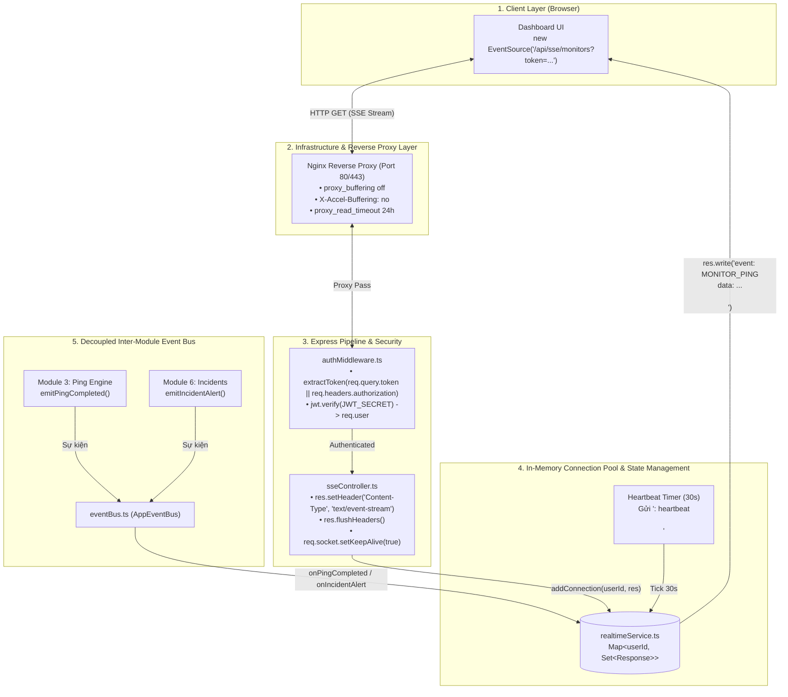

# Real-Time Event Streaming Architecture via Server-Sent Events (SSE)

Tài liệu thiết kế kỹ thuật chuyên sâu về cấu trúc vận hành, luồng xử lý mã nguồn chi tiết từng bước, phân tích so sánh các giao thức truyền tin thời gian thực và cấu hình hạ tầng Nginx/DevOps của **Module 4: Realtime** trong hệ thống DevPulse.

---

## 1. System Architecture and Event Stream Topology

Mô-đun Realtime chịu trách nhiệm thiết lập và duy trì kênh truyền phát dữ liệu một chiều (Unidirectional Streaming) từ máy chủ Node.js đến trình duyệt của người dùng thông qua giao thức **Server-Sent Events (SSE)** chuẩn hóa theo đặc tả W3C / WHATWG HTML5.


---

## 2. Step-by-Step Code-Driven Execution Flow

Dưới đây là hành trình chi tiết của một kết nối SSE, từ lúc client gửi request bắt tay, qua cơ chế xác thực token, nạp vào bể chứa kết nối trên RAM, truyền phát sự kiện từ Ping Engine, đến khi dọn dẹp sạch sẽ tài nguyên.

---

### Bước 1: Vượt qua rào cản xác thực của Native Browser `EventSource`
Trong trình duyệt, API chuẩn `window.EventSource` **hoàn toàn không hỗ trợ gắn custom HTTP headers** (như `Authorization: Bearer <token>`). Mặt khác, hệ thống DevPulse sử dụng kiến trúc **Dual Token**:
* `refreshToken`: Lưu trong HttpOnly Cookie (chỉ dùng cho endpoint xoay vòng token `/api/auth/refresh-token`).
* `accessToken`: Lưu trên bộ nhớ RAM của ứng dụng React để phòng chống tấn công XSS.

Để giải quyết bài toán này theo chuẩn công nghiệp, middleware [`src/middlewares/authMiddleware.ts`](../backend/src/middlewares/authMiddleware.ts) hỗ trợ trích xuất Access Token linh hoạt từ cả Header lẫn Query Parameter:

```typescript
// File: src/middlewares/authMiddleware.ts
export function authenticate(req: Request, _res: Response, next: NextFunction): void {
  const token = extractToken(req);

  if (!token) {
    next(new AppError('Authentication token required', 401));
    return;
  }

  try {
    const decoded = jwt.verify(token, env.JWT_SECRET) as JwtPayloadDecoded;
    req.user = {
      id: decoded.id,
      role: decoded.role,
    } as AuthenticatedUserPayload;
    next();
  } catch {
    next(new AppError('Invalid or expired authentication token', 401));
  }
}

// Extract token from Authorization header or query parameter (for SSE EventSource)
function extractToken(req: Request): string | undefined {
  // 1. Ưu tiên Bearer token chuẩn cho các REST API calls thông thường
  if (req.headers.authorization && req.headers.authorization.startsWith('Bearer ')) {
    return req.headers.authorization.substring(7);
  }
  // 2. Dự phòng qua query param cho EventSource streaming của trình duyệt
  if (typeof req.query.token === 'string' && req.query.token.length > 0) {
    return req.query.token;
  }
  return undefined;
}
```

* **Cơ chế Fail-fast:** Nếu người dùng chưa đăng nhập hoặc token đã hết hạn, request bị từ chối ngay tại cửa với mã `HTTP 401 Unauthorized` dưới dạng JSON thông thường trước khi chạm vào bất kỳ logic stream nào.

---

### Bước 2: Thiết lập luồng phản hồi SSE & Vô hiệu hóa bộ đệm (Anti-Buffering)
Khi request hợp lệ đi qua middleware xác thực và vào [`src/controllers/sseController.ts`](../backend/src/controllers/sseController.ts), máy chủ khởi tạo các tiêu đề phản hồi đặc thù của giao thức Server-Sent Events:

```typescript
// File: src/controllers/sseController.ts
export function subscribeMonitors(req: Request, res: Response): void {
  const userId = req.user!.id;

  // 1. Thiết lập các headers bắt buộc của giao thức SSE
  res.setHeader('Content-Type', 'text/event-stream');
  res.setHeader('Cache-Control', 'no-cache, no-transform');
  res.setHeader('Connection', 'keep-alive');
  // Vô hiệu hóa bộ đệm Nginx proxy buffering
  res.setHeader('X-Accel-Buffering', 'no');

  // 2. Giữ kết nối TCP luôn mở và loại bỏ timeout mặc định của socket
  req.socket.setKeepAlive(true);
  req.socket.setTimeout(0);

  // 3. Ép xả headers lập tức về client để hoàn tất bắt tay HTTP
  res.flushHeaders();

  // 4. Đăng ký luồng kết nối vào Connection Pool trên RAM
  realtimeService.addConnection(userId, res);

  // 5. Gửi sự kiện chào mừng xác nhận kết nối thành công
  const initialPayload: SseConnectedEvent = {
    type: 'CONNECTED',
    userId,
    connectedAt: new Date().toISOString(),
  };
  res.write(`event: CONNECTED\ndata: ${JSON.stringify(initialPayload)}\n\n`);

  // 6. Lắng nghe sự kiện ngắt kết nối từ phía client
  req.on('close', () => {
    realtimeService.removeConnection(userId, res);
  });
}
```

* **Tại sao phải có `X-Accel-Buffering: no`?** Khi chạy sau Nginx Reverse Proxy, mặc định Nginx sẽ gom dữ liệu vào bộ đệm (buffer 4KB–8KB) rồi mới gửi một thể. Header này yêu cầu Nginx chuyển tiếp ngay từng byte dữ liệu đến trình duyệt mà không được giữ lại.
* **Tại sao phải gọi `res.flushHeaders()`?** Đảm bảo mã phản hồi `HTTP 200 OK` cùng các header được gửi đi ngay lập tức, chuyển trạng thái của `EventSource` trên trình duyệt sang `OPEN` (readyState = 1).

---

### Bước 3: Quản lý kết nối trên RAM (In-Memory Connection Pool)
Tại [`src/services/realtimeService.ts`](../backend/src/services/realtimeService.ts), toàn bộ các luồng socket đang mở được quản lý bằng cấu trúc `Map<string, Set<Response>>`:

```typescript
// File: src/services/realtimeService.ts
export class RealtimeService {
  // Key: userId, Value: Tập hợp các đối tượng Response HTTP đang kết nối
  private connections: Map<string, Set<Response>> = new Map();
  private heartbeatTimer: NodeJS.Timeout | null = null;
  private readonly heartbeatIntervalMs = 30000;

  // Đăng ký luồng phản hồi mới cho người dùng
  addConnection(userId: string, res: Response): void {
    let clientSet = this.connections.get(userId);
    if (!clientSet) {
      clientSet = new Set<Response>();
      this.connections.set(userId, clientSet);
    }
    clientSet.add(res);
  }

  // Dọn dẹp luồng phản hồi khi ngắt kết nối (Độ phức tạp O(1))
  removeConnection(userId: string, res: Response): void {
    const clientSet = this.connections.get(userId);
    if (!clientSet) return;

    clientSet.delete(res);
    // Nếu user không còn tab nào mở, xóa luôn key userId để giải phóng hoàn toàn RAM
    if (clientSet.size === 0) {
      this.connections.delete(userId);
    }
  }
}
```

* **Hỗ trợ Multi-tab:** Một người dùng có thể mở đồng thời 3–4 tab trình duyệt trên nhiều thiết bị. Việc dùng `Set<Response>` cho phép phát sóng đồng thời đến tất cả các tab của người đó.
* **Nguyên tắc giải phóng bộ nhớ (Zero Memory Leak):** Khi một tab đóng lại, hàm `removeConnection` xóa phần tử khỏi `Set`. Khi `clientSet.size === 0`, key `userId` bị xóa sổ hoàn toàn khỏi `Map`, không để lại bất kỳ đối tượng rác nào trong Garbage Collector của V8.

---

### Bước 4: Tiếp nhận sự kiện từ Ping Engine & Phát sóng dữ liệu
Khi một monitor hoàn thành kiểm tra độ trễ mạng trong [`src/services/pingEngine.ts`](../backend/src/services/pingEngine.ts), nó chỉ việc gọi `eventBus.emitPingCompleted(...)`.

Dịch vụ Realtime đã đăng ký sẵn listener trong hàm khởi tạo:

```typescript
// File: src/services/realtimeService.ts
private registerEventBusListeners(): void {
  // Lắng nghe sự kiện kiểm tra ping hoàn tất
  eventBus.onPingCompleted((payload: PingCompletedEvent) => {
    this.broadcastMonitorPing(payload);
  });

  // Lắng nghe sự kiện sự cố hệ thống (phục vụ Module 6)
  eventBus.onIncidentAlert((payload: IncidentAlertEvent) => {
    this.broadcastIncidentAlert(payload);
  });
}
```

Hàm `broadcastMonitorPing` thực thi việc cách ly dữ liệu giữa các người dùng (Tenant Isolation):

```typescript
// File: src/services/realtimeService.ts
broadcastMonitorPing(payload: PingCompletedEvent): void {
  // Chỉ tìm các kết nối của đúng chủ sở hữu mục tiêu này
  const clientSet = this.connections.get(payload.userId);
  if (!clientSet || clientSet.size === 0) {
    return;
  }

  // Đóng gói payload đúng theo đặc tả spec/realtime.md
  const eventData: SseMonitorPingEvent = {
    type: 'MONITOR_PING',
    monitorId: payload.monitorId,
    statusCode: payload.statusCode,
    latency: payload.latency,
    isUp: payload.isUp,
    timestamp: payload.timestamp,
  };

  if (payload.error) {
    eventData.error = payload.error;
  }

  // Định dạng khối văn bản chuẩn Server-Sent Events
  const message = `event: MONITOR_PING\ndata: ${JSON.stringify(eventData)}\n\n`;

  // Bắn dữ liệu xuống từng stream đang mở của người dùng đó
  for (const res of clientSet) {
    if (!res.writableEnded) {
      res.write(message);
    }
  }
}
```

* **Định dạng SSE chuẩn:** Khối tin bắt buộc kết thúc bằng **2 dấu xuống dòng liên tiếp (`\n\n`)**.
  * Dòng 1: `event: MONITOR_PING\n` chỉ định tên sự kiện để trình duyệt bắt qua `eventSource.addEventListener('MONITOR_PING', ...)`.
  * Dòng 2: `data: {"type":"MONITOR_PING", ...}\n\n` chứa nội dung chuỗi JSON.
* **Bảo mật cách ly tuyệt đối:** Nếu Monitor A thuộc về User 1, dữ liệu chỉ được gửi đến các socket trong `connections.get(User 1)`. User 2 hoàn toàn không nhận được gói tin này.

---

### Bước 5: Cơ chế Heartbeat giữ kết nối (30s Keep-Alive)
Trong môi trường mạng công cộng, các thiết bị định tuyến trung gian, tường lửa doanh nghiệp và máy chủ Nginx thường tự động cắt đứt các kết nối TCP "im lặng" sau 60 giây không có lưu lượng truyền tải.

Để giữ kết nối luôn hoạt động 24/7, `RealtimeService` duy trì một đồng hồ định thời:

```typescript
// File: src/services/realtimeService.ts
private startHeartbeat(): void {
  this.heartbeatTimer = setInterval(() => {
    // Dòng comment SSE bắt đầu bằng dấu hai chấm ':'
    const heartbeat = ': heartbeat\n\n';
    for (const clientSet of this.connections.values()) {
      for (const res of clientSet) {
        if (!res.writableEnded) {
          res.write(heartbeat);
        }
      }
    }
  }, this.heartbeatIntervalMs);

  // Không giữ tiến trình Node.js nếu mọi tác vụ khác đã hoàn thành
  this.heartbeatTimer.unref();
}
```

* **Cú pháp `: heartbeat\n\n`:** Theo đặc tả W3C SSE, bất kỳ dòng tin nào bắt đầu bằng ký tự hai chấm `:` được coi là **Comment / Heartbeat ping**. Trình duyệt sẽ âm thầm nhận gói tin này để duy trì kết nối mạng mà **không kích hoạt sự kiện `onmessage` rác** lên giao diện người dùng.

---

### Bước 6: Vòng đời tắt máy an toàn (Graceful Shutdown)
Khi quản trị viên triển khai phiên bản mới hoặc lệnh `docker compose stop` phát tín hiệu `SIGTERM`, máy chủ phải đóng toàn bộ các kết nối stream đang mở một cách có kiểm soát trước khi hủy tiến trình:

```typescript
// File: src/services/realtimeService.ts
stop(): void {
  // 1. Tắt đồng hồ hẹn giờ heartbeat
  if (this.heartbeatTimer) {
    clearInterval(this.heartbeatTimer);
    this.heartbeatTimer = null;
  }

  // 2. Gửi tín hiệu kết thúc sạch sẽ tới toàn bộ client
  for (const clientSet of this.connections.values()) {
    for (const res of clientSet) {
      if (!res.writableEnded) {
        res.end();
      }
    }
  }

  // 3. Xóa sạch bảng kết nối trên RAM
  this.connections.clear();
}
```

Tại [`src/server.ts`](../backend/src/server.ts), hàm `realtimeService.stop()` được móc nối vào quy trình dừng hệ thống trước khi ngắt kết nối database:

```typescript
// File: src/server.ts
const shutdown = async (signal: string): Promise<void> => {
  console.log(`[Server] Received ${signal}. Starting graceful shutdown...`);

  // Terminate persistent SSE client connections
  try {
    realtimeService.stop();
  } catch (error) {
    console.error('[Server] Error while stopping realtime service:', error);
  }

  // Stop accepting new pings and flush buffer...
  await pingEngine.stop();
  // ...
};
```

---

## 3. Deep-Dive: So Sánh Toàn Diện Các Giao Thức Realtime

Bảng so sánh chi tiết giữa 4 công nghệ truyền tin thời gian thực phổ biến nhất trong phát triển ứng dụng Web:

| Tiêu chí | Server-Sent Events (SSE) *(Lựa chọn của DevPulse)* | WebSocket (WS) | HTTP Long Polling | Short Polling |
| :--- | :--- | :--- | :--- | :--- |
| **Chiều truyền tin** | **Một chiều (Server $\rightarrow$ Client)** | Hai chiều (Full-Duplex) | Một chiều (Giả lập) | Một chiều (Kéo dữ liệu) |
| **Giao thức nền tảng** | **HTTP/1.1 hoặc HTTP/2 thuần túy** | TCP riêng (`ws://`, `wss://`) sau khi Upgrade | HTTP request tuần tự | HTTP request lặp lại |
| **Cơ chế kết nối** | **1 kết nối HTTP duy nhất giữ mở liên tục** | 1 kết nối TCP persistent | Mở request, chờ server trả, đóng, mở lại | Bắn request liên tục sau mỗi X giây |
| **Tự động kết nối lại** | **Có sẵn trong trình duyệt (Native Auto-reconnect)** | Phải tự code logic reconnect bằng tay | Phải tự kích hoạt request mới | Tự động qua `setInterval` |
| **Tương thích Proxy/Firewall** | **Tương thích 100% (Cổng chuẩn 80/443)** | Dễ bị chặn bởi proxy/tường lửa công ty | Tương thích tốt | Tương thích tốt |
| **Hỗ trợ HTTP/2 Multiplexing** | **Có (Ghép nhiều stream trên 1 kết nối TCP)** | Không (WebSocket đi luồng riêng) | Có | Có |
| **Độ trễ truyền tin** | **$< 1\text{ms}$ (Bắn ngay khi có sự kiện)** | $< 1\text{ms}$ | 50ms – 200ms (Do bắt tay HTTP lại) | Phụ thuộc vào chu kỳ polling (vài giây) |
| **Tiêu tốn tài nguyên Server** | **Rất thấp (Bộ nhớ quản lý nhẹ trên RAM)** | Trung bình (Duy trì socket state 2 chiều) | Cao (Tạo/hủy HTTP context liên tục) | Rất cao (Lãng phí CPU cho request rỗng) |

---

## 4. Tại Sao DevPulse Chọn SSE Thay Vì WebSocket?

Đây là câu hỏi "bảo chứng kiến trúc" quan trọng nhất khi phỏng vấn Senior Fullstack / DevOps:

### 1. Bản chất nghiệp vụ Uptime Monitoring là "Một Chiều" (Unidirectional Nature)
* Dashboard giám sát mạng chỉ cần **ngồi nghe máy chủ thông báo**: *"Monitor X vừa ping xong: 45ms, UP"*.
* Người dùng **hoàn toàn không gửi dữ liệu giám sát ngược lại** thông qua luồng này. Mọi hành động tương tác (Tạo monitor, Check Now, Xóa) đều là các hành vi riêng lẻ, được đảm nhiệm hoàn hảo bởi các API RESTful (`POST`, `PUT`, `DELETE`).
* Sử dụng WebSocket cho một bài toán chỉ nhận tin một chiều là **thừa thãi tính năng (Over-engineering)**.

### 2. Tận dụng cơ chế Tự Phục Hồi Tự Động (Native Auto-Reconnection & Backoff)
* Với WebSocket, nếu mạng của người dùng bị chập chờn hoặc laptop gập nắp mở lại, lập trình viên phải tự viết mã xử lý bắt sự kiện `onclose`, tự tính toán hàm mũ *Exponential Backoff* để thử kết nối lại, tự lắng nghe trạng thái mạng `navigator.onLine`.
* Với SSE, đối tượng `EventSource` của trình duyệt **đã được tích hợp sẵn 100% cơ chế tự động kết nối lại**: Nếu server khởi động lại hoặc mất mạng, trình duyệt sẽ tự động thử lại sau 3 giây mà lập trình viên không cần viết một dòng code phòng thủ nào.

### 3. Tương thích hoàn hảo với Hạ tầng Nginx & HTTP/2
* Trên môi trường VPS tài nguyên giới hạn (1 vCPU, 1GB RAM), SSE chạy hoàn toàn trên nền tảng HTTP chuẩn.
* Khi cấu hình HTTP/2 trên Nginx, hàng loạt các luồng dữ liệu (API, hình ảnh, CSS, luồng SSE) được **ghép chung (Multiplexed) trên đúng 1 kết nối TCP duy nhất**, tiết kiệm tối đa RAM và socket mạng của hệ điều hành.

---

## 5. Cấu Hình Nginx Reverse Proxy Cho SSE Trên Production

Khi triển khai DevPulse lên máy chủ Linux VPS qua Docker Compose và Nginx, nếu không cấu hình đúng, kết nối SSE sẽ bị đứt hoặc bị đơ dữ liệu.

Đoạn cấu hình Nginx chuẩn mực cho điểm kết nối `/api/sse/`:

```nginx
# Cấu hình Location dành riêng cho Server-Sent Events trong Nginx
location /api/sse/ {
    proxy_pass http://backend:5000;

    # 1. Bắt buộc dùng HTTP/1.1 để hỗ trợ kết nối Keep-Alive liên tục
    proxy_http_version 1.1;
    proxy_set_header Connection "";

    # 2. Vô hiệu hóa tuyệt đối bộ đệm proxy (Crucial for Realtime)
    proxy_buffering off;
    proxy_cache off;

    # 3. Kéo dài thời gian chờ đọc của Nginx lên 24 giờ
    # Tránh việc Nginx tự ý ngắt kết nối sau 60 giây mặc định
    proxy_read_timeout 86400s;
    proxy_send_timeout 86400s;

    # 4. Chuyển tiếp các header nhận diện client chuẩn
    proxy_set_header Host $host;
    proxy_set_header X-Real-IP $remote_addr;
    proxy_set_header X-Forwarded-For $proxy_add_x_forwarded_for;
    proxy_set_header X-Forwarded-Proto $scheme;
}
```

---

## 6. Tổng Hợp Bảng Tra Cứu Sự Kiện Stream (Stream Event Specification)

| Tên sự kiện (`event:`) | Thời điểm phát | Cấu trúc dữ liệu JSON (`data:`) | Mục đích trên giao diện |
| :--- | :--- | :--- | :--- |
| **`CONNECTED`** | Ngay khi client mở kết nối thành công | `{"type":"CONNECTED", "userId":"...", "connectedAt":"..."}` | Đổi chấm trạng thái sang màu xanh (Live Streaming Active) |
| **`MONITOR_PING`** | Ngay khi Ping Engine hoặc Instant Ping đo xong một monitor | `{"type":"MONITOR_PING", "monitorId":"...", "statusCode":200, "latency":45, "isUp":true, "timestamp":"..."}` | Bắn điểm dữ liệu mới vào đuôi biểu đồ Live Latency; đổi màu badge UP/DOWN |
| **`INCIDENT_ALERT`** | Khi phát sinh sự cố mới hoặc sự cố được khôi phục | `{"type":"INCIDENT_ALERT", "monitorId":"...", "status":"ongoing", "startedAt":"..."}` | Hiển thị Banner cảnh báo đỏ tức thì trên Dashboard; cập nhật danh sách Incidents |
| **`: heartbeat`** | Định kỳ mỗi 30 giây | *(Dòng chú thích SSE rỗng, không có data)* | Duy trì kết nối TCP không bị Nginx hoặc router mạng cắt quá hạn |

