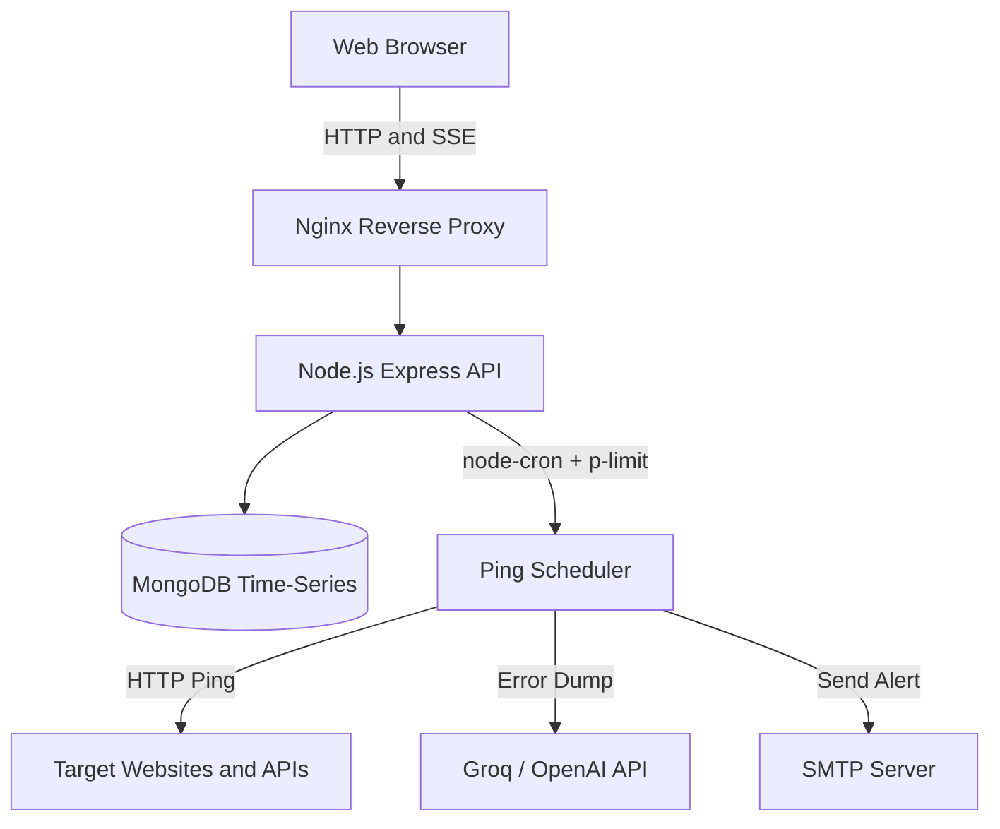

# System Specification - DevPulse

## 1. System Overview

DevPulse là nền tảng SaaS giám sát tính sẵn sàng của website và API. Hệ thống hỗ trợ phát hiện downtime, đo lường latency, cung cấp public status page cho người dùng cuối và tự động phân tích root cause sự cố thông qua Generative AI.

---

## 2. User Roles

| Role | Description |
| :--- | :--- |
| Anonymous User | Người dùng chưa đăng nhập, chỉ có quyền truy cập public status page. |
| Member | Người dùng đã đăng nhập với vai trò tiêu chuẩn, có quyền quản lý toàn bộ monitors và xem incident reports do chính mình tạo ra. Đây là role mặc định khi đăng ký tài khoản mới. |
| Admin | Quản trị viên hệ thống, sở hữu toàn bộ quyền hạn của Member và có thêm quyền xem system metrics tại admin overview endpoint. |
| System Scheduler | Background scheduler nội bộ, chịu trách nhiệm thực thi chu kỳ ping và thu thập số liệu. |

---

## 3. Functional Requirements

### 3.1. Authentication and Account Management
- **Đăng ký và Đăng nhập:** Người dùng tạo tài khoản bằng họ tên (`name`), email và mật khẩu. Xác thực thông qua JWT lưu trữ trong HttpOnly Cookie với các cờ bảo mật Secure và SameSite.
- **Khôi phục mật khẩu:** Cung cấp quy trình gửi mã OTP gồm 6 chữ số đến email của người dùng.
- **Rate Limit và Cooldown cho OTP:** Áp dụng rate limiting theo IP và cooldown 60 giây giữa các lần yêu cầu gửi lại OTP cho cùng một email.
- **Tự động hủy OTP:** Mã OTP tự động hết hạn và bị xóa khỏi database sau 5 phút thông qua TTL index.

### 3.2. Monitor Management
- **Cấu hình mục tiêu:** Cho phép tạo mới, cập nhật hoặc xóa cấu hình monitor gồm URL, HTTP method, custom headers và chu kỳ ping là 30 giây, 60 giây hoặc 300 giây.
- **Trạng thái hoạt động (Pause / Resume):** Cho phép tạm dừng (`pause` - chuyển trạng thái sang `paused`, không ping và không bắn alert) hoặc kích hoạt lại (`resume` - nạp lại vào scheduler) một monitor bất kỳ.
- **Giám sát chứng chỉ SSL:** Theo dõi ngày hết hạn chứng chỉ SSL và phát cảnh báo trước thời hạn 7 ngày.
- **Kiểm tra tức thì và Cooldown:** Cho phép kích hoạt kiểm tra ngay lập tức một monitor theo yêu cầu của người dùng, áp dụng cooldown 15 giây và rate limiting để chống lạm dụng.

### 3.3. Health Check Execution
- **Ping định kỳ:** Scheduler kích hoạt việc ping định kỳ cho từng monitor dựa trên interval đã đăng ký.
- **Kiểm soát Concurrency:** Sử dụng `p-limit` giới hạn tối đa 5 requests ping chạy đồng thời để tránh làm cạn kiệt socket mạng và nghẽn Event Loop.
- **Đo lường độ trễ:** Đo lường tổng response time từ lúc gửi request đến khi nhận được response đầu tiên từ target server.
- **Phân loại kết quả:**
  - Up khi nhận HTTP status code 2xx.
  - Redirect khi nhận HTTP status code 3xx.
  - Down khi nhận HTTP status code 4xx, 5xx hoặc request bị timeout.

### 3.4. Metric Buffering and Ingestion
- **In-Memory Buffer:** Kết quả ping được đẩy vào RAM buffer tạm thời.
- **Ghi dữ liệu theo Batch:** Dữ liệu trong RAM buffer được flush xuống database khi đạt đủ 100 items hoặc sau mỗi chu kỳ 5 giây bằng một lệnh `bulkWrite` duy nhất, giúp giảm hơn 90% disk I/O.

### 3.5. Real-Time Status Streaming
- **Real-time SSE:** Cung cấp kết nối Server-Sent Events một chiều đến dashboard frontend.
- **Cập nhật giao diện tức thì:** Khi có kết quả ping mới hoặc phát hiện sự cố, backend đẩy event qua SSE để React dashboard tự động cập nhật latency chart và status badge mà không cần reload trang.

### 3.6. Public Status Page
- **Public Status Page:** Cung cấp URL công khai để khách hàng theo dõi trạng thái uptime của dịch vụ.
- **Multi-layer Cache:** Áp dụng in-memory cache qua `node-cache` với TTL 30 giây và header Cache-Control cho reverse proxy / CDN để phục vụ spike traffic dưới 2 mili giây mà không truy vấn database.

### 3.7. Incident Detection and AI Post-Mortem
- **Ghi nhận sự cố:** Tự động tạo incident record khi monitor trả về lỗi liên tiếp hoặc timeout.
- **Thu thập dữ liệu lỗi:** Thu thập HTTP status code, response headers và error response body.
- **AI Post-Mortem:** Tự động chuyển error dump sang LLM API như Groq hoặc OpenAI để sinh báo cáo sự cố gồm tóm tắt hiện tượng, root cause tiềm tàng và action items đề xuất.
- **Đóng sự cố:** Tự động ghi nhận thời điểm resolved khi target server hoạt động bình thường trở lại ở các lượt ping kế tiếp.

### 3.8. Alert Notification
- **Gửi cảnh báo sự cố:** Kích hoạt gửi email thông báo đến chủ sở hữu monitor kèm theo nội dung AI post-mortem khi phát hiện downtime.
- **In-Memory Task Queue:** Toàn bộ tác vụ gửi email SMTP và gọi AI API được đẩy vào In-Memory Task Queue có giới hạn concurrency tối đa 2 tác vụ song song và cơ chế thử lại tối đa 3 lần cho email, tuyệt đối không block luồng xử lý API chính.

---

## 4. Non-Functional Requirements

### 4.1. Performance
- Response time phục vụ public status page từ cache không vượt quá 10 mili giây.
- Thời gian lưu trữ dữ liệu từ RAM buffer xuống database không vượt quá 100 mili giây cho mỗi đợt `bulkWrite`.

### 4.2. Concurrency and Resource Limits
- Concurrency limit cho các tác vụ ping mạng được giới hạn ở mức 5 requests đồng thời.
- Mức tiêu thụ RAM của Node.js API process duy trì dưới 200MB trong điều kiện tải bình thường.

### 4.3. Data Retention and Storage Management
- Dữ liệu chi tiết về latency và ping metrics được lưu trữ trong 7 ngày.
- Database TTL index tự động loại bỏ các records quá thời hạn mà không cần cronjob dọn rác thủ công.

### 4.4. Security
- Mật khẩu người dùng được băm an toàn bằng bcrypt trước khi lưu trữ.
- Toàn bộ traffic bên ngoài đều đi qua HTTPS có chứng chỉ SSL từ Let's Encrypt.
- Rate limiting được áp dụng nghiêm ngặt cho auth endpoints và OTP requests.

### 4.5. Reliability
- Khi server restart, các cấu hình active monitors từ database được load lại đầy đủ vào scheduler.
- Client SSE có cơ chế tự động reconnect khi đường truyền mạng bị gián đoạn.

---

## 5. System Boundaries and External Dependencies

- **Monitored Targets:** Các target servers hoặc API endpoints bên ngoài tiếp nhận kết nối qua HTTP hoặc HTTPS.
- **AI Provider API:** LLM API bên thứ ba như Groq hoặc OpenAI xử lý phân tích error dump và sinh post-mortem.
- **SMTP Server:** Dịch vụ gửi email thông báo sự cố và mã OTP qua Nodemailer.
- **Server Infrastructure:** Linux VPS chạy các Docker containers cô lập.
