# DevPulse End-to-End System Architecture & Execution Flow Blueprint

Tài liệu thiết kế kiến trúc kỹ thuật toàn diện của hệ thống **DevPulse**, mô tả từ mức vĩ mô hạ tầng đến chi tiết luồng thực thi mã nguồn và các mắt xích chuyển tiếp dữ liệu (Execution Bridges) giữa toàn bộ các phân hệ: Frontend SPA, Nginx Gateway, Layered Clean Architecture Backend, MongoDB Time-Series Database, In-Memory Caching, Ping Engine Daemon, Realtime SSE Streaming, Pluggable AI Diagnostic Queue và Incident Management Hub.

---

## 1. High-Level Macro Topology

Kiến trúc DevPulse được thiết kế tối ưu hóa đặc biệt cho môi trường máy chủ biên giới hạn tài nguyên (**VPS Linux 1GB RAM / 1 vCPU**), triệt tiêu hoàn toàn sự phụ thuộc vào các dịch vụ nặng nề (như Redis độc lập hay RabbitMQ) mà vẫn đảm bảo hiệu năng xử lý cao, không nghẽn Event Loop và đáp ứng thời gian thực.

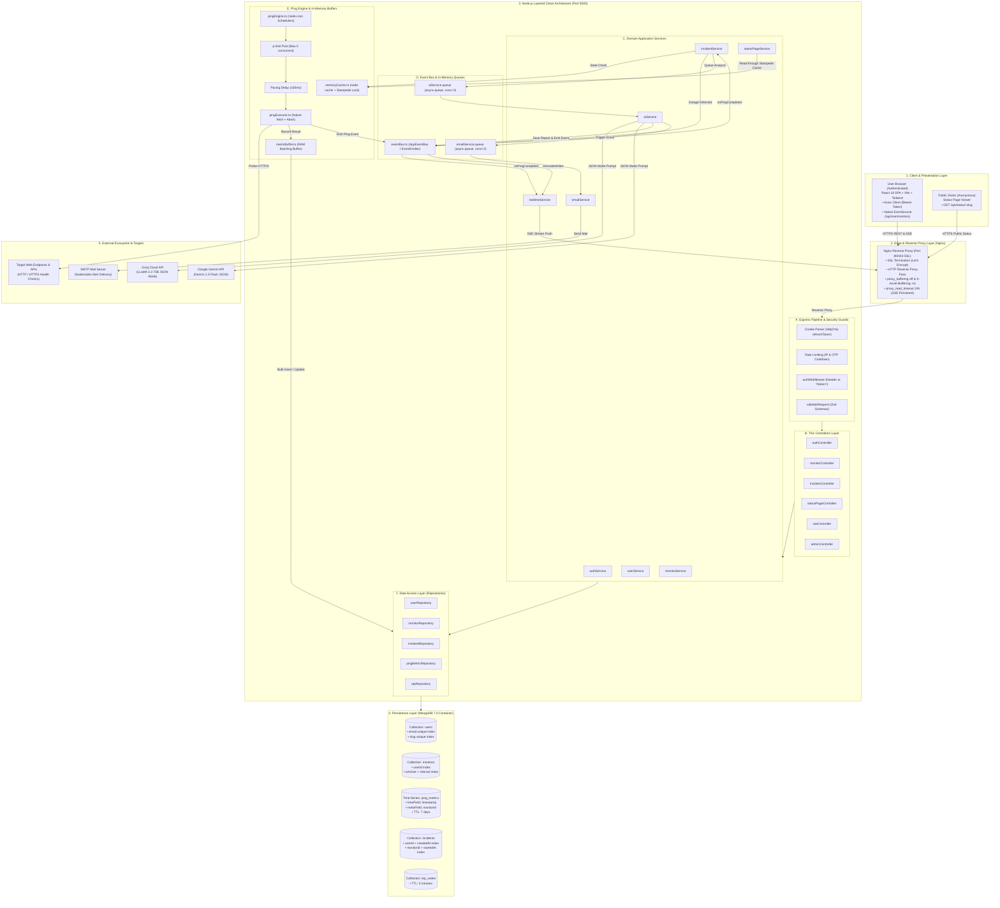

---

## 2. Dual-Engine Event-Driven Loop

Sơ đồ chi tiết hóa vòng đời khép kín từ thời điểm Cron Scheduler kích hoạt tiến trình ping, đi qua cơ chế phân phối tải, kiểm tra kết quả, rẽ nhánh xử lý dữ liệu số đo (Metrics) và trạng thái sự cố (Incident State Machine), đến khi đẩy cập nhật thời gian thực xuống giao diện người dùng.

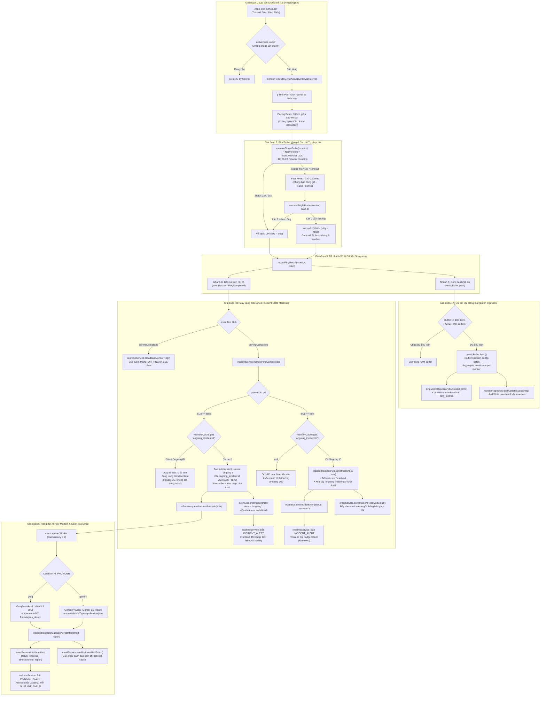

---

## 3. Multi-Layer Memory Cache Architecture

Nhằm đảm bảo mức tiêu thụ RAM luôn nằm dưới **200MB** cho toàn bộ Node.js process trên VPS 1GB, hệ thống áp dụng chiến lược phân vùng bộ nhớ đệm đa tầng có khóa chống dồn dập (Cache Stampede Protection):

```mermaid
flowchart LR
    subgraph RAM_Partitions ["In-Memory RAM Caching (node-cache)"]
        direction TB
        Part1["status_page:slug:${slug}<br>TTL = 24 giờ<br>Lưu routing pointer map: slug -> userId"]
        Part2["status_page:data:${userId}<br>TTL = 30 giây<br>Lưu snapshot tổng hợp: uptime, monitors, incidents"]
        Part3["ongoing_incident:${monitorId}<br>TTL = 0 (Vô thời hạn)<br>Lưu active incidentId, chỉ xóa khi target phục hồi"]
        Part4["ping_cooldown:${monitorId}<br>TTL = 15 giây<br>Chống spam endpoint kiểm tra tức thì /monitors/:id/ping"]
        Part5["pendingPromises Map<br>Stampede Protection Lock<br>Tái sử dụng in-flight promise cho request trùng lặp"]
    end

    subgraph Triggers ["Invalidation Events (Xóa Cache tức thời)"]
        direction TB
        T1["Target gặp sự cố (Down) ──> invalidateCache(userId)"]
        T2["Target phục hồi (Resolved) ──> invalidateCache(userId)"]
        T3["Tạo / Cập nhật / Xóa Monitor ──> invalidateCache(userId)"]
        T4["Đổi Custom Slug ──> invalidateSlug(oldSlug) + invalidateCache(userId)"]
        T5["Resolve sự cố thủ công ──> memoryCache.del('ongoing_incident:id')"]
    end

    Triggers --> RAM_Partitions
```

---

## 4. Frontend Component & Real-Time State Topology

Giao diện người dùng DevPulse được xây dựng theo mô hình Single Page Application (SPA) với React 18, Vite và Tailwind CSS, giao tiếp thời gian thực hai kênh (Dual-Channel Communication) với Backend:

```mermaid
flowchart TD
    subgraph PresentationLayer ["1. App Router & Page Layouts (React Router v7)"]
        AppLayout["App Layout (Main Shell)<br>• Header / Navigation (User Profile, Slug link)<br>• Network Indicator (Online / Reconnecting)<br>• Global Toaster & Alerts"]
        LoginPage["/login (Auth Page)"]
        RegisterPage["/register (Signup Page)"]
        VerifyOtpPage["/verify-otp (Email Activation & Password Reset)"]
        DashboardPage["/dashboard (Main System Overview & Charts)"]
        MonitorsPage["/monitors (Monitors List, Filters, Status Badges)"]
        MonitorDetailPage["/monitors/:id (Latency History, SSL Status, Action Toolbar)"]
        IncidentsPage["/incidents (Incident Timeline, AI Post-Mortem Cards)"]
        PublicStatusPage["/status/:slug (Clean Public Uptime Dashboard)"]
    end

    subgraph StateAndContext ["2. Client State & Service Layer"]
        AuthContext["Auth Context<br>• User Identity (id, name, role, slug)<br>• accessToken (RAM Only, chống XSS)<br>• refreshToken handler (HttpOnly cookie)"]
        MonitorStore["Monitor State Store<br>• Active monitors list<br>• Latency chart time-series buffers<br>• Realtime status map (up/down/paused)"]
        IncidentStore["Incident State Store<br>• Ongoing outages<br>• AI Post-Mortem reports<br>• Manual resolve handler"]
    end

    subgraph NetworkLayer ["3. Dual-Channel Network Layer"]
        AxiosClient["Axios REST Client<br>• baseURL: /api<br>• withCredentials: true<br>• Request Interceptor: Attach Bearer Token<br>• Response Interceptor: 401 Silent Refresh Token Queue"]
        SSEListener["Native EventSource Stream Hook<br>• URL: /api/sse/monitors?token=${accessToken}<br>• Event: MONITOR_PING -> Update latency buffer<br>• Event: INCIDENT_ALERT -> Update status & AI card<br>• Exponential backoff auto-reconnect"]
    end

    PresentationLayer --> StateAndContext
    StateAndContext --> NetworkLayer
```

---

## 5. Step-by-Step Code-Driven Execution Flows

Dưới đây là hành trình thực thi chi tiết của toàn bộ 10 phân hệ nghiệp vụ, kèm các **mắt xích chuyển tiếp (Execution Bridges)** thể hiện chính xác luồng dữ liệu, cấu trúc tham số truyền qua hàm và lời gọi phương thức giữa các lớp kiến trúc.

---

### Flow 1: Authentication & Dual-Token Rotation

Hệ thống bảo vệ phiên làm việc theo mô hình **Dual-Token Architecture**:
* **Access Token:** Ký hạn ngắn (15 phút), chứa `id` và `role`, lưu trên RAM của trình duyệt nhằm ngăn ngừa triệt để nguy cơ trích xuất token qua lỗ hổng Cross-Site Scripting (XSS).
* **Refresh Token:** Ký hạn dài (7 ngày), mã hóa bảo mật lưu trong HttpOnly, Secure, SameSite Cookie. Khi người dùng đổi mật khẩu hoặc đăng xuất toàn bộ thiết bị, trường `tokenVersion` trên model `users` được tăng lũy tiến, lập tức vô hiệu hóa mọi refresh token đang lưu hành.

```
[Browser Request] ──> [authMiddleware.ts] ──> jwt.verify(JWT_SECRET) ──> req.user = { id, role }
                                   │ (Nếu Access Token hết hạn)
                                   ▼
[Axios 401 Interceptor] ──> POST /api/auth/refresh-token ──> [authService.refreshToken]
                                   │
                                   ├── 1. Đọc refreshToken từ req.cookies
                                   ├── 2. jwt.verify(JWT_REFRESH_SECRET)
                                   ├── 3. Tra cứu user và so khớp user.tokenVersion === decoded.tokenVersion
                                   └── 4. Ký cấp Access Token mới + xoay vòng Refresh Token mới
```

```typescript
// Trích xuất mã nguồn: src/middlewares/authMiddleware.ts
export function authenticate(req: Request, _res: Response, next: NextFunction): void {
  const token = extractToken(req);
  if (!token) {
    next(new AppError('Authentication token required', 401));
    return;
  }

  try {
    const decoded = jwt.verify(token, env.JWT_SECRET) as JwtPayloadDecoded;
    req.user = {
      id: decoded.id,
      role: decoded.role,
    } as AuthenticatedUserPayload;
    next();
  } catch {
    next(new AppError('Invalid or expired authentication token', 401));
  }
}

// Hỗ trợ trích xuất cả Header Bearer và Query Parameter (cho Browser EventSource)
function extractToken(req: Request): string | undefined {
  if (req.headers.authorization && req.headers.authorization.startsWith('Bearer ')) {
    return req.headers.authorization.substring(7);
  }
  if (typeof req.query.token === 'string' && req.query.token.length > 0) {
    return req.query.token;
  }
  return undefined;
}
```

---

### Flow Transition Bridge: Flow 1 to Flow 2

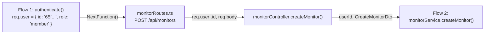

Khi request qua `authMiddleware`, `req.user.id` được controller trích xuất trực tiếp truyền vào tầng Service, bảo đảm 100% tài nguyên tạo mới luôn được gán đúng chủ sở hữu (Multi-Tenant Isolation).

---

### Flow 2: Monitor Configuration & Instant Ping Probe

Khi người dùng khởi tạo hoặc hiệu chỉnh endpoint theo dõi:
1. Nếu URL bắt đầu bằng `https://`, [`monitorService`](../backend/src/services/monitorService.ts) chủ động kích hoạt [`checkSslCertificate`](../backend/src/utils/sslChecker.ts) mở socket TLS với cờ SNI an toàn (`net.isIP(host) ? undefined : host`) để trích xuất tổ chức phát hành (`issuer`), thời hạn (`validTo`) và số ngày còn lại (`daysRemaining`).
2. Lưu cấu hình vào database và gọi ngay `statusPageService.invalidateCache(userId)` để làm mới dữ liệu public status page.
3. Nếu người dùng nhấn nút **"Ping Now"**, hệ thống kiểm tra khóa RAM `ping_cooldown:${monitorId}` (15s). Nếu hợp lệ, một lượt ping đo lường được thực thi trực tiếp và lưu vào số đo lịch sử.

```typescript
// Trích xuất mã nguồn: src/services/monitorService.ts
export class MonitorService {
  async createMonitor(userId: string, data: CreateMonitorDto): Promise<MonitorResponseDto> {
    let sslInfo: ISslInfo | undefined;
    if (data.url.startsWith('https://')) {
      sslInfo = await checkSslCertificate(data.url);
    }

    const newMonitor = await monitorRepository.create({
      userId: new Types.ObjectId(userId),
      name: data.name.trim(),
      url: data.url.trim(),
      method: data.method || 'GET',
      headers: data.headers ? new Map(Object.entries(data.headers)) : new Map(),
      interval: data.interval,
      isActive: true,
      status: 'pending',
      sslInfo,
    });

    // Vô hiệu hóa cache status page để khách xem trang thấy ngay monitor mới
    statusPageService.invalidateCache(userId);
    return this.mapToDto(newMonitor);
  }
}
```

---

### Flow Transition Bridge: Flow 2 to Flow 3

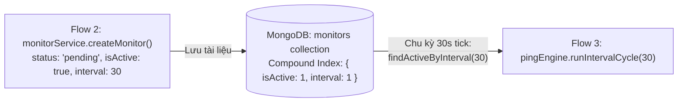

**Cơ chế chuyển tiếp hoàn toàn phi trạng thái (Stateless Scheduler):**
Ping Engine không duy trì danh sách monitor trong RAM cố định. Thay vào đó, mỗi khi cron tick (30s, 60s, 300s), phương thức `monitorRepository.findActiveByInterval(interval)` truy vấn trực tiếp vào MongoDB bằng Compound Index `{ isActive: 1, interval: 1 }`. Mọi monitor vừa được tạo hoặc resume ở Flow 2 lập tức được nạp vào lượt ping kế tiếp mà không cần khởi động lại server.

---

### Flow 3: Scheduled Ping Engine & Concurrency Throttling

Tại [`src/services/pingEngine.ts`](../backend/src/services/pingEngine.ts), 3 tác vụ `node-cron` chạy tuần hoàn tương ứng với các chu kỳ 30 giây, 60 giây và 300 giây.
1. `this.activeRuns.get(interval)` đóng vai trò là ổ khóa ngăn ngừa chu kỳ mới đè lên chu kỳ cũ khi mạng bên ngoài bị chậm.
2. `pLimit(5)` khống chế tối đa 5 requests ping được gửi ra Internet song song.
3. Kẹp `pacingDelayMs = 100` giải phóng CPU và tránh làm bão hòa bảng socket state của kernel Linux.
4. [`pingExecutor.ts`](../backend/src/services/pingExecutor.ts) gửi probe với `AbortController` (10s timeout). Nếu gặp lỗi (4xx, 5xx, Timeout, Connection Refused), probe tự động hoãn 2000ms và thực hiện **Fast Retest lần 2** để loại trừ 100% tình trạng sụt mạng tạm thời (chống báo động giả).

```typescript
// Trích xuất mã nguồn: src/services/pingEngine.ts
private async runIntervalCycle(interval: 30 | 60 | 300): Promise<void> {
  if (this.activeRuns.get(interval)) {
    return; // Bỏ qua nếu chu kỳ trước chưa hoàn thành
  }
  this.activeRuns.set(interval, true);

  try {
    const activeMonitors = await monitorRepository.findActiveByInterval(interval);
    if (activeMonitors.length === 0) return;

    // Giới hạn concurrency tối đa 5 và chèn độ trễ nhịp 100ms
    const pingPromises = activeMonitors.map((monitor) =>
      this.limit(async () => {
        await new Promise((resolve) => setTimeout(resolve, this.pacingDelayMs));
        await this.processSingleMonitor(monitor);
      })
    );

    await Promise.allSettled(pingPromises);
  } finally {
    this.activeRuns.set(interval, false);
  }
}
```

---

### Flow Transition Bridge: Flow 3 to Flow 4 & Event Bus

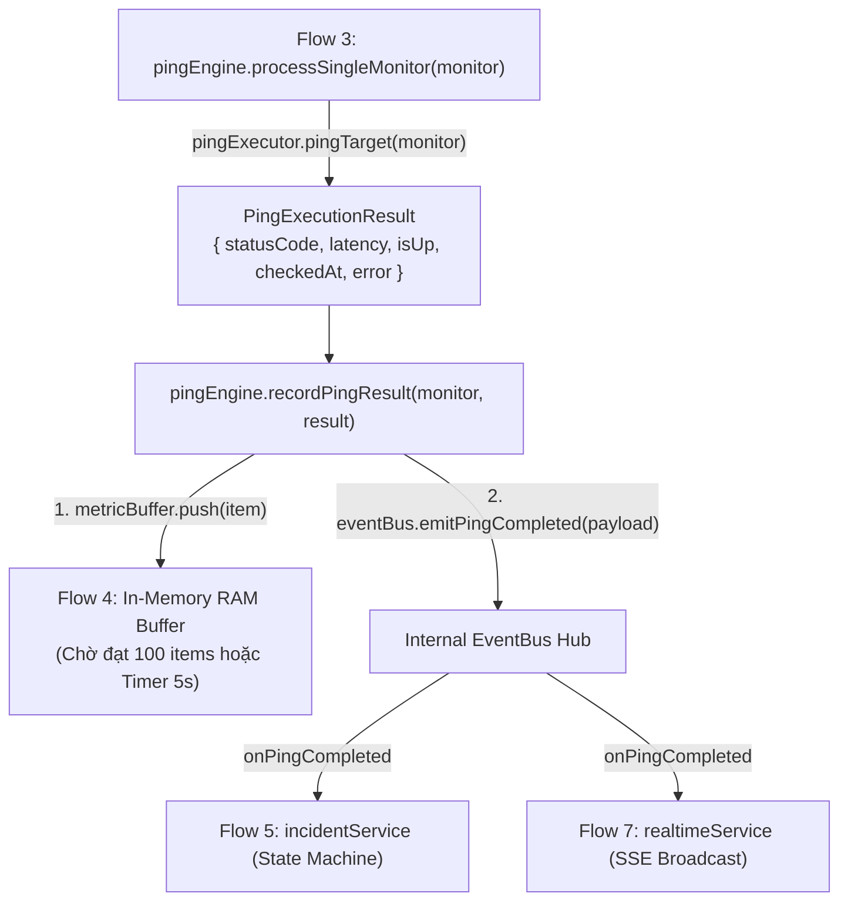

Đây là mắt xích phân tách trách nhiệm quan trọng nhất trong hệ thống: Sau khi hoàn thành probe, kết quả được rẽ làm 2 nhánh hoàn toàn độc lập: **Nhánh lưu trữ số đo (Flow 4)** và **Nhánh phát sự kiện thời gian thực (Flow 5 & Flow 7)**.

```typescript
// Trích xuất mã nguồn mắt xích chuyển tiếp: src/services/pingEngine.ts
async processSingleMonitor(monitor: IMonitor): Promise<void> {
  try {
    const result = await pingExecutor.pingTarget(monitor);
    await this.recordPingResult(monitor, result);
  } catch (error) {
    console.error(`[PingEngine] Failed to process monitor ${monitor._id}:`, error);
  }
}

async recordPingResult(monitor: IMonitor, result: PingExecutionResult): Promise<void> {
  // Chuyển tiếp sang Flow 4: Gom buffer RAM
  await metricBuffer.push({
    timestamp: result.checkedAt,
    monitorId: monitor._id,
    statusCode: result.statusCode,
    latency: result.latency,
    isUp: result.isUp,
    error: result.error,
  });

  // Chuyển tiếp sang Flow 5 & Flow 7: Phát sự kiện nội bộ
  eventBus.emitPingCompleted({
    monitorId: monitor._id.toString(),
    userId: monitor.userId.toString(),
    statusCode: result.statusCode,
    latency: result.latency,
    isUp: result.isUp,
    timestamp: result.checkedAt.toISOString(),
    error: result.error,
  });
}
```

---

### Flow 4: In-Memory Metric Buffer & Batch Ingestion

Mỗi kết quả ping không ghi lẻ tẻ vào cơ sở dữ liệu mà được đẩy vào mảng bộ nhớ đệm [`metricBuffer.ts`](../backend/src/services/metricBuffer.ts):
1. **Điều kiện xả (Flush):** Đạt 100 items trong RAM hoặc bộ đếm thời gian 5000ms điểm nhịp.
2. **Cô lập mảng:** Dùng `const itemsToFlush = this.buffer.splice(0)` rút cạn mảng nguyên tử, cho phép các lượt ping mới tiếp tục đẩy vào buffer mà không xảy ra xung đột luồng (Thread-safe concurrency).
3. **Thực thi BulkWrite:** Ghi hàng loạt số đo vào `ping_metrics` và tổng hợp trạng thái mới nhất (`up` / `down`) để cập nhật vào `monitors` chỉ bằng **1 thao tác mạng duy nhất**.

```typescript
// Trích xuất mã nguồn: src/services/metricBuffer.ts
export class MetricBuffer {
  private buffer: CreatePingMetricDto[] = [];
  private flushTimer: NodeJS.Timeout | null = null;
  private readonly batchSizeLimit = 100;
  private readonly flushIntervalMs = 5000;

  // Khởi động timer nền xả buffer mỗi 5 giây
  startTimer(): void {
    if (this.flushTimer) return;
    this.flushTimer = setInterval(async () => {
      await this.flush();
    }, this.flushIntervalMs);
  }

  // Đẩy metric vào RAM buffer và kích hoạt flush ngay nếu chạm trần dung lượng
  async push(metric: CreatePingMetricDto): Promise<void> {
    this.buffer.push(metric);
    if (this.buffer.length >= this.batchSizeLimit) {
      await this.flush();
    }
  }

  async flush(): Promise<number> {
    if (this.isFlushing || this.buffer.length === 0) return 0;
    this.isFlushing = true;
    const itemsToFlush = this.buffer.splice(0); // Rút cạn mảng nguyên tử

    try {
      // 1. Bulk insert vào Time-Series collection ping_metrics
      await pingMetricRepository.bulkInsert(itemsToFlush);

      // 2. Gom trạng thái mới nhất cho mỗi monitor để bulk update
      const latestUpdates = new Map<string, { status: MonitorStatus; lastCheckedAt: Date }>();
      for (const item of itemsToFlush) {
        latestUpdates.set(item.monitorId.toString(), {
          status: item.isUp ? 'up' : 'down',
          lastCheckedAt: item.timestamp,
        });
      }

      if (latestUpdates.size > 0) {
        await monitorRepository.bulkUpdateStatus(latestUpdates);
      }

      this.lastFlushAt = new Date();
      return itemsToFlush.length;
    } catch (error) {
      this.buffer.unshift(...itemsToFlush);
      if (this.buffer.length > 5000) {
        this.buffer.splice(0, this.buffer.length - 5000);
      }
      return 0;
    } finally {
      this.isFlushing = false;
    }
  }
}
```

---

### Flow Transition Bridge: Event Bus to Flow 5 & Flow 7

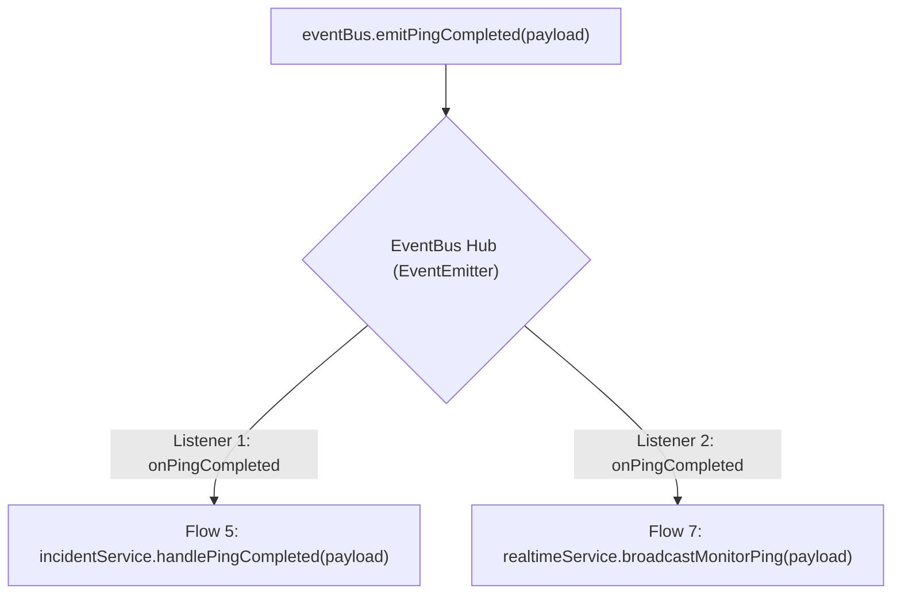

Sự kiện `PING_COMPLETED` được truyền phát theo mô hình **Pub/Sub phi ghép nối (Decoupled Publish/Subscribe)**. Ping Engine hoàn toàn không cần biết `incidentService` hay `realtimeService` là ai, triệt tiêu hoàn toàn sự phụ thuộc vòng giữa các module.

---

### Flow 5: Event Bus & Incident State Machine

[`incidentService.ts`](../backend/src/services/incidentService.ts) lắng nghe sự kiện `PING_COMPLETED` qua [`eventBus.ts`](../backend/src/utils/eventBus.ts):
* **Khi Target gặp lỗi (`isUp === false`):**
  Kiểm tra cache `ongoing_incident:${monitorId}`:
  - Nếu đã tồn tại key: Mục tiêu đang trong đợt downtime đã được ghi nhận $\rightarrow$ Bỏ qua với độ phức tạp $O(1)$ trên RAM, **0 truy vấn DB**.
  - Nếu chưa có: Tạo mới document sự cố trong MongoDB, lưu `incidentId` vào cache RAM (`TTL = 0`), lập tức bắn sự kiện `INCIDENT_ALERT` (Phase 1: Giao diện chuyển đỏ) và đẩy tác vụ sang hàng đợi AI.
* **Khi Target phục hồi (`isUp === true`):**
  Kiểm tra cache `ongoing_incident:${monitorId}`:
  - Nếu không có key: Mục tiêu khỏe mạnh bình thường $\rightarrow$ Bỏ qua $O(1)$, **0 truy vấn DB**.
  - Nếu có key: Đóng sự cố trong database, xóa key cache, tính tổng thời gian gián đoạn và phát tán sự kiện phục hồi (Phase 3).

```typescript
// Trích xuất mã nguồn: src/services/incidentService.ts
private async handleTargetFailure(payload: PingCompletedEvent): Promise<void> {
  const cacheKey = `${ONGOING_INCIDENT_CACHE_PREFIX}${payload.monitorId}`;
  if (memoryCache.has(cacheKey)) {
    return; // Đang trong đợt downtime -> 0 hit DB
  }

  const monitor = await monitorRepository.findById(payload.monitorId);
  if (!monitor) return;

  const incident = await incidentRepository.create({
    monitorId: monitor._id,
    userId: monitor.userId,
    status: 'ongoing',
    startedAt: new Date(payload.timestamp),
    resolvedAt: null,
    errorDetails: {
      statusCode: payload.statusCode,
      errorMessage: payload.error || 'Health check probe failed',
      responseBody: '',
      responseHeaders: new Map(),
    },
  });

  // Lưu active incidentId vào RAM cache vô thời hạn cho tới khi phục hồi
  memoryCache.set(cacheKey, incident._id.toString(), 0);

  // Giai đoạn 1: Bắn alert ngay lập tức để dashboard chuyển trạng thái ĐỎ
  eventBus.emitIncidentAlert({
    incidentId: incident._id.toString(),
    monitorId: payload.monitorId,
    userId: payload.userId,
    status: 'ongoing',
    startedAt: payload.timestamp,
    errorMessage: payload.error,
  });

  statusPageService.invalidateCache(payload.userId);

  // Đẩy sang hàng đợi chẩn đoán AI ngầm (Flow 6)
  aiService.queueIncidentAnalysis({
    incidentId: incident._id.toString(),
    monitorId: monitor._id.toString(),
    userId: monitor.userId.toString(),
    monitorName: monitor.name,
    monitorUrl: monitor.url,
    startedAt: payload.timestamp,
    statusCode: payload.statusCode,
    errorMessage: payload.error || 'Health check probe failed',
  });
}
```

---

### Flow Transition Bridge: Flow 5 to Flow 6

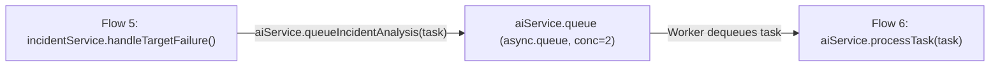

Tác vụ gọi Generative AI API được đẩy vào hàng đợi bất đồng bộ có giới hạn worker = 2, bảo vệ tiến trình Node.js không bị treo khi hàng chục website cùng sập một lúc.

---

### Flow 6: Pluggable AI Post-Mortem & Email Alerts

[`aiService.ts`](../backend/src/services/aiService.ts) sử dụng `async.queue` với `concurrency = 2` để đảm bảo không làm nghẽn CPU và bộ nhớ:
1. Trừu tượng hóa qua giao diện [`IAiProvider`](../backend/src/services/ai/aiProvider.ts), hỗ trợ chuyển đổi linh hoạt qua biến môi trường giữa **Groq (LLaMA 3.3 70B)** và **Gemini (Gemini 1.5 Flash)**.
2. Sử dụng chế độ ép kiểu JSON chuẩn (`JSON Mode`) để AI trả về đúng cấu trúc gồm 3 trường: `summary` (tóm tắt hiện tượng), `rootCause` (nguyên nhân gốc rễ dự đoán), và `actionItems` (các bước khắc phục đề xuất).
3. Cập nhật báo cáo vào database, phát sự kiện Phase 2 để giao diện tắt loading skeleton và hiển thị thẻ chẩn đoán AI, đồng thời đẩy email sang [`emailService`](../backend/src/services/emailService.ts).

```typescript
// Trích xuất mã nguồn: src/services/aiService.ts
private async processTask(task: AiTask): Promise<void> {
  const postMortem = await this.generatePostMortem({
    targetUrl: task.monitorUrl,
    statusCode: task.statusCode,
    errorMessage: task.errorMessage,
    responseBody: task.responseBody,
  });

  if (postMortem) {
    const generatedAt = new Date();
    await incidentRepository.updateAiPostMortem(task.incidentId, {
      summary: postMortem.summary,
      rootCause: postMortem.rootCause,
      actionItems: postMortem.actionItems,
      generatedAt,
    });

    // Giai đoạn 2: Bắn alert cập nhật kèm báo cáo AI hoàn chỉnh sang Flow 7
    eventBus.emitIncidentAlert({
      incidentId: task.incidentId,
      monitorId: task.monitorId,
      userId: task.userId,
      status: 'ongoing',
      startedAt: task.startedAt,
      errorMessage: task.errorMessage,
      aiPostMortem: {
        summary: postMortem.summary,
        rootCause: postMortem.rootCause,
        actionItems: postMortem.actionItems,
        generatedAt: generatedAt.toISOString(),
      },
    });

    // Chuyển tiếp sang emailService để gửi thư cảnh báo
    const user = await userRepository.findById(task.userId);
    if (user) {
      emailService.sendIncidentAlertEmail(
        user.email,
        task.monitorName,
        task.monitorUrl,
        task.errorMessage,
        task.startedAt,
        postMortem
      );
    }
  }
}
```

---

### Flow Transition Bridge: Event Bus to Flow 7

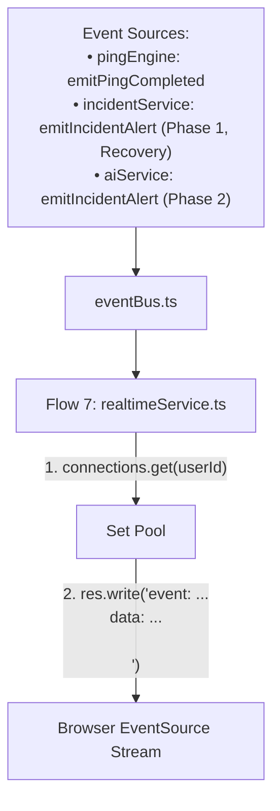

---

### Flow 7: Real-Time Server-Sent Events Streaming

[`realtimeService.ts`](../backend/src/services/realtimeService.ts) quản lý bể chứa kết nối trên RAM dạng `Map<userId, Set<Response>>`:
1. Khi trình duyệt gọi `GET /api/sse/monitors?token=...`, [`sseController.ts`](../backend/src/controllers/sseController.ts) thiết lập các headers cấm đệm:
   - `Content-Type: text/event-stream`
   - `Cache-Control: no-cache, no-transform`
   - `X-Accel-Buffering: no`
   - Gọi ngay `res.flushHeaders()`.
2. Gửi heartbeat comment `: heartbeat\n\n` định kỳ 30s bằng `unref()` timer để giữ kết nối không bị Nginx proxy ngắt.
3. Khi nhận sự kiện từ `eventBus`, hệ thống lọc chính xác các kết nối thuộc sở hữu của `userId` và ghi dữ liệu SSE trực tiếp qua `res.write()`.

```typescript
// Trích xuất mã nguồn: src/services/realtimeService.ts
export class RealtimeService {
  private connections: Map<string, Set<Response>> = new Map();

  addConnection(userId: string, res: Response): void {
    let clientSet = this.connections.get(userId);
    if (!clientSet) {
      clientSet = new Set<Response>();
      this.connections.set(userId, clientSet);
    }
    clientSet.add(res);
  }

  broadcastMonitorPing(payload: PingCompletedEvent): void {
    const clientSet = this.connections.get(payload.userId);
    if (!clientSet || clientSet.size === 0) return;

    const eventData: SseMonitorPingEvent = {
      type: 'MONITOR_PING',
      monitorId: payload.monitorId,
      statusCode: payload.statusCode,
      latency: payload.latency,
      isUp: payload.isUp,
      timestamp: payload.timestamp,
      error: payload.error,
    };

    const message = `event: MONITOR_PING\ndata: ${JSON.stringify(eventData)}\n\n`;
    for (const res of clientSet) {
      if (!res.writableEnded) {
        res.write(message);
      }
    }
  }

  broadcastIncidentAlert(payload: IncidentAlertEvent): void {
    const clientSet = this.connections.get(payload.userId);
    if (!clientSet || clientSet.size === 0) return;

    const message = `event: INCIDENT_ALERT\ndata: ${JSON.stringify(payload)}\n\n`;
    for (const res of clientSet) {
      if (!res.writableEnded) {
        res.write(message);
      }
    }
  }
}
```

---

### Flow Transition Bridge: State Mutation to Flow 8

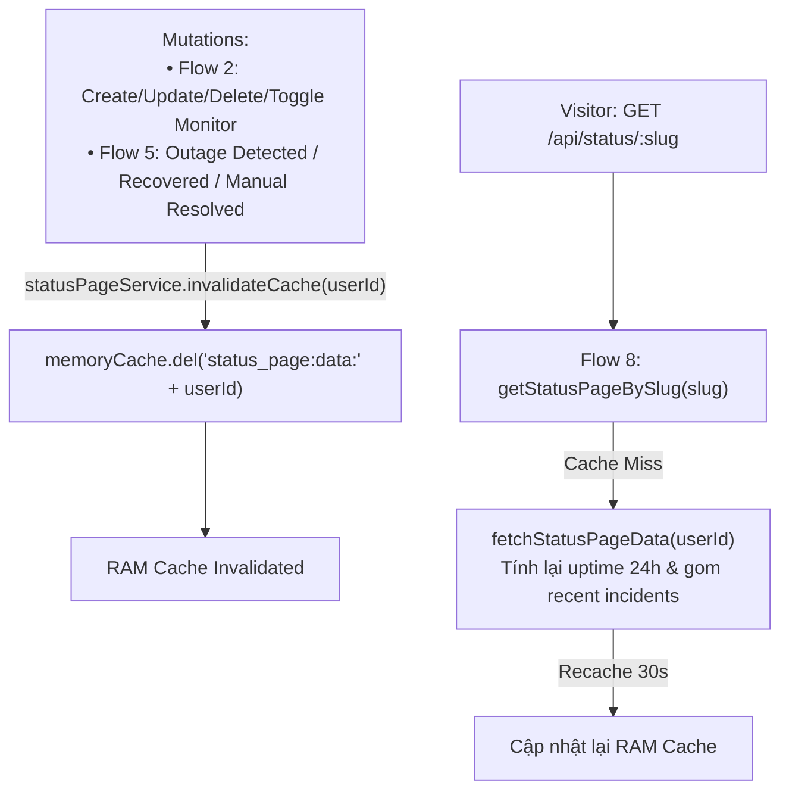

---

### Flow 8: Public Status Page & Cache Stampede Protection

Khách vãng lai truy cập `GET /api/status/:slug` hoàn toàn không cần đăng nhập. Để chịu được hàng chục nghìn lượt truy cập đồng thời khi dịch vụ sập nguồn (traffic spike) mà không làm sập MongoDB:
1. **Tầng 1 (Slug Lookup):** Tra cứu `status_page:slug:${slug}` (TTL 24h) để lấy `userId`.
2. **Tầng 2 (Data Aggregate):** Lấy dữ liệu từ `status_page:data:${userId}` (TTL 30s).
3. **Cache Stampede Protection:** [`MemoryCacheService.getOrSet`](../backend/src/utils/cache.ts) sử dụng một `pendingPromises` Map. Nếu 100 requests cùng ùa vào lúc cache vừa hết hạn, chỉ duy nhất 1 truy vấn thực tế được gửi xuống MongoDB; 99 requests còn lại sẽ dùng chung kết quả của Promise đang bay (In-flight promise deduplication).

```typescript
// Trích xuất mã nguồn: src/utils/cache.ts
async getOrSet<T>(key: string, fetchFn: () => Promise<T>, ttlSeconds?: number): Promise<T> {
  const cached = this.get<T>(key);
  if (cached !== undefined) {
    return cached;
  }

  // Tái sử dụng Promise đang chạy nếu có request trùng lặp
  const inFlight = this.pendingPromises.get(key) as Promise<T> | undefined;
  if (inFlight) {
    return inFlight;
  }

  const executionPromise = (async () => {
    try {
      const result = await fetchFn();
      this.set(key, result, ttlSeconds);
      return result;
    } finally {
      this.pendingPromises.delete(key);
    }
  })();

  this.pendingPromises.set(key, executionPromise);
  return executionPromise;
}
```

---

### Flow 9: Admin System Supervision & Engine Diagnostics

Quản trị viên hệ thống có quyền truy cập endpoint bảo vệ cao cấp:
1. `GET /api/admin/overview`: [`adminService.ts`](../backend/src/services/adminService.ts) tổng hợp nhanh:
   - Tổng số tài khoản, phân loại số lượng user verified vs unverified.
   - Thống kê toàn diện monitors: tổng số, số active, số paused, và phân loại trạng thái up/down/pending.
   - Số lượng sự cố đang diễn ra (`ongoing`) và sự cố đã giải quyết trong 24 giờ qua.
   - Thông số RAM sử dụng của Node.js process (`process.memoryUsage()`) và trạng thái máy chủ (uptime OS, CPU cores, load average).
2. `GET /api/admin/ping-engine/status`: Trả về trạng thái nội bộ của Ping Engine: số lượng active monitors được nạp, kích thước buffer hiện tại trong RAM, thời điểm xả gần nhất và concurrency limit.
3. `POST /api/admin/ping-engine/flush`: Kích hoạt ép xả toàn bộ buffer RAM xuống MongoDB ngay lập tức.

---

### Flow 10: Frontend SPA State & Real-Time Synchronization

Tại tầng giao diện React 18, ứng dụng quản lý trạng thái đồng bộ:
1. **Lớp Dịch vụ API (`src/services/api.ts`):** Cấu hình Axios instance tự động gửi kèm cookie và kẹp Access Token vào header `Authorization`.
2. **Hook Lắng nghe SSE (`useRealtimeEvents`):** 
   - Khởi tạo kết nối `new EventSource('/api/sse/monitors?token=' + token)`.
   - Lắng nghe event `MONITOR_PING`: Tìm monitor tương ứng trong mảng state, cập nhật lại trạng thái (`status: 'up' | 'down'`), cập nhật latency gần nhất và đẩy điểm dữ liệu mới vào biểu đồ đường Recharts.
   - Lắng nghe event `INCIDENT_ALERT`: Nếu nhận sự cố `ongoing`, lập tức cập nhật badge cảnh báo đỏ của monitor, hiển thị banner thông báo sự cố trên top dashboard và hiển thị component `AiPostMortemCard` (nếu có trường `aiPostMortem`, tắt skeleton loading).
3. **Cơ chế Reconnect Tự động:** Khi mất kết nối mạng hoặc server khởi động lại, EventSource tự động kết nối lại theo cơ chế Exponential Backoff mà không làm mất trạng thái đang hiển thị của người dùng.

---

## 6. Resource Budget & Production Capacity Matrix

| Thành phần | Tiêu thụ Tài nguyên (VPS 1GB RAM) | Cơ chế Đảm bảo Ổn định |
| :--- | :--- | :--- |
| **Node.js Process** | RAM: 90MB - 160MB / CPU: 2% - 8% | Chạy đơn tiến trình với `p-limit(5)` và `async.queue(2)` |
| **MongoDB Container** | RAM: 180MB - 240MB / IOPS: Thấp | Gom batch `bulkWrite` và Time-Series Collection |
| **Network Sockets** | Tối đa 5 outbound connections đồng thời | Pacing delay 100ms và `AbortController(10s)` |
| **Realtime SSE** | ~2KB RAM cho mỗi client kết nối | Dọn dẹp $O(1)$ trên RAM khi kết nối đóng, Heartbeat 30s |
| **Public Status Page** | < 2ms latency khi hit cache | Caching 2 tầng + Stampede lock, 0 hit database |
