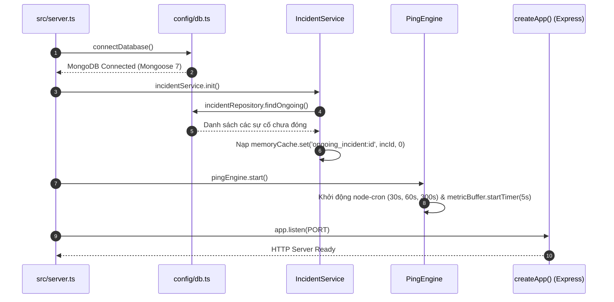
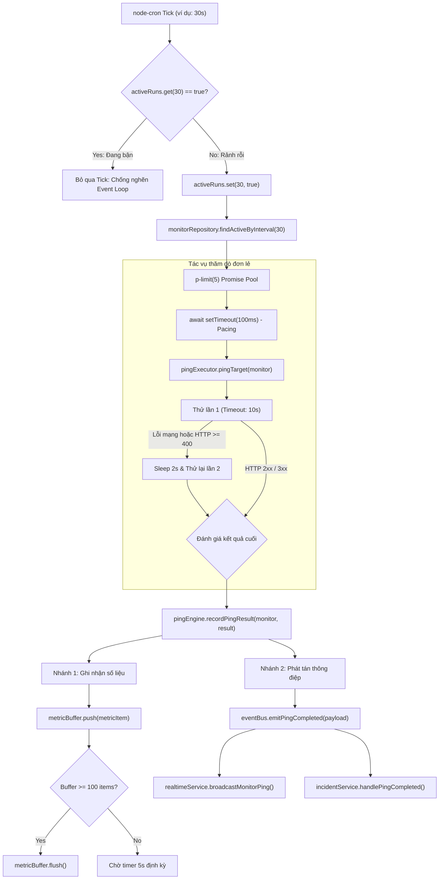
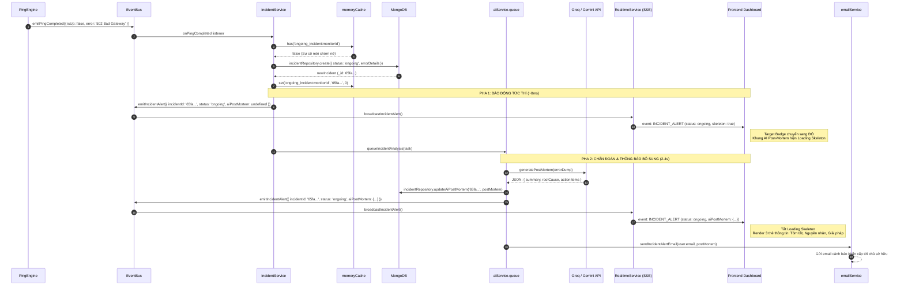
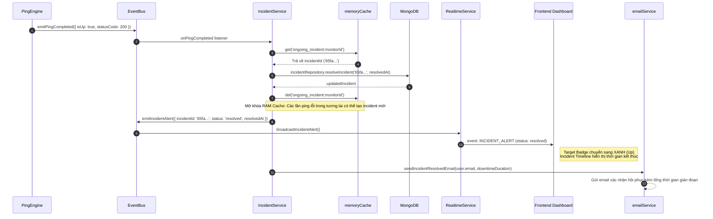
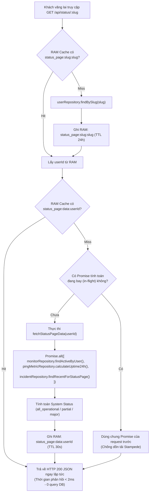
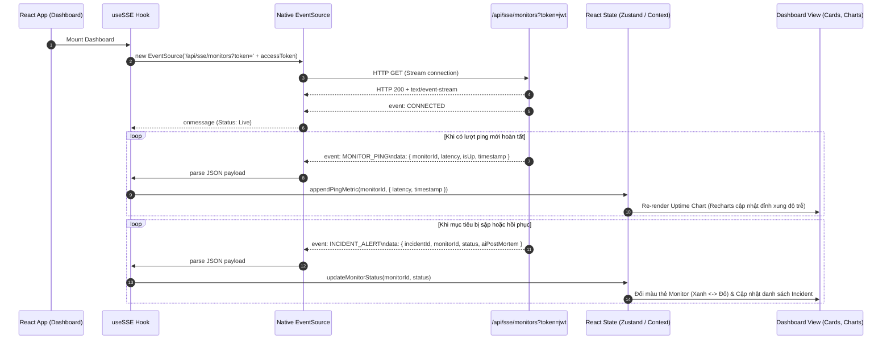

<!-- AGENT_DIRECTIVE: READ_ALLOWED -->
# DevPulse Master System Architecture & End-to-End Execution Flow

Tài liệu thiết kế kỹ thuật kiến trúc tổng thể toàn diện của nền tảng **DevPulse**, mô tả cấu trúc vận hành từ đầu đến cuối (End-to-End) bao quát toàn bộ các tầng: Giao diện người dùng (Frontend SPA), Cổng Reverse Proxy (Nginx), Dịch vụ máy chủ (Backend REST API & SSE), Động cơ lập lịch ngầm (Ping Engine Daemon), Hệ thống truyền tin hướng sự kiện nội bộ (EventBus), Máy trạng thái sự cố (Incident State Machine), Hàng đợi xử lý AI & Email (Task Queues), Cơ chế bộ nhớ đệm đa tầng (Multi-tier Caching) và Cơ sở dữ liệu chuỗi thời gian (MongoDB Time-Series).

---

## 1. High-Level Master Topology (End-to-End System Diagram)

Sơ đồ kiến trúc tổng thể dưới đây biểu diễn toàn bộ vòng đời tương tác giữa người dùng, client, các daemon chạy ngầm và hạ tầng lưu trữ.

```mermaid
flowchart TD
    %% CLIENT LAYER
    subgraph ClientLayer ["1. Client Layer (Presentation & Real-Time Sync)"]
        BrowserUser["User / Admin Browser<br>(React 18 + Vite SPA)"]
        GuestUser["Anonymous Visitor<br>(Public Status Page)"]
    end

    %% INGRESS LAYER
    subgraph IngressLayer ["2. Ingress & Security Gateway"]
        Nginx["Nginx Reverse Proxy<br>• Let's Encrypt SSL/TLS<br>• Gzip / Cache-Control Proxy<br>• X-Accel-Buffering: no (SSE)"]
    end

    BrowserUser -->|HTTPS REST / Cookies| Nginx
    BrowserUser -->|SSE Connection ?token=| Nginx
    GuestUser -->|HTTPS GET /status/:slug| Nginx

    %% BACKEND LAYER
    subgraph BackendApp ["3. Node.js Backend API Service (Express + TypeScript)"]
        Router["Express App Router & Middlewares<br>• Rate Limiting (Multi-tier)<br>• Zod Request Validation<br>• JWT Auth & Role Guard"]
        Nginx -->|Proxy Pass /api| Router

        subgraph CoreAPIs ["REST API Controllers & Services"]
            AuthController["Auth & User Module<br>(BCrypt, JWT Cookie, OTP TTL)"]
            MonitorController["Monitor CRUD & Instant Ping<br>(IDOR Scoping, SSL Checker)"]
            IncidentController["Incident Management<br>(Manual Resolve, Reanalyze)"]
            StatusPageService["Status Page Service<br>(2-Tier Cache, Stampede Guard)"]
        end

        Router --> AuthController
        Router --> MonitorController
        Router --> IncidentController
        Router --> StatusPageService

        subgraph RealtimeModule ["Real-Time Streaming Hub (SSE)"]
            SSEController["SSE Controller (/api/sse/monitors)"]
            SSEPool["In-Memory Connection Pool<br>Map<userId, Set<Response>><br>• Heartbeat Keep-Alive (30s)<br>• Client disconnect auto-drain"]
            SSEController --> SSEPool
        end
        Router --> SSEController

        subgraph EventBusHub ["In-Process Event Hub"]
            EventBus{"Internal EventBus<br>(Node.js EventEmitter)"}
        end

        subgraph DaemonScheduler ["Ping Engine Daemon (Background Worker)"]
            Cron["node-cron Scheduler<br>(30s / 60s / 300s)"]
            ActiveLock{"activeRuns Lock<br>(Chống chồng chéo)"]
            PLimitPool["p-limit Pool (Max 5 Concurrency)<br>+ Pacing Delay (100ms)"]
            PingExecutor["Ping Executor<br>• 10s AbortController Timeout<br>• Fast Retest (2s) chống False Alarm"]

            Cron --> ActiveLock
            ActiveLock -- "Idle" --> PLimitPool
            PLimitPool --> PingExecutor
        end

        subgraph BatchBuffer ["High-Throughput Metric Ingestion"]
            RAMBuffer["MetricBuffer (RAM)<br>capacity: 100 items / timer: 5s"]
            AtomicDrain["Atomic Drain: buffer.splice(0)"]
            RAMBuffer -->|Threshold reached| AtomicDrain
        end

        subgraph IncidentEngine ["Incident State Machine & Pluggable AI"]
            IncidentMgr["IncidentService<br>• RAM Cache Key: ongoing_incident:id (TTL=0)<br>• 0-DB Query Outage Lookup"]
            AIQueue["AI Task Queue<br>(async.queue, Concurrency = 2)"]
            EmailQueue["Email Task Queue<br>(async.queue, Concurrency = 2)"]
            
            AIProvider{"Pluggable LLM Provider<br>(Groq LLaMA 3.3 / Gemini 1.5)"}
            SMTPService["Nodemailer SMTP Mailer<br>(Exponential Backoff 3 retries)"]

            AIQueue --> AIProvider
            EmailQueue --> SMTPService
        end
    end

    %% DATA PERSISTENCE LAYER
    subgraph DataLayer ["4. Persistence & In-Memory Storage"]
        NodeCache["In-Memory RAM Cache (node-cache)<br>• Ongoing Incidents (TTL=0)<br>• Status Page Data (TTL=30s)<br>• Status Slug Pointers (TTL=24h)<br>• Ping Cooldowns (15s)"]
        MongoDB[(MongoDB 7.0 Community Edition)]
        
        subgraph MongoCollections ["Collections"]
            ColUsers[("users<br>Unique: email, slug")]
            ColMonitors[("monitors<br>Index: userId, interval")]
            ColMetrics[("ping_metrics (Time-Series)<br>granularity: seconds, TTL: 7 days")]
            ColIncidents[("incidents<br>Index: monitorId, userId, status")]
            ColOTP[("otp_codes<br>TTL Index: 5 minutes")]
        end
        MongoDB --- MongoCollections
    end

    %% EXTERNAL TARGETS & SERVICES
    subgraph ExternalEcosystem ["5. External Web & 3rd-Party APIs"]
        MonitoredTargets["Monitored Targets<br>(Websites, Microservices, Public APIs)"]
        LLMAPIs["External AI Endpoints<br>(Groq API / Google Gemini API)"]
        UserMailbox["Customer Mailbox<br>(Downtime & Recovery Notifications)"]
    end

    %% INTER-COMPONENT CONNECTIONS
    PingExecutor -->|HTTP/HTTPS Probes| MonitoredTargets
    PingExecutor -->|Branch 1: Raw Metrics| RAMBuffer
    PingExecutor -->|Branch 2: emitPingCompleted| EventBus

    AtomicDrain -->|Unordered bulkWrite Insert| ColMetrics
    AtomicDrain -->|Unordered bulkWrite Status Update| ColMonitors

    EventBus -->|onPingCompleted: Broadcast Latency| SSEPool
    EventBus -->|onPingCompleted: State Machine Check| IncidentMgr
    IncidentMgr <-->|O(1) Cache Reads/Writes| NodeCache

    IncidentMgr -->|Phase 1: Emit Outage Alert| EventBus
    IncidentMgr -->|Push AI Diagnostic Task| AIQueue
    AIProvider -->|Fetch Root-Cause JSON| LLMAPIs
    AIProvider -->|Persist Post-Mortem| ColIncidents
    AIProvider -->|Phase 2: Emit AI Diagnostic Alert| EventBus
    AIProvider -->|Dispatch Outage Email| EmailQueue

    IncidentMgr -->|Target Recovery: Emit Resolved Alert| EventBus
    IncidentMgr -->|Dispatch Recovery Email| EmailQueue
    SMTPService -->|Send Notification| UserMailbox

    EventBus -->|onIncidentAlert: Stream UI Updates| SSEPool
    SSEPool -->|SSE EventStream: MONITOR_PING & INCIDENT_ALERT| BrowserUser

    StatusPageService <-->|Get or Set with Stampede Guard| NodeCache
    StatusPageService -.->|Read Fallback on Cache Miss| ColMonitors
    StatusPageService -.->|Read Fallback on Cache Miss| ColMetrics
    StatusPageService -.->|Read Fallback on Cache Miss| ColIncidents
```

---

## 2. Phân tích đối chiếu: Bản vẽ tay (Sketch) vs. Kiến trúc chuẩn thực tế

Bản vẽ phác thảo tay của bạn (`media_1793942870375_c276edab.jpg`) đã nắm bắt chính xác **xương sống hướng sự kiện (Event-Driven Backbone)** của hệ thống. Dưới đây là phân tích đối chiếu chi tiết để hoàn thiện bức tranh thực tế:

```
                  ┌──────────────────────────────────────────────────────────────┐
                  │                 BẢN PHÁC THẢO TAY CỦA BẠN                     │
                  │ (node-cron -> p-limit -> metricBuffer + eventBus -> SSE/AI)  │
                  └──────────────────────────────┬───────────────────────────────┘
                                                 │
                                                 ▼
┌──────────────────────────────────────────────────────────────────────────────────────────────────┐
│                             CÁC ĐIỂM CHÍNH XÁC ĐÃ ĐƯỢC GIỮ NGUYÊN                                │
├──────────────────────────────────────────────────────────────────────────────────────────────────┤
│ 1. Scheduler 3 chu kỳ: 30s, 60s, 300s gom monitor theo interval.                                 │
│ 2. Điều tiết Concurrency: Dùng p-limit(5) + Pacing delay 100ms bảo vệ socket mạng.               │
│ 3. Hai nhánh xử lý độc lập từ kết quả Ping (Record Result):                                      │
│    • Nhánh 1 (Metric Ingestion): metricBuffer -> flush (>=100 hoặc 5s) -> bulkInsert & bulkUpdate.│
│    • Nhánh 2 (Event Dispatch): eventBus.emitPingCompleted -> chuyển tiếp tới SSE & Incidents.    │
│ 4. Phân luồng sự cố trong Incident Service:                                                      │
│    • Handle Failure -> Kiểm tra Cache -> Tạo Incident -> Phát Alert -> Đẩy vào AI Queue.         │
│    • Handle Recovery -> Kiểm tra Cache -> Update Resolve -> Phát Alert kết thúc.                │
│ 5. Hàng đợi AI ngầm: AI Service nhận task -> Gọi LLM -> Phát alert bổ sung báo cáo sự cố.        │
└──────────────────────────────────────────────────────────────────────────────────────────────────┘
                                                 │
                                                 ▼
┌──────────────────────────────────────────────────────────────────────────────────────────────────┐
│                         CÁC ĐIỂM HOÀN THIỆN & BỔ SUNG TRONG HỆ THỐNG THỰC TẾ                     │
├──────────────────────────────────────────────────────────────────────────────────────────────────┤
│ 1. Khóa Chống Chồng Chéo (activeRuns Lock): Nếu chu kỳ 30s trước chưa ping xong do mạng trễ,      │
│    chu kỳ sau sẽ tự động SKIP, tuyệt đối không tạo hiệu ứng thác lũ (Waterfall Congestion).      │
│ 2. Cơ chế Fast Retest (2s) chống Báo động giả: Trước khi kết luận target bị Down, worker sẽ nghỉ │
│    2 giây và thử lại lần thứ 2. Chỉ khi cả 2 lần đều hỏng thì mới xác nhận sự cố.                │
│ 3. Xả đệm nguyên tử (Atomic Buffer Drain): Dùng `buffer.splice(0)` lấy toàn bộ items ra RAM riêng│
│    để ghi database. Nếu DB lỗi mạng, nạp ngược lại đầu mảng (`unshift`), không mất 1 dòng log.   │
│ 4. Phân kỳ cảnh báo 2 pha (2-Phase Alert Architecture):                                          │
│    • Pha 1 (Tức thì ~0ms): Bắn alert `ongoing` ngay lập tức để Dashboard đổi màu Đỏ và bật      │
│      Loading Skeleton cho khung AI.                                                              │
│    • Pha 2 (Sau 2-4s): AI phân tích xong, bắn alert bổ sung payload `aiPostMortem` để tắt        │
│      Skeleton, điền báo cáo và kích hoạt gửi email SMTP.                                         │
│ 5. Bảo vệ Cache Stampede (Public Status Page): Khi hàng nghìn khách hàng cùng truy cập trang     │
│    trạng thái, Promise đang bay (in-flight) được dùng chung, chặn đứng sập database MongoDB.     │
│ 6. Luồng Frontend End-to-End: Kết nối Native EventSource lắng nghe luồng sự kiện 1 chiều, cập     │
│    nhật biến động độ trễ trực tiếp lên biểu đồ Recharts mà không phải F5 trang.                   │
└──────────────────────────────────────────────────────────────────────────────────────────────────┘
```

---

## 3. Kiến trúc chi tiết từng phân hệ (Domain Breakdown)

### 3.1. Phân hệ Xác thực & Quản trị Người dùng (Auth, User & RBAC)
* **JWT Stateless kết hợp HttpOnly Cookie:** Access Token (15m) được lưu trong cookie trình duyệt với cờ `HttpOnly`, `SameSite: strict`, `Secure` trên môi trường production.
* **Token Versioning (Thu hồi phiên tức thì):** Trường `tokenVersion: number` trên `UserModel` tăng lên 1 khi người dùng đổi mật khẩu hoặc đăng xuất toàn bộ thiết bị. Refresh token cũ lập tức bị từ chối mà không cần blacklist Redis.
* **Mã xác thực OTP tự hủy:** Quản lý quy trình kích hoạt và quên mật khẩu qua collection `otp_codes` với TTL index 5 phút (`expireAfterSeconds: 300`) do MongoDB tự động purge.

### 3.2. Động cơ Ping định kỳ & Điều tiết lưu lượng (Ping Engine Daemon)
* **Scheduler:** `node-cron` đăng ký 3 jobs định kỳ chạy 24/7 độc lập với HTTP Request:
  * `*/30 * * * * *` (Chu kỳ 30 giây)
  * `0 * * * * *` (Chu kỳ 60 giây)
  * `0 */5 * * * *` (Chu kỳ 300 giây)
* **Kiểm soát nghẽn mạng:** Giới hạn tối đa **5 probes song song** qua `p-limit`. Mỗi worker trước khi gửi HTTP request đều dừng lại một nhịp **100ms pacing delay** để tránh làm cạn kiệt socket file descriptors trên Linux VPS 1GB RAM.
* **Timeout & Anti-False Positive:** Mỗi probe được cấp 10 giây qua `AbortController`. Nếu thất bại lần đầu, hệ thống dừng 2 giây rồi thực hiện retest lần thứ 2 trước khi kết luận mục tiêu bị sập.

### 3.3. Cơ chế Gom cụm & Xả đệm số liệu (Metric Buffer & Bulk Ingestion)
* **Cắt giảm 90% Disk I/O:** Kết quả ping không lưu lẻ tẻ từng bản ghi. Toàn bộ được gom vào mảng RAM `MetricBuffer`.
* **Kích hoạt kép (Dual Triggers):**
  1. *Ngưỡng dung lượng:* Mảng tích lũy đủ $\ge 100$ items.
  2. *Ngưỡng thời gian:* Timer chạy ngầm mỗi 5 giây (`setInterval(5000)`).
* **Xả đệm không khóa (Unordered BulkWrite):** Gom nhóm trạng thái mới nhất của từng monitor để cập nhật `status`, `lastCheckedAt` vào `monitors` và chèn log hàng loạt vào `ping_metrics` trong một vòng quay disk duy nhất.

### 3.4. Hệ thống Phát sự kiện Thời gian thực (Real-Time SSE Hub)
* **Đặc tả luồng một chiều (SSE):** Cho phép client duy trì kết nối persistent stream tới `/api/sse/monitors` bằng native `EventSource`. Hỗ trợ xác thực qua Query param `?token=` do native browser API không gửi được header Authorization.
* **Connection Pooling:** Lưu trữ `Map<userId, Set<Response>>`. Khi sự kiện ping hoàn thành hoặc có sự cố, hệ thống lọc đúng danh sách kết nối thuộc quyền sở hữu của `userId` đó và đẩy dữ liệu dạng `event: MONITOR_PING\ndata: {...}\n\n`.
* **Heartbeat Keep-Alive:** Bắn comment `: heartbeat\n\n` mỗi 30 giây để ngăn Reverse Proxy Nginx đóng kết nối idle.

### 3.5. Máy trạng thái Sự cố & Trí tuệ Nhân tạo chẩn đoán (Incident AI Engine)
* **Máy trạng thái RAM Cache $O(1)$:**
  * Khóa sự cố: `ongoing_incident:${monitorId}` lưu trong `memoryCache` với `TTL = 0` (tồn tại vĩnh viễn cho đến khi phục hồi).
  * Khi mục tiêu báo lỗi: Kiểm tra cache trong $0.001\text{ms}$. Nếu đã tồn tại key $\rightarrow$ Bỏ qua (0 query MongoDB, không sinh duplicate incident ticket).
  * Khi mục tiêu hồi phục: Kiểm tra cache. Nếu có key $\rightarrow$ Lấy ID sự cố, tính toán khoảng thời gian downtime và đánh dấu `status: 'resolved'`.
* **Kiến trúc AI Pluggable:** Hỗ trợ hoán đổi linh hoạt giữa Groq (LLaMA 3.3 70B) và Google Gemini (Gemini 1.5 Flash). Tác vụ chẩn đoán chạy trong hàng đợi `async.queue` với `concurrency = 2`, tự động trích xuất nguyên nhân gốc rễ và đề xuất hành động dạng JSON.

### 3.6. Trang Trạng thái Công khai & Bộ nhớ đệm Đa tầng (Public Status Page)
* **Hai tầng Cache (Two-Tier Caching):**
  1. *Tầng Routing Pointer:* `status_page:slug:${slug}` trỏ tới `userId` (TTL 24 giờ).
  2. *Tầng Aggregate Metrics:* `status_page:data:${userId}` lưu cấu trúc JSON trang trạng thái, uptime 24h và recent incidents (TTL 30 giây).
* **Chống nghẽn dòng dữ liệu (Cache Stampede Protection):** Tái sử dụng in-flight Promise qua bảng băm `pendingPromises`. Dù có 10,000 requests đổ về cùng 1 giây khi cache hết hạn, chỉ duy nhất 1 query được bắn vào MongoDB.

---

## 4. Hành trình Luồng mã nguồn Chi tiết (Step-by-Step Code Execution Flows)

Dưới đây là 6 kịch bản thực thi thực tế, đi kèm trích đoạn mã nguồn thực tế trong dự án.

---

### Kịch bản 1: Khởi động Hệ thống & Làm ấm Bộ nhớ đệm (Bootstrap Lifecycle)



#### Trích đoạn mã nguồn thực thi:
Tại [`src/server.ts`](../backend/src/server.ts):
```typescript
// File: src/server.ts
async function bootstrap(): Promise<void> {
  await connectDatabase();

  // Nạp toàn bộ ongoing incidents vào RAM cache để sẵn sàng phát hiện recovery với 0 query DB
  await incidentService.init();

  // Khởi động các cron jobs định kỳ và bộ đếm giờ xả buffer 5 giây
  pingEngine.start();

  const app = createApp();
  const server = app.listen(env.PORT, () => {
    console.log(`[Server] DevPulse Backend running on port ${env.PORT} (${env.NODE_ENV})`);
  });
  // ... Cấu hình graceful shutdown (SIGINT, SIGTERM)
}
```

---

### Kịch bản 2: Chu kỳ Quét mục tiêu & Xử lý Hai nhánh dữ liệu (Scheduled Health Check Flow)



#### Trích đoạn mã nguồn thực thi:
Tại [`src/services/pingEngine.ts`](../backend/src/services/pingEngine.ts):
```typescript
// File: src/services/pingEngine.ts
private async runIntervalCycle(interval: 30 | 60 | 300): Promise<void> {
  if (this.activeRuns.get(interval)) {
    console.warn(`[PingEngine] Previous cycle for interval ${interval}s is still running. Skipping.`);
    return;
  }
  this.activeRuns.set(interval, true);

  try {
    const activeMonitors = await monitorRepository.findActiveByInterval(interval);
    if (activeMonitors.length === 0) return;

    // Giới hạn tối đa 5 tasks chạy đồng thời, xen kẽ 100ms pacing delay
    const pingPromises = activeMonitors.map((monitor) =>
      this.limit(async () => {
        await new Promise((resolve) => setTimeout(resolve, this.pacingDelayMs));
        await this.processSingleMonitor(monitor);
      })
    );

    await Promise.allSettled(pingPromises);
  } finally {
    this.activeRuns.set(interval, false);
  }
}
```

Và tại [`src/services/metricBuffer.ts`](../backend/src/services/metricBuffer.ts):
```typescript
// File: src/services/metricBuffer.ts
async flush(): Promise<number> {
  if (this.isFlushing || this.buffer.length === 0) return 0;

  this.isFlushing = true;
  // Rút toàn bộ dữ liệu ra một mảng cục bộ độc lập (Atomic Drain)
  const itemsToFlush = this.buffer.splice(0);

  try {
    // 1. Chèn hàng loạt metrics vào Time-Series Collection
    await pingMetricRepository.bulkInsert(itemsToFlush);

    // 2. Gom trạng thái mới nhất của từng monitor và cập nhật hàng loạt bảng monitors
    const latestUpdates = new Map<string, { status: MonitorStatus; lastCheckedAt: Date }>();
    for (const item of itemsToFlush) {
      latestUpdates.set(item.monitorId.toString(), {
        status: item.isUp ? 'up' : 'down',
        lastCheckedAt: item.timestamp,
      });
    }
    if (latestUpdates.size > 0) {
      await monitorRepository.bulkUpdateStatus(latestUpdates);
    }
    return itemsToFlush.length;
  } catch (error) {
    // Hoàn trả dữ liệu về đầu hàng đợi nếu gặp lỗi kết nối DB
    this.buffer.unshift(...itemsToFlush);
    return 0;
  } finally {
    this.isFlushing = false;
  }
}
```

---

### Kịch bản 3: Phát hiện Sự cố & Phân kỳ Cảnh báo 2 Pha (Outage & 2-Phase AI Alert Flow)

Khi một website khách hàng bị sập, hệ thống chia phản ứng thành 2 giai đoạn riêng biệt nhằm tối ưu hóa trải nghiệm UI của người dùng trên Dashboard.



#### Trích đoạn mã nguồn thực thi:
Tại [`src/services/incidentService.ts`](../backend/src/services/incidentService.ts):
```typescript
// File: src/services/incidentService.ts
private async handleTargetFailure(payload: PingCompletedEvent): Promise<void> {
  const cacheKey = `${ONGOING_INCIDENT_CACHE_PREFIX}${payload.monitorId}`;
  
  // O(1) Memory Check: Nếu sự cố đã được ghi nhận trước đó, bỏ qua để tránh trùng lặp ticket
  if (memoryCache.has(cacheKey)) {
    return;
  }

  const monitor = await monitorRepository.findById(payload.monitorId);
  if (!monitor) return;

  const incident = await incidentRepository.create({
    monitorId: new Types.ObjectId(payload.monitorId),
    userId: monitor.userId,
    status: 'ongoing',
    startedAt: new Date(payload.timestamp),
    errorDetails: {
      statusCode: payload.statusCode,
      errorMessage: payload.error || 'Health check probe failed',
      responseBody: '',
      responseHeaders: new Map(),
    },
  });

  // Khóa trạng thái sự cố vĩnh viễn trong RAM cho đến khi mục tiêu hồi phục (TTL = 0)
  memoryCache.set(cacheKey, incident._id.toString(), 0);

  // PHA 1: Bắn cảnh báo ngay lập tức để Dashboard đổi màu đỏ và hiện skeleton loading
  eventBus.emitIncidentAlert({
    incidentId: incident._id.toString(),
    monitorId: payload.monitorId,
    userId: payload.userId,
    status: 'ongoing',
    startedAt: payload.timestamp,
    errorMessage: payload.error,
  });

  // Đẩy tác vụ chẩn đoán AI vào hàng đợi xử lý ngầm (Concurrency = 2)
  aiService.queueIncidentAnalysis({
    incidentId: incident._id.toString(),
    monitorId: monitor._id.toString(),
    userId: monitor.userId.toString(),
    monitorName: monitor.name,
    monitorUrl: monitor.url,
    startedAt: payload.timestamp,
    statusCode: payload.statusCode,
    errorMessage: payload.error || 'Health check probe failed',
  });
}
```

---

### Kịch bản 4: Mục tiêu Phục hồi Hoạt động & Đóng sự cố (Service Recovery Flow)



#### Trích đoạn mã nguồn thực thi:
Tại [`src/services/incidentService.ts`](../backend/src/services/incidentService.ts):
```typescript
// File: src/services/incidentService.ts
private async handleTargetRecovery(payload: PingCompletedEvent): Promise<void> {
  const cacheKey = `${ONGOING_INCIDENT_CACHE_PREFIX}${payload.monitorId}`;
  const ongoingIncidentId = memoryCache.get<string>(cacheKey);

  // Nếu trong RAM không có sự cố đang diễn ra, chứng tỏ website vốn đã hoạt động bình thường -> Bỏ qua
  if (!ongoingIncidentId) {
    return;
  }

  const resolvedDate = new Date(payload.timestamp);
  const resolvedIncident = await incidentRepository.resolveIncident(ongoingIncidentId, resolvedDate);

  // Xóa key sự cố khỏi bộ nhớ đệm
  memoryCache.del(cacheKey);

  if (!resolvedIncident) return;

  // Phát tán sự kiện phục hồi tới toàn bộ SSE clients
  eventBus.emitIncidentAlert({
    incidentId: resolvedIncident._id.toString(),
    monitorId: payload.monitorId,
    userId: payload.userId,
    status: 'resolved',
    startedAt: resolvedIncident.startedAt.toISOString(),
    resolvedAt: payload.timestamp,
  });

  // Tính toán thời gian downtime và gửi email thông báo hồi phục cho khách hàng
  const monitor = await monitorRepository.findById(payload.monitorId);
  const user = await userRepository.findById(payload.userId);
  if (monitor && user) {
    const durationMs = resolvedDate.getTime() - resolvedIncident.startedAt.getTime();
    emailService.sendIncidentResolvedEmail(
      user.email,
      monitor.name,
      monitor.url,
      resolvedIncident.startedAt.toISOString(),
      resolvedDate.toISOString(),
      this.formatDuration(durationMs)
    );
  }
}
```

---

### Kịch bản 5: Truy vấn Public Status Page & Chống Thắt nút Cổ chai (Stampede-Protected Flow)



#### Trích đoạn mã nguồn thực thi:
Tại [`src/utils/cache.ts`](../backend/src/utils/cache.ts):
```typescript
// File: src/utils/cache.ts
async getOrSet<T>(key: string, fetchFn: () => Promise<T>, ttlSeconds?: number): Promise<T> {
  const cached = this.get<T>(key);
  if (cached !== undefined) {
    return cached;
  }

  // Nếu một request khác đã bắt đầu truy vấn DB cho key này, nhập chung vào Promise đó
  const inFlight = this.pendingPromises.get(key) as Promise<T> | undefined;
  if (inFlight) {
    return inFlight;
  }

  const executionPromise = (async () => {
    try {
      const result = await fetchFn();
      this.set(key, result, ttlSeconds);
      return result;
    } finally {
      this.pendingPromises.delete(key);
    }
  })();

  this.pendingPromises.set(key, executionPromise);
  return executionPromise;
}
```

---

### Kịch bản 6: Kiến trúc Giao diện Frontend & Đồng bộ Phản ứng Thời gian thực (Frontend Reactive Sync)

Trên giao diện React SPA (Vite + Tailwind CSS), client kết nối Server-Sent Events ngay khi đăng nhập để nhận dữ liệu thời gian thực và cập nhật giao diện mà không cần reload trang.



#### Kiến trúc Code Frontend Client (Mẫu triển khai chuẩn React):
```typescript
// Frontend: src/hooks/useRealtimeSSE.ts
import { useEffect } from 'react';
import { useMonitorStore } from '../stores/monitorStore';

export function useRealtimeSSE(token: string | null) {
  const { handlePingUpdate, handleIncidentAlert } = useMonitorStore();

  useEffect(() => {
    if (!token) return;

    // Khởi tạo stream SSE với token đính kèm trên URL
    const eventSource = new EventSource(`/api/sse/monitors?token=${encodeURIComponent(token)}`);

    eventSource.addEventListener('MONITOR_PING', (event: MessageEvent) => {
      const data = JSON.parse(event.data);
      // Cập nhật điểm latency mới nhất vào biểu đồ thời gian thực
      handlePingUpdate(data);
    });

    eventSource.addEventListener('INCIDENT_ALERT', (event: MessageEvent) => {
      const data = JSON.parse(event.data);
      // Đổi màu badge monitor, hiển thị toast alert hoặc nạp phân tích AI
      handleIncidentAlert(data);
    });

    eventSource.onerror = () => {
      // Trình duyệt tự động reconnect theo đặc tả chuẩn SSE
      console.warn('[SSE] Connection interrupted. Reconnecting...');
    };

    return () => {
      eventSource.close();
    };
  }, [token]);
}
```

---

## 5. Hạn mức Tài nguyên & Phòng vệ trên Linux VPS 1GB RAM

Hệ thống được thiết kế đo ni đóng giày để vận hành ổn định trên VPS cấu hình thấp (1 vCPU, 1GB RAM) với Docker Compose:

```
┌─────────────────────────────────────────────────────────────────────────────────┐
│                      PHÂN BỔ BỘ NHỚ RAM TRÊN LINUX VPS 1GB                     │
├────────────────────────────────┬───────────────────┬────────────────────────────┤
│ THÀNH PHẦN                     │ HẠN MỨC TỐI ĐA    │ KỸ THUẬT PHÒNG VỆ          │
├────────────────────────────────┼───────────────────┼────────────────────────────┤
│ Node.js Backend Container      │ 256 MB            │ • Max Old Space Size: 200MB│
│                                │                   │ • p-limit(5) concurrency   │
│                                │                   │ • 100ms socket pacing      │
│                                │                   │ • Buffer bulkWrite (5s)    │
├────────────────────────────────┼───────────────────┼────────────────────────────┤
│ MongoDB 7.0 Container          │ 256 MB            │ • WiredTiger Cache: 128MB  │
│                                │                   │ • Time-Series auto-purge   │
├────────────────────────────────┼───────────────────┼────────────────────────────┤
│ Nginx Reverse Proxy Container  │ 32 MB             │ • X-Accel-Buffering: no    │
│                                │                   │ • Lightweight worker_proc  │
├────────────────────────────────┼───────────────────┼────────────────────────────┤
│ OS Linux + System Buffers/Swap │ ~450 MB           │ • 1GB Swap File dự phòng   │
│                                │                   │ • vm.swappiness = 10       │
└────────────────────────────────┴───────────────────┴────────────────────────────┘
```

---

## 6. Tổng kết Định vị File Mã nguồn (File Registry)

| Phân hệ / Trách nhiệm | File Mã nguồn Backend | File Giao diện Frontend |
| :--- | :--- | :--- |
| **System Bootstrap** | [`src/server.ts`](../backend/src/server.ts) $\rightarrow$ [`src/app.ts`](../backend/src/app.ts) | [`src/main.tsx`](../frontend/src/main.tsx) $\rightarrow$ [`src/App.tsx`](../frontend/src/App.tsx) |
| **Xác thực & Người dùng** | [`src/services/authService.ts`](../backend/src/services/authService.ts) $\rightarrow$ [`src/services/userService.ts`](../backend/src/services/userService.ts) | `src/pages/LoginPage.tsx`, `src/pages/RegisterPage.tsx` |
| **Ping Engine Daemon** | [`src/services/pingEngine.ts`](../backend/src/services/pingEngine.ts) $\rightarrow$ [`src/services/pingExecutor.ts`](../backend/src/services/pingExecutor.ts) | N/A (Tiến trình máy chủ nền) |
| **Xả đệm số liệu** | [`src/services/metricBuffer.ts`](../backend/src/services/metricBuffer.ts) $\rightarrow$ [`src/repositories/pingMetricRepository.ts`](../backend/src/repositories/pingMetricRepository.ts) | `src/components/charts/LatencyChart.tsx` |
| **Truyền phát SSE** | [`src/services/realtimeService.ts`](../backend/src/services/realtimeService.ts) $\rightarrow$ [`src/controllers/sseController.ts`](../backend/src/controllers/sseController.ts) | `src/hooks/useRealtimeSSE.ts` |
| **Sự cố & Trí tuệ AI** | [`src/services/incidentService.ts`](../backend/src/services/incidentService.ts) $\rightarrow$ [`src/services/aiService.ts`](../backend/src/services/aiService.ts) | `src/pages/IncidentsPage.tsx`, `src/components/AiPostMortemCard.tsx` |
| **Public Status Page** | [`src/services/statusPageService.ts`](../backend/src/services/statusPageService.ts) $\rightarrow$ [`src/controllers/statusPageController.ts`](../backend/src/controllers/statusPageController.ts) | `src/pages/StatusPage.tsx` |
| **EventBus nội bộ** | [`src/utils/eventBus.ts`](../backend/src/utils/eventBus.ts) | N/A (Kiến trúc nội bộ Node.js) |
| **RAM Cache & Stampede**| [`src/utils/cache.ts`](../backend/src/utils/cache.ts) | N/A |
